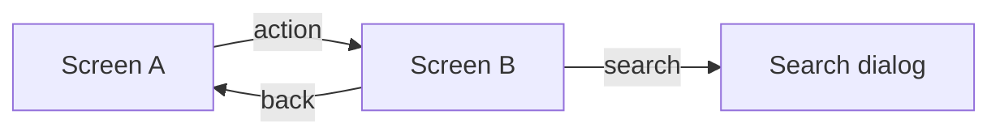
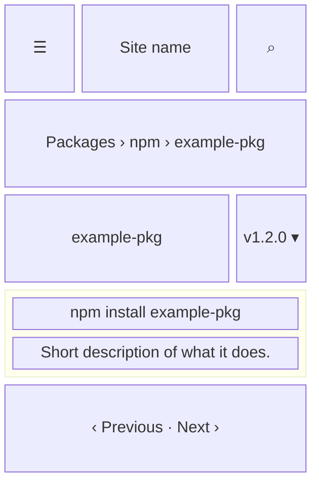

- **Status:** Draft
- **Last updated:** YYYY-MM-DD
- **Related ADRs:** ADR-NNNN

> Snapshot of the system as it stands today. Edit in place; never record what changed.

What a person sees and how they move through it. Sample values are invented (ADR-0008).
Phone width first; note where desktop differs.

## Entry points

- Where a person reaches it from (home page, sidebar, search, a package badge or README link,
  a direct URL, the Markdown version), and what access it needs.
- Who does not see it, and what they get at its URL.

## Flow

## Screens

### 1. `<Screen name>` — `/route`

**States**

- Empty: …
- Loading: …
- Not found: …
- Refused (private, no access): …
- Error: …
- Degraded (an external service such as search is unavailable): …
- Success: …
