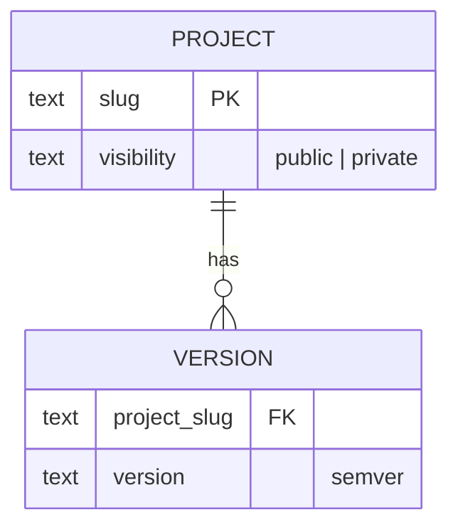

- **Status:** Draft
- **Last updated:** YYYY-MM-DD
- **Related ADRs:** ADR-NNNN

> Snapshot of the system as it stands today. Edit in place; never record what changed.

## Diagram

## Entities

### `<ENTITY>`

| Column | Type | Null | Notes |
|---|---|---|---|

**Indexes:** …
**Invariants:** rules the store or application guarantees (uniqueness, required references,
allowed values).

## Relationships

| From | To | Cardinality | On delete |
|---|---|---|---|

## Sensitive fields

Classification per [`../security/data-classification.md`](../security/data-classification.md).

| Field | Classification | Protection |
|---|---|---|
