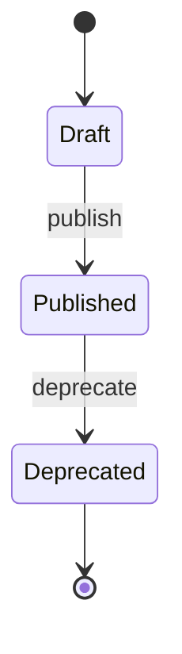

- **Status:** Draft
- **Last updated:** YYYY-MM-DD
- **Related ADRs:** ADR-NNNN

> Snapshot of the system as it stands today. Edit in place; never record what changed.

## Diagram

## States

| State | Meaning | Who can see it |
|---|---|---|

## Transitions

| From | To | Trigger | Guard | Side effects |
|---|---|---|---|---|

## Terminal states

Which states are final, and what remains possible from them (read, redirect, archive).
