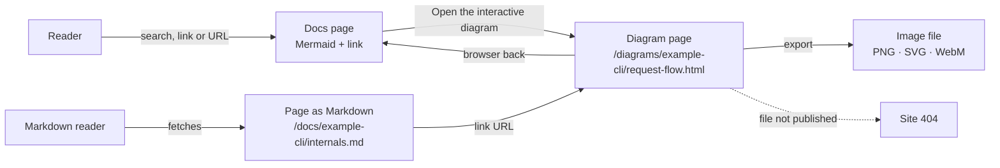
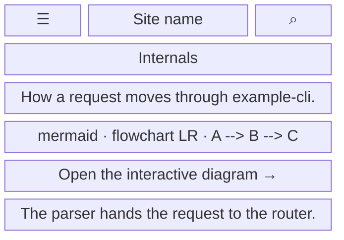
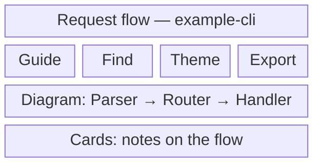
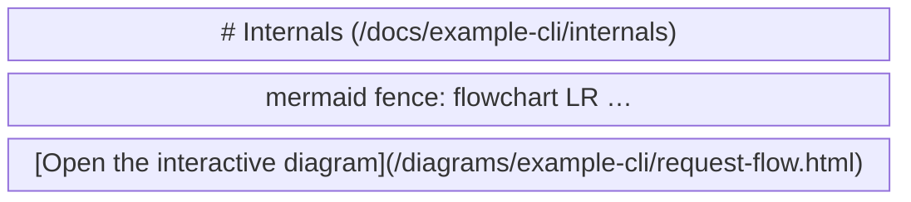

- **Status:** Draft
- **Last updated:** 2026-10-31
- **Related ADRs:** [ADR-0011](../adr/ADR-0011-archify-diagrams-are-published-as-standalone-pages.md)

> Snapshot of the system as it stands today. Edit in place; never record what changed.

What a person sees and how they move through it. Sample values are invented (ADR-0008).
Phone width first; note where desktop differs.

A page with a diagram shows its Mermaid version as highlighted code, then a link to the
interactive diagram. The diagram is Archify's standalone HTML, served at
`/diagrams/<project-slug>/<diagram-slug>.html`.

The flow below is made with Archify. Its source is
`.archify/workflow-diagram-pages-20261031/candidate.json`, and it moves to
`diagrams/documentation/diagram-pages.json` once ADR-0011 is approved.

## Entry points

- The **Open the interactive diagram** link, directly below a diagram's Mermaid block on a
  docs page.
- The same link in the page's Markdown version (`/docs/<page>.md`, `llms-full.txt`), followed
  by a person or a tool.
- A direct or shared URL to the diagram page.
- Search does not lead here: diagram pages are not indexed. It leads to the docs page.
- Everyone sees every diagram. Private projects have no diagrams here (ADR-0011, invariant 1),
  so there is nothing to refuse.

## Flow

## Screens

### 1. `Docs page with a diagram` — `/docs/<project-slug>/...`

Phone width. The Mermaid block scrolls sideways inside its frame; the link sits directly below
it.

Desktop: the same, with the sidebar on the left and the table of contents on the right.

**States**

- Empty: a page without a diagram has neither the block nor the link.
- Loading: none of its own; pages are prerendered.
- Not found: an unknown page shows the site's 404.
- Refused: not applicable; no private content exists here.
- Error: the site's error page; no raw error text.
- Degraded: if search is unavailable, the search dialog shows its error notice; the page, the
  Mermaid block and the link still work.
- Success: the page with its Mermaid block and the link.

### 2. `Diagram page` — `/diagrams/<project-slug>/<diagram-slug>.html`

Archify's own page, opened with a full page load. It has no site header or sidebar. At phone
width the diagram is contained to the screen and explored by zooming; Archify does not adapt
its layout for phones.

Desktop: the diagram at full width, with the same controls.

**States**

- Empty: not applicable; every published diagram has content.
- Loading: the page is one static file; it renders once loaded.
- Not found: a link to a file that was never published shows the site's 404.
- Refused: not applicable.
- Error: if scripts are blocked, the reader gets whatever Archify renders without them; this is
  not yet checked in a browser.
- Degraded: under the sandbox (ADR-0011, decision 5) the theme choice is not remembered between
  visits. Whether copying an image to the clipboard works is checked on implementation.
- Success: the diagram, explorable, with export to PNG, SVG or WebM.

### 3. `Page as Markdown` — `/docs/<project-slug>/<page>.md`

What a tool or `llms-full.txt` receives: the Mermaid fence as text, then the link.

**States**

- Not found: an unknown page returns the Markdown route's not-found response.
- Success: the Mermaid source and the root-relative link. A tool outside the site must prefix
  the site's address to follow it.
- Empty, loading, refused, error, degraded: as for the page's Markdown route today.
