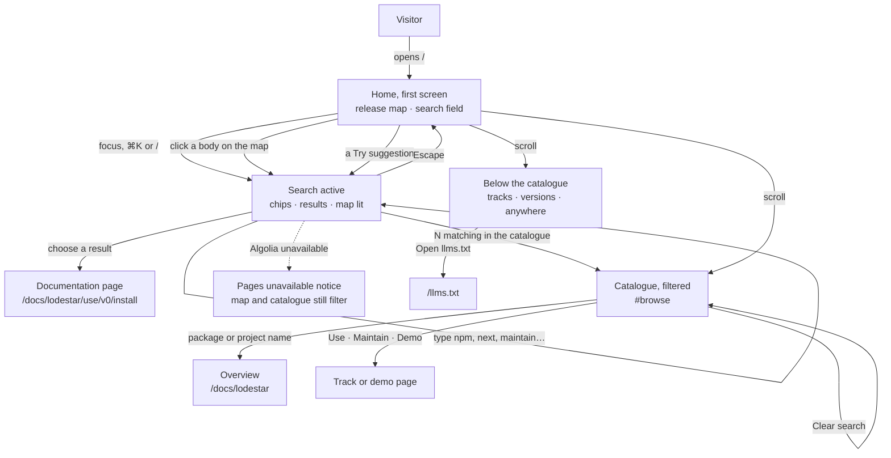
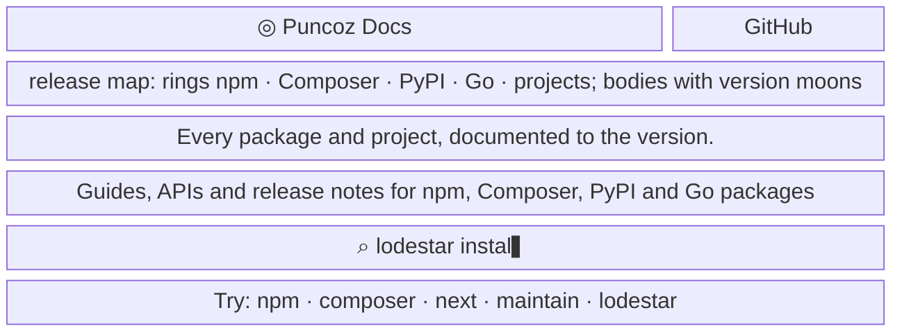
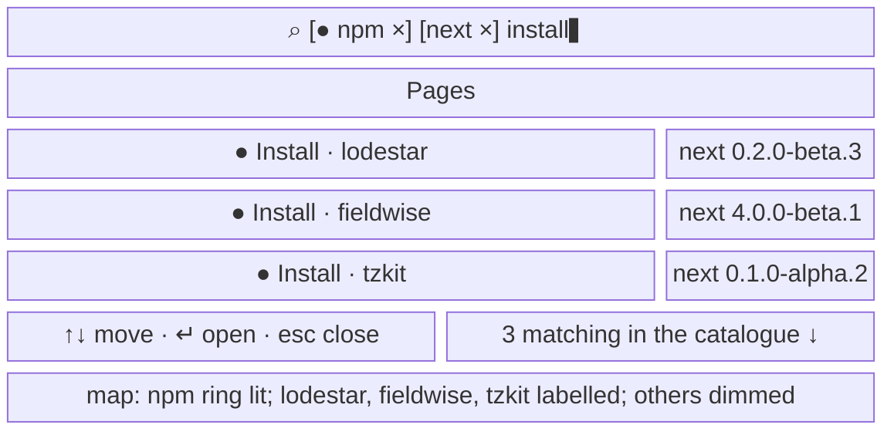
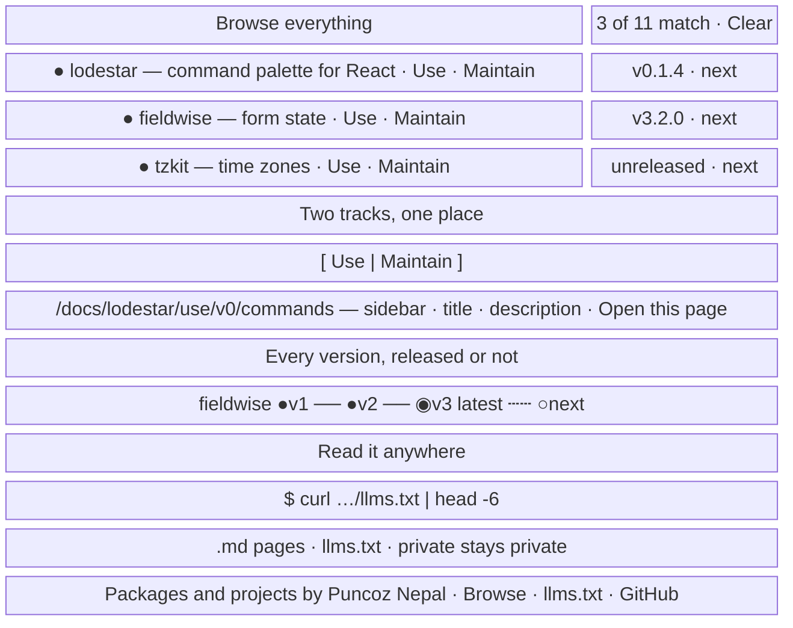

- **Status:** Current
- **Last updated:** 2026-10-31
- **Related ADRs:** [ADR-0014](../adr/ADR-0014-home-page-is-a-search-first-release-map.mdx),
  [ADR-0013](../adr/ADR-0013-packages-and-projects-share-one-catalogue-shape.mdx)

> Snapshot of the system as it stands today. Edit in place; never record what changed.

What a person sees and how they move through it. Sample values are invented (ADR-0008):
`lodestar`, `fieldwise`, `ledgerly`, `pykettle`, `gobeam`, `orbit-board` and the rest are not
real packages or projects. Phone width first; desktop differences are noted under each screen.

The home page at `/` opens on a **map of every release**: each ecosystem is an orbit ring, each
package or project a body on it, each documented version line a moon, dashed when unreleased.
In front of the map are the headline and **one large search field**. The field steers the whole
page: filter words become chips, the results list shows matching pages, the map lights the
matching bodies, and the catalogue below filters itself. Below the hero come the catalogue, the
two tracks, the version rails and "Read it anywhere". Every entry, line and version comes from
the catalogue fields in the content folders (ADR-0013) at build time. The only request while the
page is open is the search query the reader types.

No package or project is documented yet, so today the page shows its empty states: faint
default rings, "No packages or projects yet", and no tracks or version sections.

The home page has no demo section, and nothing runs a demo yet: that waits for ADR-0011's
sandboxed embed. A catalogue row links to a line's `demo` page when one exists.

The flow is made with Archify. Its source is `.archify/home-page-20261031/candidate.json`. An
HTML prototype of the page is at `.prototypes/home/index.html`. Until ADR-0011 is approved,
both stay in those folders and are not published.

## Entry points

- A direct visit to the site's root URL, the header wordmark on every page, and links from
  package READMEs or registry pages that point at the site rather than at one package.
- Search engines and AI assistants: `llms.txt` links to `/`, and the page has its own title and
  description.
- Everyone sees the same page. **Signed-out visitors see nothing of private projects**: no
  name, no count, no body on the map, no placeholder (owner's decision, 2026-10-31). Private
  projects do not exist on the site until the private-documentation ADR is approved.
- The page has no Markdown twin of its own. `llms.txt` lists every package and project instead
  (invariant 5 covers documentation pages; the home page is navigation).

## Flow

## Screens

### 1. `Home, first screen` — `/`

The orbital map fills the hero behind the text and turns slowly. The headline and the search
field sit in front of it, centred. Until the reader focuses the field, its placeholder types
real queries (`lodestar install`, `ledgerly posting entries`) and the map lights the bodies that
match. Under the field, a "Try" row offers up to two of the ecosystems present, `next` when a
package has an unreleased line, `maintain` when a Maintain track exists, and the first entry's
name. Pointing at a body slows the map and shows a card: name, description, version tags.
Clicking a body puts its name in the field.

Desktop: the header adds Packages, `llms.txt` and, when a public project exists, Projects links;
Packages jumps to the catalogue and clears the search; Projects jumps there with the `projects`
filter set. The hero is about 900px
tall. The field is 720px wide and 64px high with a `⌘K` hint. A legend under the field names
each ring's colour and says moons are versions. The map's rings span the full width; the
hovered body's card follows the pointer.

**States**

- Empty: with no public entries, the map draws faint default rings (npm, Composer, PyPI, Go,
  projects) with no bodies, the field stays and searches this site's own pages, and the "Try"
  row is hidden. Once entries exist, only rings with entries are drawn.
- Loading: none; the page is prerendered. The map starts turning after first paint; until
  then the text and field are already usable.
- Not found: not applicable at `/`; unknown paths get the site's 404.
- Refused: not applicable; the page is public and holds nothing private.
- Error: a broken catalogue field fails the build (ADR-0013), so a broken home page never ships.
  If the canvas cannot be drawn, the hero shows the text and field on the plain background.
- Degraded: with reduced motion, the map is drawn once and stays still, and the placeholder
  doesn't type. With scripts off, the map is absent and the search field is replaced by a link
  to `/docs`, since search needs scripts; the catalogue below lists everything. Keyboard and screen-reader users get the map's content as text in the
  catalogue; the canvas has a label explaining its encoding.
- Success: the map shows every public package and project; hovering or clicking a body works.

### 2. `Search active` — `/` with the field focused

Focusing the field stops the typing demonstration and opens the results list under it. Filter
words followed by a space become chips inside the field. The map dims everything that doesn't
match and labels what does. The catalogue below filters at the same time.

- **Chips.** `npm`, `composer` (alias `php`), `pypi` (alias `python`), `go`, `projects`,
  `maintain` and `next` (alias `unreleased`). Each chip has a remove button; Backspace in an
  empty field removes the last one.
- **Results.** Up to seven pages, one per URL, each with an ecosystem dot, the page title and the package,
  and a tag: the line and version (`v0 · 0.1.4`), `next <version>` on a dashed tag, or
  `maintain`. Arrow keys move the selection, Enter opens it, Escape closes the list. The footer
  links to the catalogue with the number of matching entries.
- **With no query** the list offers each package's first Use page ("Start here", or "Overview"
  for an entry without a released or `next` line) under the heading "Start with a package". With
  nothing documented it says "Nothing is documented yet. Type to search this site's own pages."

Desktop: the same list drops 8px under the 720px field and floats over the map.

**States**

- Empty: no match shows "No page matches. Try a package name, or remove a filter." The map dims
  every body and the catalogue shows its own empty line.
- Loading: while Algolia answers, the previous results stay in place; the map and catalogue
  update at once because they filter locally.
- Not found: a result whose page was removed since the last index sync opens the site's 404.
- Refused: not applicable.
- Error: an unknown word stays free text; only listed words become chips.
- Degraded: if Algolia is unreachable, the list shows "Page search is unavailable right now.
  The catalogue below still filters." and the chips keep filtering the map and catalogue.
- Success: choosing a result opens that page at the version its tag shows.

### 3. `Home, below the first screen` — `/#browse` and onward

- **Catalogue.** Every public entry in one list (two columns on desktop). Each row: ecosystem
  dot (outlined for a project), name in monospace, a one-line description, Use / Maintain
  links and a Demo link when the latest line has a `demo` page, and at the right the latest version and any `next <version>` on a dashed tag. A
  package with no release shows `unreleased`; a project shows its status. The count reads
  "11 packages and projects", or "3 of 11 match" with a Clear search button while the hero
  search is active.
- **Two tracks.** Shown when an entry has both tracks. A Use / Maintain switch whose knob
  slides; the window beside it cross-fades between that entry's Use and Maintain tracks, each
  showing its sidebar (version menu on Use), the current page's title and description, and an
  "Open this page" link. The pages are real ones from the content.
- **Version rails.** One rail per featured package with several lines: released lines solid,
  the `latest` dot filled, `next` dashed. Each rail draws once when it comes into view.
- **Read it anywhere.** A terminal that types a `curl` of `llms.txt` once when it comes into
  view and shows the real first lines of `llms.txt`, beside three cards: "Add .md to any page"
  (linking a package's first Use page as Markdown, or the Documentation overview's while
  nothing is documented), `llms.txt` and
  `llms-full.txt`, and "Private stays private".
- **Footer.** "Packages and projects by Puncoz Nepal", with Browse, `llms.txt` and GitHub links.

Desktop: content is 1180px wide. The tracks section and "Read it anywhere" are two columns.

**States**

- Empty: with no entries the catalogue says "No packages or projects yet". No match shows
  "Nothing matches. Clear the search to see everything." No entry with both tracks means no
  tracks section; no featured package with two or more lines means no version rails. A track
  that doesn't exist for an entry has no link.
- Loading: none; prerendered. Sections enter once as they come into view; their content is
  visible without scripts.
- Not found: a row whose overview page is missing fails the build.
- Refused: not applicable.
- Error: none at runtime; everything is built from content that passed the build checks.
- Degraded: with reduced motion, rails are drawn, the terminal shows its full output and the
  track preview swaps without a fade. With scripts off, the Use preview is shown and the switch
  does not change it.
- Success: a row link opens the overview, a track or the demo page.
