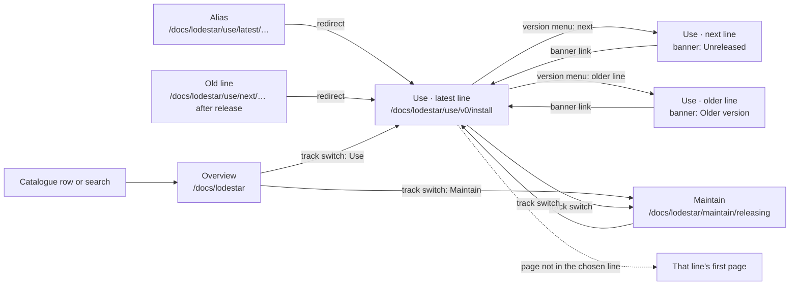
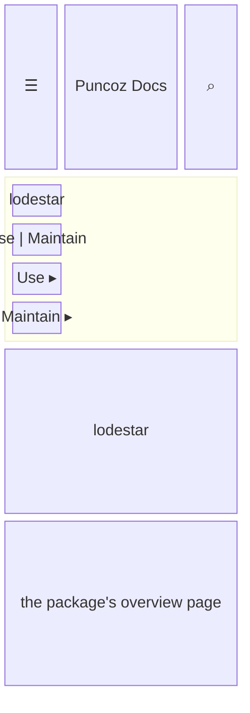
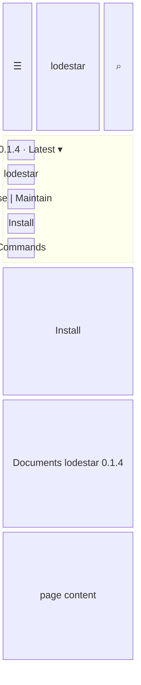
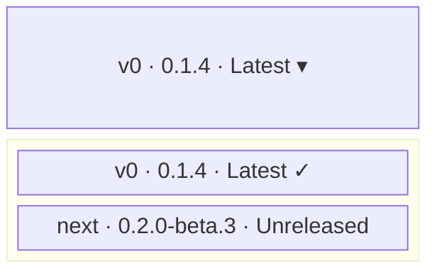
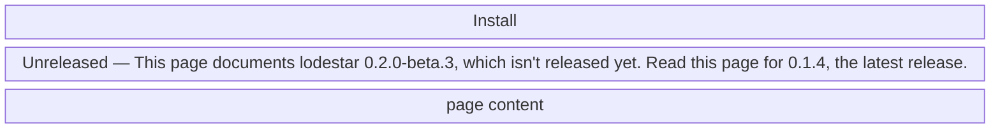
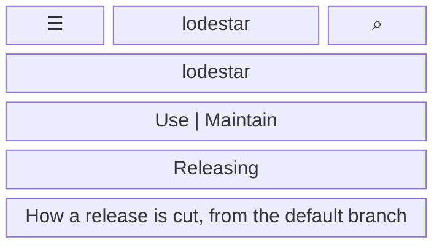

- **Status:** Current
- **Last updated:** 2026-10-31
- **Related ADRs:** [ADR-0013](../adr/ADR-0013-packages-and-projects-share-one-catalogue-shape.mdx),
  [ADR-0010](../adr/ADR-0010-projects-document-themselves-through-a-submodule.mdx)

> Snapshot of the system as it stands today. Edit in place; never record what changed.

What a person sees and how they move through it. Sample values are invented (ADR-0008).
Phone width first; desktop differences are noted under each screen.

Every package and project has the same shape (ADR-0013). Its overview is at
`/docs/<slug>`, and it has two tracks: **Use**, for people using it, and **Maintain**, for
people who look after it. A package's Use track has one line per documented major version,
plus `next` for an unreleased one. The sidebar shows the current track and line only. At its
top sit the version menu (on Use pages of a versioned package) and, under it, the package name
with the Use | Maintain switch.

The flow is made with Archify. Its source is `.archify/package-navigation-20261031/candidate.json`.

## Entry points

- A row in the home page catalogue, or a search result.
- A README or registry badge linking to `/docs/<slug>` or to a stable alias such as
  `/docs/lodestar/use/latest/install`, which redirects to the line marked `latest`.
- A direct URL to a line: `/docs/lodestar/use/v0/install`, `/docs/lodestar/use/next/install`.
  A line that no longer exists (renamed on release, or removed) redirects to the same path in
  `latest`.
- The Markdown version of any page: `/docs/lodestar/use/v0/install.md`.
- Everyone sees every public package and project. Private projects have no pages here until the
  private-documentation ADR is approved; when it is, a signed-out visitor at a private URL gets
  the same 404 as for a page that does not exist, so the URL does not confirm the project exists.

## Flow

## Screens

### 1. `Overview` — `/docs/<slug>`

The package's own `index.mdx`, as its repository writes it. The sidebar shows the package name,
the track switch, and both tracks as folders.

Desktop: the same, with the sidebar always visible.

**States**

- Empty: a package with one track shows no switch, only its name.
- Loading: none; prerendered.
- Not found: an unknown slug shows the site's 404.
- Refused: not applicable until private documentation exists (see Entry points).
- Error: a malformed catalogue field fails the build, so it never reaches readers.
- Degraded: search unavailable shows the dialog's error notice; everything else works.
- Success: the overview, with both tracks one click away.

### 2. `Use page` — `/docs/<slug>/use/<line>/<page>`

Phone width: the sidebar is a drawer; the version menu and track switch sit at its top.

Desktop: the sidebar is always visible with the menu and switch at its top. Under the page
description, a line states the version the page documents (invariant 3).

**States**

- Empty: a line with only its index page shows that page and a one-link sidebar.
- Loading: none; prerendered.
- Not found: a missing page gets the site's 404.
- Refused: not applicable today.
- Error: the site's error page; no raw error text.
- Degraded: search unavailable shows the dialog's notice.
- Success: the page, with the current line selected and Use highlighted.

### 3. `Version menu` — opened from the sidebar

Lines are listed latest first, then `next`, then older lines from newest to oldest. Each option
names its channel in words, not by colour alone.

**States**

- Empty: a package with one line shows a menu with that one line.
- Success: choosing a line opens the same page in that line when it exists, otherwise that
  line's first page.

### 4. `Unreleased page` — `/docs/<slug>/use/next/<page>`

Older lines show the same shape: "Older version — This page documents ledgerly 3.6.2. Read this
page for 4.0.1, the latest release."

**States**

- Success: the banner sits under the title and links to the same page in the latest line, or
  that line's first page. An unreleased package with no latest line shows the banner without
  the link.
- Other states: as the Use page.

### 5. `Maintain page` — `/docs/<slug>/maintain/<page>`

The Maintain track is not versioned: it describes the repository's default branch, so it has
no version menu and no version line.

**States**

- Empty: a package without a Maintain track has no switch; its Maintain URLs get the 404.
- Other states: as the Use page.

### 6. `Demo page` — `/docs/<slug>/use/<line>/demo`

Not published until ADR-0011 is approved. When a line has a `demo.mdx` page, the home page
catalogue links to it; the sandboxed embed that runs the package's demo is ADR-0011's.
