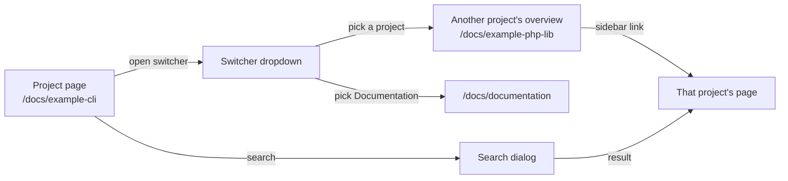
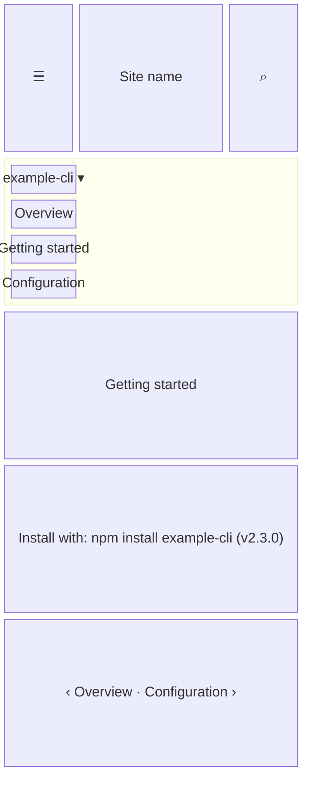
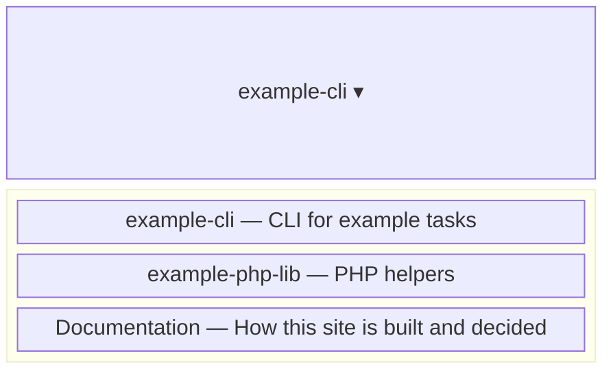

- **Status:** Draft
- **Last updated:** 2026-10-31
- **Related ADRs:** [ADR-0010](../adr/ADR-0010-projects-document-themselves-through-a-submodule.md)

> Snapshot of the system as it stands today. Edit in place; never record what changed.

What a person sees and how they move through it. Sample values are invented (ADR-0008).
Phone width first; note where desktop differs.

Each project or package documented here has a root folder, `content/docs/<project-slug>/`.
Fumadocs lists every root folder in a switcher at the top of the sidebar (`SidebarTabsDropdown`,
default `tabMode: "auto"`). Nothing new is built: this flow is what the default layout already
does once project folders exist.

## Entry points

- The sidebar switcher, from any page under `/docs`.
- A project's README or registry page linking to `/docs/<project-slug>`.
- Search results for one of the project's pages.
- A direct URL, or the Markdown version at `/docs/<project-slug>.md`.
- Everyone sees every project. Private projects have no folder here yet (ADR-0010, decision 4),
  so there is nothing to refuse.

## Flow

## Screens

### 1. `Project page` — `/docs/<project-slug>/...`

Phone width: the sidebar is a drawer opened from the menu button; the switcher sits at its top.

Desktop: the sidebar is always visible on the left, with the switcher at its top; the table of
contents is on the right.

**States**

- Empty: a project folder with only `index.mdx` shows its overview and a one-link sidebar.
- Loading: none of its own; pages are prerendered.
- Not found: an unknown slug or page shows the site's 404.
- Refused: not applicable; no private project content exists here.
- Error: the site's error page; no raw error text.
- Degraded: if search is unavailable, the search dialog shows its error notice; the switcher
  and sidebar still work.
- Success: the page, with the current project selected in the switcher.

### 2. `Switcher` — opened from the sidebar

Each entry shows the folder's `meta.json` `title` and `description`.

**States**

- Empty: with no project folders, it lists only Documentation.
- Loading, not found, refused, error, degraded: not applicable; the list is built at build time.
- Success: choosing an entry opens that folder's first page.
