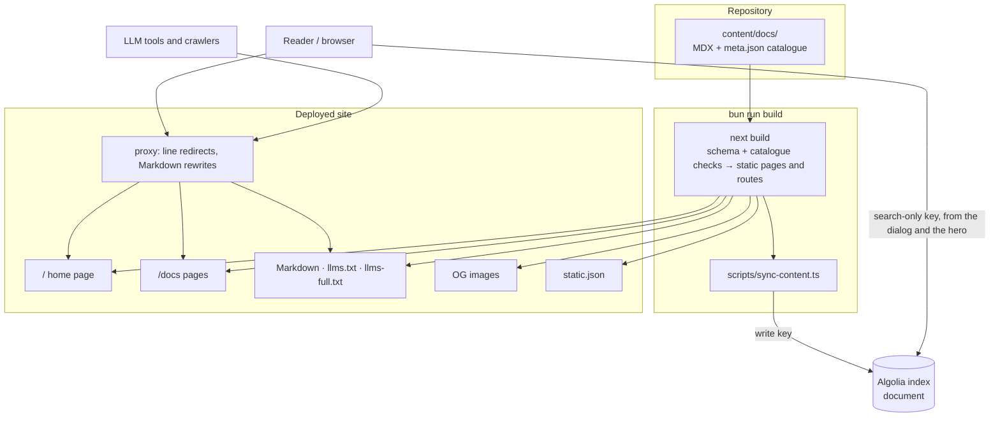

- **Status:** Current
- **Last updated:** 2026-10-31
- **Related ADRs:** [ADR-0013](../adr/ADR-0013-packages-and-projects-share-one-catalogue-shape.mdx),
  [ADR-0014](../adr/ADR-0014-home-page-is-a-search-first-release-map.mdx)

> Snapshot of the system as it stands today. Edit in place; never record what changed.

## Context

A Next.js 16 App Router site built on Fumadocs. It renders the MDX pages in `content/docs/`
as a documentation site, and serves every page again as Markdown, as an Open Graph image, and
as a search record. Search runs on Algolia. There is no database, no sign-in and no
server-side state: every route is generated at build time (`revalidate = false`).

Every top-level folder in `content/docs/` except `documentation/` is a **catalogue entry**: a
package or project whose root `meta.json` carries a `catalog` field (ADR-0013). Inside it,
`use/` and `maintain/` are the two tracks, and a package's `use/` holds one folder per version
line (`use/v3/`, `use/next/`), each with `version` and `channel` in its `meta.json`. No
package or project is documented yet, so the catalogue is empty and the home page shows its
empty states. **Documentation** (`content/docs/documentation/`) holds this site's own
decisions and design documents and is not catalogued.

## Routes

| URL | File | What it is |
|---|---|---|
| `/` | `src/app/(home)/page.tsx` | Home page: release map, hero search, catalogue and the sections of ADR-0014 |
| `/docs/…` | `src/app/docs/[[...slug]]/page.tsx` | A documentation page in `DocsLayout`; package pages add the version notice or banner |
| `/docs/<slug>/use/latest/…` | `src/proxy.ts` | 307 redirect to the line marked `latest` |
| `/docs/<slug>/use/<line>/…` for a line that no longer exists | `src/proxy.ts` | 307 redirect to the same path in `latest` |
| `/docs/….md` | `src/proxy.ts` → `/llms.mdx/docs/…/content.md` | The page as Markdown |
| `/docs/…` with `Accept` preferring Markdown | `src/proxy.ts` → `/llms.mdx/docs/…/content.md` | The page as Markdown, `Vary: Accept` |
| `/llms.mdx/docs/…/content.md` | `src/app/llms.mdx/docs/[[...slug]]/route.ts` | Processed Markdown of one page, `text/markdown` |
| `/llms.txt` | `src/app/llms.txt/route.ts` | Index of every page, version lines labelled |
| `/llms-full.txt` | `src/app/llms-full.txt/route.ts` | Every page's full Markdown in one file |
| `/og/docs/…/image.png` | `src/app/og/docs/[...slug]/route.tsx` | Open Graph image: title, description, site name |
| `/static.json` | `src/app/static.json/route.ts` | Every page as an Algolia search record |

Contracts for the machine-readable routes are in [`../api/`](../api/index.mdx).

## Components

| Component | Responsibility | Depends on |
|---|---|---|
| `content/docs/` | The published pages and `meta.json` files; catalogue entries and `documentation/` | — |
| `src/lib/catalog-schema.ts` | `catalogMetaSchema`: Fumadocs' `metaSchema` plus `catalog`, `version` and `channel`, as a Standard Schema; rejects any `visibility` but `public` | `fumadocs-core` |
| `src/lib/catalog-plugin.ts` | Loader plugin: the build checks of ADR-0013 decision 9, typed roots (`root: true` on an entry, `'track'` on `use/` and `maintain/`, `'line'` on a version line) and line order; `pageVersion()` | `fumadocs-core` |
| `src/lib/source.ts` | Loads `content/docs/` with `defineDocs`; exposes `source`, `getMeta` and `docsLlms` (version line in each page's Markdown and in `llms.txt`) | `fumadocs-mdx`, the two above |
| `src/lib/catalog.ts` | Reads the page tree into typed catalogue entries (lines, tracks, demo), the page context for banners, and the home page's previews | `source.ts` |
| `src/lib/catalog-routes.ts` | Meta files only (no compiled pages), for the proxy: each package's lines and its `latest`; `resolveLineRedirect()` | `fumadocs-mdx` |
| `src/lib/search-scope.ts` | The scope tag of a page (`<slug>`, `<slug>:maintain`, `<slug>:use:<line>`) | — |
| `src/lib/algolia.ts` | The search-only Algolia client, shared by the dialog and the hero search | `algoliasearch/lite` |
| `src/lib/shared.ts` | Site name (`Puncoz Docs`), route prefixes, GitHub repository (`puncoz-official/docs`), URL builders | — |
| `src/app/docs/layout.tsx` | `DocsLayout` with the version-line switcher only, and the track switch as sidebar banner | `catalog.ts` |
| `src/components/docs/` | `TrackSwitch` (package name, Use / Maintain) and `VersionNotice` (the version stated, Unreleased and Older version banners) | `fumadocs-ui` |
| `src/app/(home)/` | Home layout (fonts, `.home` scope, `home.css`) and page | `catalog.ts`, `source.ts` |
| `src/components/home/` | Shared search state, orbit map (canvas), hero search, catalogue, tracks preview, version rails, terminal, header, reveal | `algolia.ts`, `lucide-react` |
| `src/components/search.tsx` | The site-wide search dialog | `algolia.ts` |
| `src/proxy.ts` | Line redirects, then the Markdown rewrites | `catalog-routes.ts`, `fumadocs-core/negotiation` |
| `scripts/sync-content.ts` | After `next build`, reads the built `static.json` and replaces the Algolia index `document` with it | `algoliasearch`, `ALGOLIA_WRITE_KEY` |

## How navigation is scoped

Fumadocs shows the sidebar of the deepest root folder on the current path, and groups root
folders of the same type into one switcher whose options keep the reader on the same page
(`fumadocs-ui/contexts/tree`). The catalogue plugin marks folders so that:

- on a package's Use page the sidebar holds only that line's pages, with a version menu
  (`v4 · 4.0.1 · Latest`, `next · 5.0.0-beta.1 · Unreleased`, older lines) that keeps the reader
  on the same page when it exists;
- on a Maintain page the sidebar holds only the Maintain pages;
- `TrackSwitch` switches between the two tracks;
- the site-wide switcher of root folders is not shown: the layout passes only `line` roots as
  tabs. The Documentation project keeps its default sidebar.

## Diagram

## Key decisions in force

- [ADR-0013](../adr/ADR-0013-packages-and-projects-share-one-catalogue-shape.mdx): the catalogue
  shape, tracks, version lines, URLs, scoped navigation, search fields and build checks.
- [ADR-0014](../adr/ADR-0014-home-page-is-a-search-first-release-map.mdx): the home page.

## Constraints

- **Mermaid is not rendered.** Diagrams in the Documentation project show as highlighted code.
- **Every page is public on every surface.** Nothing filters a page out of the site, the
  Markdown routes, `llms.txt` / `llms-full.txt`, `static.json`, the OG images or the search
  index. The catalogue schema rejects a private entry, so the build fails instead of publishing
  one (`AGENTS.md` §6.1).
- **Demos are not published** until ADR-0011 is approved: a `use/<line>/demo.mdx` page would be
  linked from the catalogue, but there is no sandboxed embed and the home page has no demo
  section.
- **`defineCollections({ type: 'meta' })` is broken in fumadocs-mdx 15.4.10** (its generated
  call passes `meta` where the runtime reads `entries`), so `catalog-routes.ts` uses a
  `defineDocs` whose page pattern matches nothing.
- **`bun run build` publishes.** Its second step overwrites the live search index.
- **Hosting is not decided.** `.gitignore` lists `.vercel`, from the scaffold; no host is
  configured in the repository.
