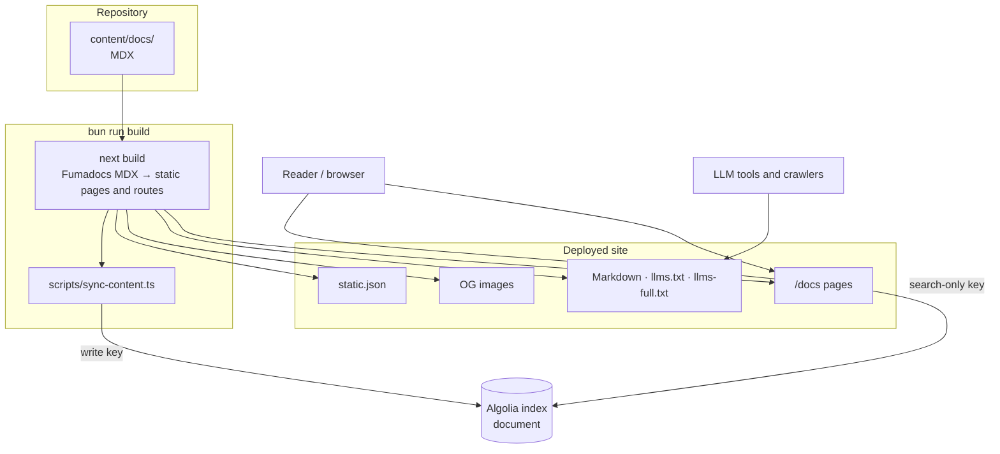

- **Status:** Current
- **Last updated:** 2026-10-31
- **Related ADRs:** none yet — this describes the Fumadocs scaffold as generated

> Snapshot of the system as it stands today. Edit in place; never record what changed.

## Context

A Next.js 16 App Router site built on Fumadocs. It renders the MDX pages in `content/docs/`
as a documentation site, and serves every page again as Markdown, as an Open Graph image, and
as a search record. Search runs on Algolia. There is no database, no sign-in and no
server-side state: every route is generated at build time (`revalidate = false`).

The content is the scaffold's two placeholder pages plus **Documentation**, a root folder
(`content/docs/documentation/`, `"root": true` in its `meta.json`) holding this site's own
decisions and design documents, shown as its own sidebar tab. The home page is a placeholder, and
`src/lib/shared.ts` still carries the scaffold's site name (`My App`) and GitHub repository.

## Routes

| URL | File | What it is |
|---|---|---|
| `/` | `src/app/(home)/page.tsx` | Home page (placeholder), in `HomeLayout` |
| `/docs/…` | `src/app/docs/[[...slug]]/page.tsx` | A documentation page, in `DocsLayout` with the page tree as sidebar; copy-as-Markdown and "view on GitHub" controls |
| `/docs/….md` | `src/proxy.ts` → `/llms.mdx/docs/…/content.md` | The page as Markdown |
| `/docs/…` with `Accept` preferring Markdown | `src/proxy.ts` → `/llms.mdx/docs/…/content.md` | The page as Markdown, `Vary: Accept` |
| `/llms.mdx/docs/…/content.md` | `src/app/llms.mdx/docs/[[...slug]]/route.ts` | Processed Markdown of one page, `text/markdown` |
| `/llms.txt` | `src/app/llms.txt/route.ts` | Index of every page, for LLMs |
| `/llms-full.txt` | `src/app/llms-full.txt/route.ts` | Every page's full Markdown in one file |
| `/og/docs/…/image.png` | `src/app/og/docs/[...slug]/route.tsx` | Open Graph image: title, description, site name |
| `/static.json` | `src/app/static.json/route.ts` | Every page as an Algolia search record |

Contracts for the machine-readable routes are in [`../api/`](../api/index.mdx).

## Components

| Component | Responsibility | Depends on |
|---|---|---|
| `content/docs/` | The published pages (`.mdx` and `.md` with frontmatter, `meta.json` for ordering and root folders); `documentation/` is this site's own docs | — |
| `src/lib/source.ts` | Loads `content/docs/` with `defineDocs` (`fumadocs-mdx/macro`), validates frontmatter with `pageSchema` and `meta.json` with `metaSchema`; exposes `source` and `docsLlms` | `fumadocs-core`, `fumadocs-mdx` |
| `src/lib/shared.ts` | Site name, route prefixes, GitHub repository, URL builders for Markdown and OG routes | — |
| `src/lib/layout.shared.tsx` | Nav title and GitHub link shared by both layouts | `shared.ts` |
| `src/components/mdx.tsx` | MDX component map | `fumadocs-ui` |
| `src/components/search.tsx` | Search dialog, querying Algolia from the browser with the search-only key | `algoliasearch/lite` |
| `src/proxy.ts` | Rewrites Markdown requests to the `llms.mdx` route | `fumadocs-core/negotiation` |
| `scripts/sync-content.ts` | After `next build`, reads the built `static.json` and replaces the Algolia index `document` with it | `algoliasearch`, `ALGOLIA_WRITE_KEY` |

## Diagram

## Key decisions in force

None yet. ADR-0001 to ADR-0009 govern how work is done, not how the site is built.

## Constraints

- **Mermaid is not rendered.** Diagrams in the Documentation project show as highlighted code.
- **Every page is public on every surface.** Nothing filters a page out of the site, the
  Markdown routes, `llms.txt` / `llms-full.txt`, `static.json`, the OG images or the search
  index. Private documentation needs its own ADR before any exists (`AGENTS.md` §6.1).
- **`bun run build` publishes.** Its second step overwrites the live search index.
- **Hosting is not decided.** `.gitignore` lists `.vercel`, from the scaffold; no host is
  configured in the repository.
