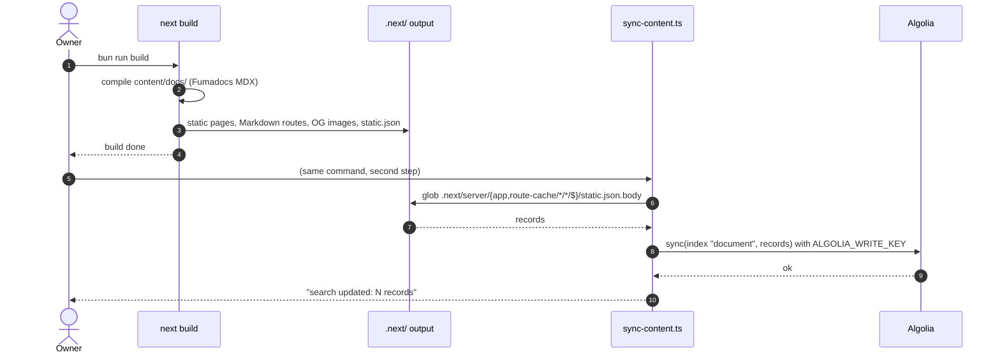

- **Status:** Current
- **Last updated:** 2026-10-31
- **Related ADRs:** none yet — scaffold behaviour

> Snapshot of the system as it stands today. Edit in place; never record what changed.

## Trigger

`bun run build`. It runs `next build`, then
`node --env-file-if-exists=.env.local scripts/sync-content.ts`.

## Diagram

## Failure paths

| Step | Failure | Behaviour | Recovery |
|---|---|---|---|
| 2 | Invalid MDX or frontmatter | `next build` fails; the sync never runs | Fix the page, rebuild |
| 6 | `static.json.body` not found (unknown build adapter layout) | The script throws reading an undefined path; the index is unchanged | Check the build output layout; adjust the glob |
| 8 | Algolia variables missing from the environment | The script does not check for them (non-null assertions), so `undefined` reaches the Algolia client; where it fails has not been verified | Set the variables (`content/docs/documentation/security/secrets.mdx`) |
| 8 | Algolia rejects or is unreachable | The script fails after a successful build | Re-run the build, or the sync step alone |

## Post-conditions

The Algolia index `document` holds exactly the pages in this build — every page in
`content/docs/`. Anyone with the public search-only key can query all of them.
