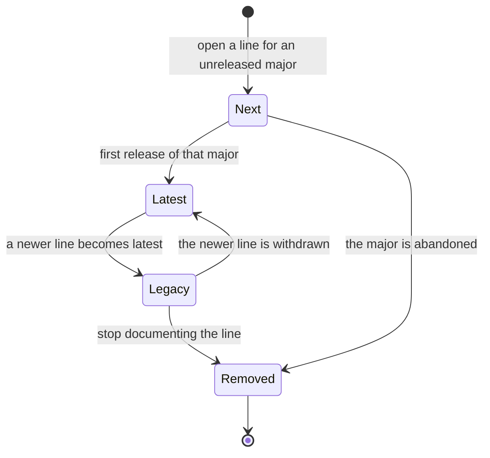

- **Status:** Draft
- **Last updated:** 2026-10-31
- **Related ADRs:** [ADR-0013](../adr/ADR-0013-packages-and-projects-share-one-catalogue-shape.mdx)

> Snapshot of the system as it stands today. Edit in place; never record what changed.

A **line** is one documented major version of a package's Use track, a folder such as
`use/v3/` or `use/next/` (ADR-0013). Its `meta.json` sets `channel` and the exact `version`
it documents. The consuming repository moves a line from one state to the next by editing
those fields, and a human commits the change (ADR-0010).

The diagram is made with Archify. Its source is
`.archify/package-version-lifecycle-20261031/candidate.json`.

## Diagram

## States

| State | Meaning | Who can see it |
|---|---|---|
| Next | Documents an unreleased version (`4.0.0-beta.3`). Every page carries the "Unreleased" banner. | Everyone, for a public package |
| Latest | Documents the newest released version. The `use/latest/…` alias redirects here. Exactly one per released package. | Everyone |
| Legacy | Documents an older major that is still in use. Every page carries the "Older version" banner. | Everyone |
| Removed | The folder is deleted; its pages no longer exist. | Nobody. URLs redirect (see below) |

## Transitions

| From | To | Trigger | Guard | Side effects |
|---|---|---|---|---|
| — | Next | The consuming repository adds `use/next/` | The package has no other `next` line | Pages published with the banner; the home page row shows `next <version>`; search and `llms.txt` include them, labelled |
| Next | Latest | The major is released: `channel: latest`, `version` set to the release, folder renamed `next` → `v<major>` | The previous `latest` moves to Legacy in the same change | The alias moves; `/docs/<slug>/use/next/…` redirects to the same path in the new line; the home page row shows the new version |
| Latest | Legacy | Another line becomes latest | Same change as above | Banner added; the line stays in the version menu |
| Legacy | Latest | The newer release is withdrawn | Same change moves the newer line back to Next or removes it | The alias moves back |
| Legacy | Removed | The folder is deleted | Not the only line | Its URLs redirect to the same path in `latest` (404 there if that page doesn't exist); Algolia records removed on the next index sync |
| Next | Removed | The folder is deleted | — | Its URLs redirect to the same path in `latest`; a package with no `latest` has nowhere to redirect, so they return 404 |

The build fails when a package has two `latest` lines, two `next` lines, released lines but no
`latest`, or a line missing `version` or `channel` (`src/lib/catalog-plugin.ts`). The redirects
are in `src/proxy.ts` and apply to line folders named `v<number>`, `next` or `latest`. A package with only a `next` line is unreleased, and the catalogue shows it as such.

## Terminal states

**Removed** is final. Its pages are gone from the site, `llms.txt` and the next index sync. Pages
already crawled or copied elsewhere cannot be withdrawn (ADR-0005). Restoring a line is adding
it again as a new folder.
