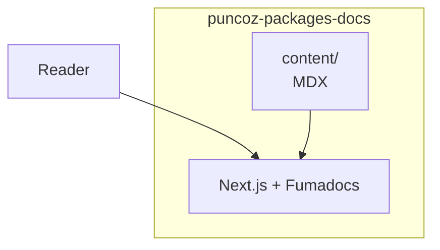

- **Status:** Draft
- **Last updated:** YYYY-MM-DD
- **Related ADRs:** ADR-NNNN

> Snapshot of the system as it stands today. Edit in place; never record what changed.

## Context

What this is, and the boundary between it and everything else.

## Components

| Component | Responsibility | Depends on |
|---|---|---|
| | | |

## Diagram

Draw this diagram with Archify too. In a copy, wrap the fence in
`<Diagram src="/diagrams/<project-slug>/<slug>.html" title="…">` … `</Diagram>`, with nothing else
inside: the page shows the Archify view and its Markdown the Mermaid. Outside the templates, a
bare Mermaid fence fails the build (ADR-0022).

## Key decisions in force

Links to the ADRs that govern this, one line each on what they mandate.

## Constraints

Performance, security, privacy and operational constraints this must respect.
