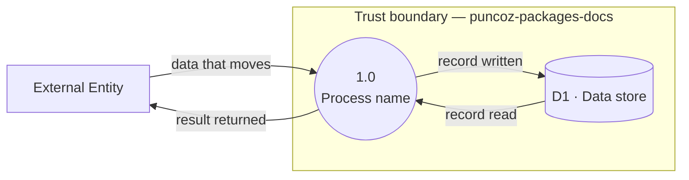

- **Status:** Draft
- **Last updated:** YYYY-MM-DD
- **Related ADRs:** ADR-NNNN

> Snapshot of the system as it stands today. Edit in place; never record what changed.
> Conventions: `content/docs/maintain/dfd/index.mdx`. Levels balance — a child's flows match its parent's.

## Scope

Which process this decomposes, and its parent diagram.

## Diagram

## External entities

| Entity | Role |
|---|---|

## Processes

| # | Process | Input → Output |
|---|---|---|

## Data stores

| ID | Store | Contents | Classification |
|---|---|---|---|
| D1 | | | Public / Internal / Confidential / Restricted — see [`../security/data-classification.mdx`](../security/data-classification.mdx) |

## Trust boundary crossings

Every flow that crosses a boundary, with how it is authorised and whether private content can
travel on it.

| Flow | Direction | Authorisation | Private content? |
|---|---|---|---|
