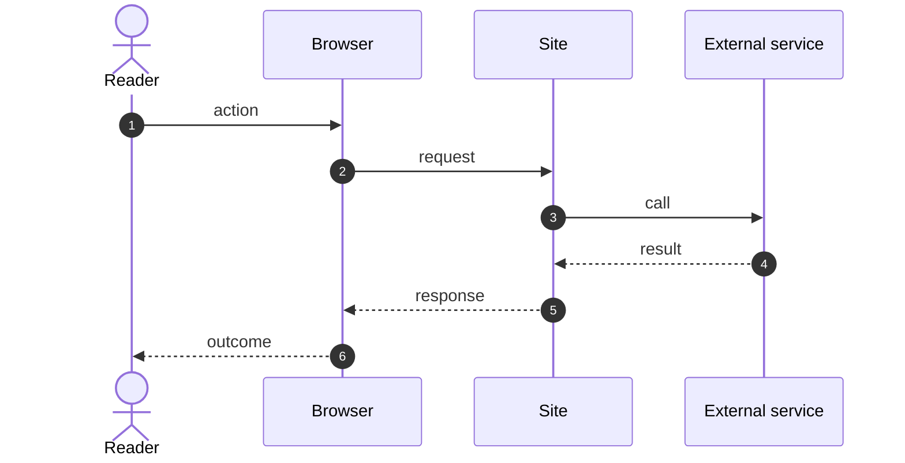

- **Status:** Draft
- **Last updated:** YYYY-MM-DD
- **Related ADRs:** ADR-NNNN

> Snapshot of the system as it stands today. Edit in place; never record what changed.

## Trigger

What starts this flow, and the preconditions that must hold.

## Diagram

Draw this diagram with Archify too. In a copy, wrap the fence in
`<Diagram src="/diagrams/<project-slug>/<slug>.html" title="…">` … `</Diagram>`, with nothing else
inside: the page shows the Archify view and its Markdown the Mermaid. Outside the templates, a
bare Mermaid fence fails the build (ADR-0022).

## Failure paths

| Step | Failure | Behaviour | Recovery |
|---|---|---|---|

## Post-conditions

What is true once the flow completes, including what was written or published.
