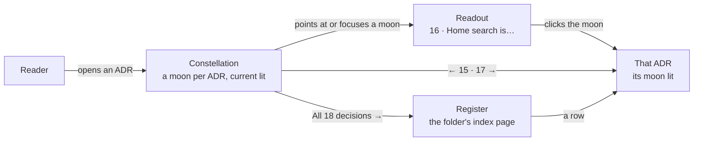
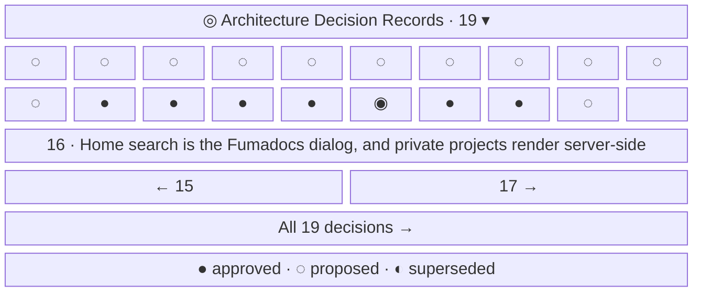
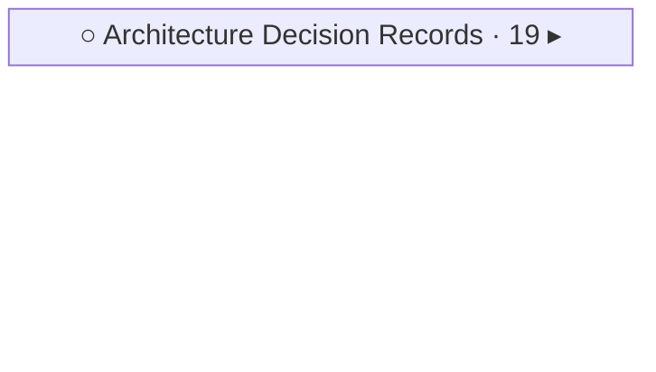

- **Status:** Current
- **Last updated:** 2026-11-01
- **Related ADRs:** [ADR-0019](../adr/ADR-0019-adr-folders-show-as-a-constellation-in-the-sidebar.mdx),
  [ADR-0018](../adr/ADR-0018-docs-pages-get-orbit-stations-a-trajectory-and-the-full-horizon.mdx)

> Snapshot of the system as it stands today. Edit in place; never record what changed.

How an ADR folder's station shows its pages (ADR-0019). Every other folder stays
an orbit station ([Docs sidebars](./docs-sidebars.mdx), screen 1). Sample values are invented
(ADR-0008): `lodestar` is not a real package; this site's own ADRs are real and public. Phone
width first; the characters in the wireframes stand for drawn SVG moons.

The flow and every screen are drawn with Archify; the page shows them and its Markdown
carries their Mermaid (ADR-0022). Their sources are in `diagrams/docs/`: `adr-constellation.json` for the
flow, one `adr-constellation-screen-<n>.json` per screen.

## Entry points

- Any page in a track that has a folder named `adr`: the station opens on any ADR and on the
  folder's index page, and starts closed elsewhere. A folder named `adr` with sub-folders keeps
  the plain station.
- On phones, the sidebar drawer; on desktop, the sidebar column.
- Everyone sees the same; the per-page Markdown and `llms.txt` carry none of it.

## Flow

<Diagram src="/diagrams/docs/adr-constellation.html" title="The ADR constellation">

</Diagram>

## Screens

### 1. `Constellation` — the open Decisions station, on `/docs/maintain/adr/ADR-0016-…`

<Diagram src="/diagrams/docs/adr-constellation-screen-1.html" title="Screen 1 — Constellation">

</Diagram>

Moons run in page order, oldest first, as many to a row as fit. Each moon's phase is its ADR's
status: full approved, dashed new moon proposed, crescent superseded, a faint ring rejected or
without a status line. The current ADR is the teal planet ringed in the ecosystem colour.
Pointing at or focusing a moon shows its number and title in the readout; leaving it returns
the readout to the current page. The wireframe shows this site's ADRs as they stand: 0001 to
0011 and 0019 proposed, 0012 to 0018 approved. Desktop: about nine moons a row in the 268px sidebar. Phone:
more a row in the wider drawer.

**States**

- On the folder's index page: no moon lit, the readout reads "19 decisions · 12 proposed", no
  previous or next.
- First or last ADR: only "17 →" or only "← 17".
- One ADR: one moon, no previous or next.
- Empty: a folder named `adr` with only its index page shows the header and "No decisions yet."
- No index page: no register link.
- Loading: none; prerendered with the page, statuses included.
- Not found, refused: not applicable; every ADR here is public.
- Error: not applicable at run time; a page without a status line shows the faint ring.
- Degraded: on touch screens nothing is pointed at; a tap opens the ADR, and the readout shows
  the current page. With reduced motion the readout changes without fading. Without scripts the
  moons, previous, next and the register link still work; the readout stays on the current page.
- Success: a moon, previous, next or the register opens that page.

### 2. `Closed station` — elsewhere in the track

<Diagram src="/diagrams/docs/adr-constellation-screen-2.html" title="Screen 2 — Closed station">

</Diagram>

The header alone, as every closed station. Its chevron opens the constellation.

**States**

- Success: opening shows screen 1 with no moon lit and the summary readout.
- Other states: as screen 1.
