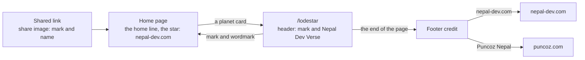
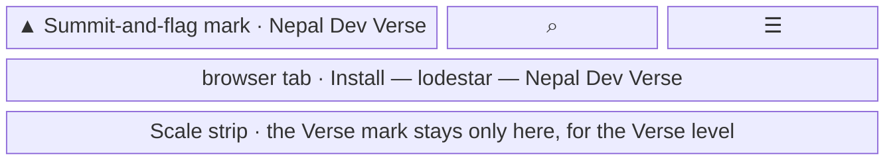
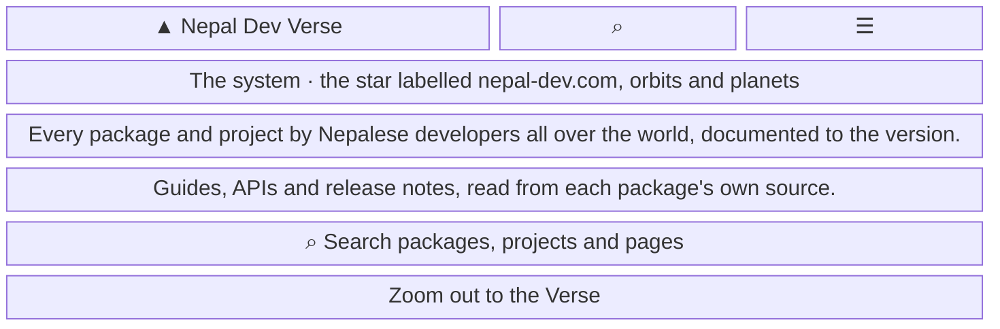
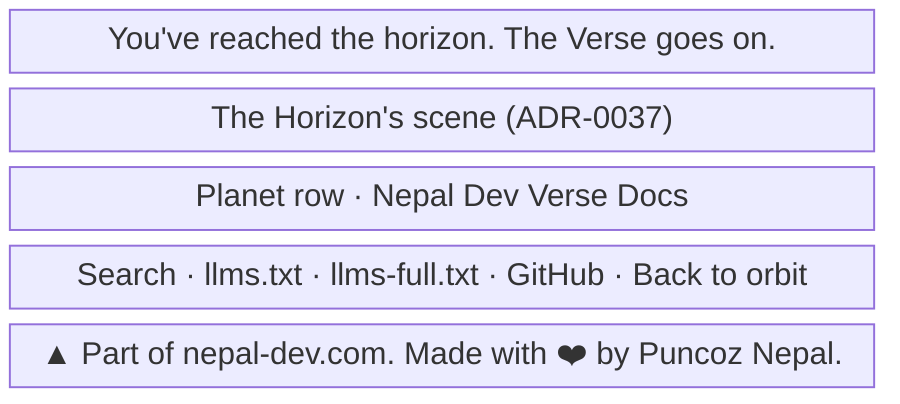
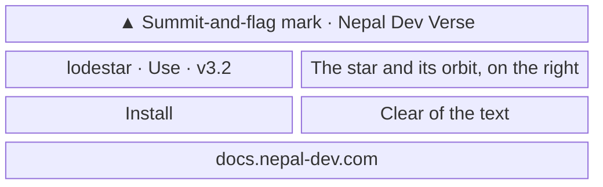

- **Status:** Current
- **Last updated:** 2026-11-03
- **Related ADRs:** [ADR-0036](../adr/ADR-0036-the-site-is-nepal-dev-verse.mdx),
  [ADR-0028](../adr/ADR-0028-the-site-gets-its-first-verse-name.mdx),
  [ADR-0029](../adr/ADR-0029-the-verse-is-a-still-sky-you-zoom-through.mdx)

> Snapshot of the system as it stands today. Edit in place; never record what changed.

Where readers see the site's identity under ADR-0036. The site is *Nepal Dev Verse*, part of
nepal-dev.com; its own documentation, the project with the slug `docs`, is *Nepal Dev Verse Docs*.
No page moves and no URL changes. Sample values are invented (ADR-0008): `lodestar` is not a real
package. Phone width first.

The flow and every screen are drawn with Archify; the page shows them and its Markdown carries their
Mermaid (ADR-0022). Their sources are in `diagrams/docs/`: `community-identity.json` for the flow, one
`community-identity-screen-<n>.json` per screen.

## Entry points

- **Every page:** the header's mark and wordmark, the browser tab, the favicon, the footer's credit.
- **The home page:** the home line and the star's label.
- **A shared link:** the mark and the name on the share image.
- **A device's home screen:** the Apple icon and the manifest's name.
- **`/docs`:** the project's planet card, planet header and sidebar chip.
- Everyone sees the same.

## Flow

<Diagram src="/diagrams/docs/community-identity.html" title="The community identity">

</Diagram>

## Screens

### 1. `Header` — every page

<Diagram src="/diagrams/docs/community-identity-screen-1.html" title="Screen 1 — Header">

</Diagram>

The mark and wordmark link home. The flag keeps its own colours in both themes; only the rock changes
with the theme, so it stands clear of the ground. The Verse mark stays as the place mark of the Verse
level in the scale strip.

**States**

- Empty, loading, not found, refused, degraded: the header does not change with them; the 404 keeps it.
- Error: the mark is inline, so it cannot fail to load.
- Success: the same mark and name on every page, and the same mark as the favicon.

### 2. `Home page` — the top, at phone width

<Diagram src="/diagrams/docs/community-identity-screen-2.html" title="Screen 2 — Home page">

</Diagram>

**States**

- Empty: with only this site documented, the empty orbits are faint and named, as they are now.
- Loading: none; the page is prerendered.
- Not found, refused, error: not applicable.
- Degraded: under reduced motion the system is drawn still, with the same label.
- Success: the line says whose work this is before anything is opened.

### 3. `Footer credit` — the end of every page

<Diagram src="/diagrams/docs/community-identity-screen-3.html" title="Screen 3 — Footer credit">

</Diagram>

*nepal-dev.com* links to `https://nepal-dev.com` and *Puncoz Nepal* to `https://puncoz.com`. It is also
the plain sentence beside the space words (*The Places, Not Controls Rule*).

**States**

- Empty, loading, not found, refused, error, degraded: the credit is plain text and links, and does not
  change with them.
- Success: both links open in the same tab, with `rel="noreferrer noopener"`.

### 4. `Share image` — at its fixed 1200 by 630

<Diagram src="/diagrams/docs/community-identity-screen-4.html" title="Screen 4 — Share image">

</Diagram>

**States**

- Empty: not applicable; every image has its page.
- Loading: none; the image is made at build.
- Not found: an unknown path's image address answers 404.
- Refused: not applicable.
- Error: a failed font fetch fails the build, as ADR-0035 decided.
- Degraded: with no `SITE_URL` the image leaves out the domain.
- Success: the card shows the mark and the name. The home page's image carries the long home line, set
  smaller so it stays clear of the system.
