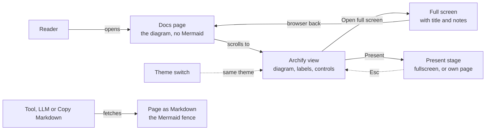
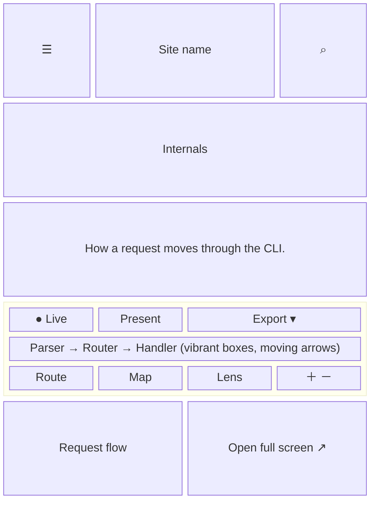
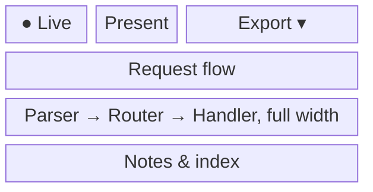
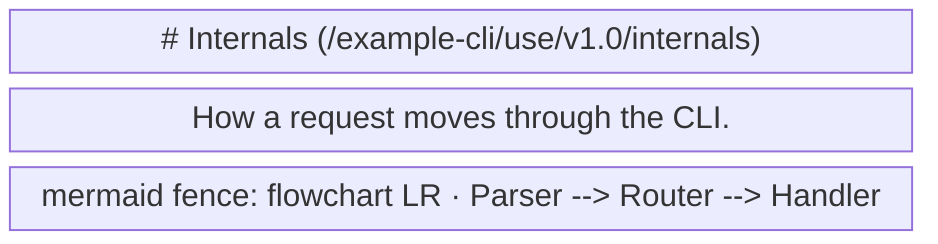

- **Status:** Current
- **Last updated:** 2026-11-01
- **Related ADRs:** [ADR-0022](../adr/ADR-0022-diagrams-show-archify-on-the-page-and-mermaid-in-markdown.mdx),
  [ADR-0011](../adr/ADR-0011-archify-diagrams-are-embedded-from-sandboxed-html.mdx)

> Snapshot of the system as it stands today. Edit in place; never record what changed.

What a person sees and how they move through it. Sample values are invented (ADR-0008).
Phone width first; note where desktop differs.

Every diagram, flows and screen wireframes alike, shows on its page as its Archify view only:
the diagram, its labels and its controls, at its own height, on the site's background, moving.
Every Markdown surface carries its Mermaid instead.

The flow and every screen are drawn with Archify; the page shows them and its Markdown
carries their Mermaid (ADR-0022). Their sources are in `diagrams/docs/`: `diagrams.json` for the
flow, one `diagrams-screen-<n>.json` per screen.

## Entry points

- Any docs page with a diagram: an app flow's flow and screens, an architecture, data-flow,
  state or sequence page, a package's own pages.
- **Open full screen** under a frame, or a shared link to the file.
- The page's Markdown: **Copy Markdown** and the view options above the page, `/<page>.md`,
  Markdown negotiation, `llms-full.txt`.
- Search leads to the page, never to the file: the diagram files are not indexed.
- Everyone sees the same diagrams; no private project has any.

## Flow

<Diagram src="/diagrams/docs/diagrams.html" title="Diagrams">

</Diagram>

## Screens

### 1. `Docs page with a diagram` — `/<project-slug>/…`

Phone width. The frame takes the content width and the diagram's own height: nothing scrolls
inside it vertically, and its height holds still while the diagram moves. The controls sit on
the frame's edges. **Export** opens its menu over the diagram, from the frame's right edge, and
the frame grows to show the whole menu while it is open.

<Diagram src="/diagrams/docs/diagrams-screen-1.html" title="Screen 1 — Docs page with a diagram">

</Diagram>

Desktop: the same, wider, with the sidebar and "On this page" either side.

**States**

- Empty: a page without a diagram has no frame.
- Loading: the frame keeps the diagram's height from the start, on the page's own background,
  with the caption and the link under it; the diagram appears when the frame scrolls near.
- Not found: never reaches a reader. A `<Diagram>` without its file, a Mermaid fence outside a
  `<Diagram>`, or a `<Diagram>` without exactly one Mermaid fence fails the build.
- Refused: not applicable.
- Error: scripts blocked in the frame show Archify's static diagram, without motion or controls.
- Degraded: the reader prefers reduced motion: the diagram starts Still. A wide diagram on a
  phone scrolls sideways inside the frame.
- Success: the diagram moving on the cycle, labels readable, Live/Still, Present, Export (PNG,
  SVG or WebM), and Route, Map, Lens, find, guide and zoom working; the theme matches the page
  and follows the theme switch.
- Present: the frame takes Archify's Present stage to fullscreen; Esc, or Present again, leaves
  both. Where the browser refuses fullscreen to the frame (a phone, a browser setting), the
  page opens the diagram's own page in its Present stage (screen 2, `?present=1`), and the
  browser's back returns.

### 2. `Full screen` — `/diagrams/<project-slug>/<slug>.html`

Archify's own page in the site's colours: title, diagram and notes; reached from Present, it
opens in Archify's Present stage. The reader returns with the browser's back.

<Diagram src="/diagrams/docs/diagrams-screen-2.html" title="Screen 2 — Full screen">

</Diagram>

**States**

- Not found: an unknown file shows the site's 404.
- Success: as in the frame, with the title and notes.
- Empty, loading, refused, error, degraded: as in the frame.

### 3. `Page as Markdown` — **Copy Markdown**, `/<project-slug>/<page>.md`

<Diagram src="/diagrams/docs/diagrams-screen-3.html" title="Screen 3 — Page as Markdown">

</Diagram>

**States**

- Success: the Mermaid fence where the diagram is; no `<Diagram>` tag, no Archify URL.
- Empty, loading, not found, refused, error, degraded: as for the page's Markdown route today.
