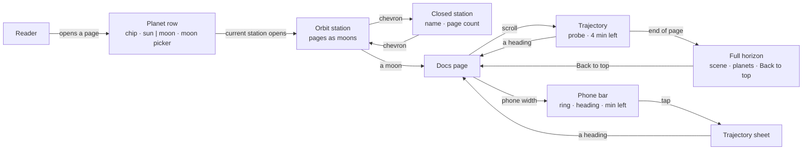
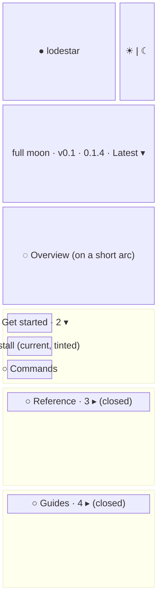
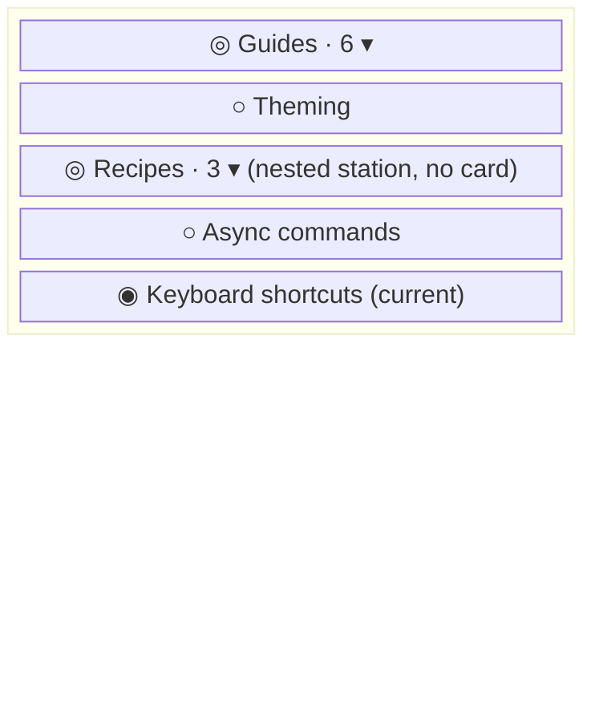
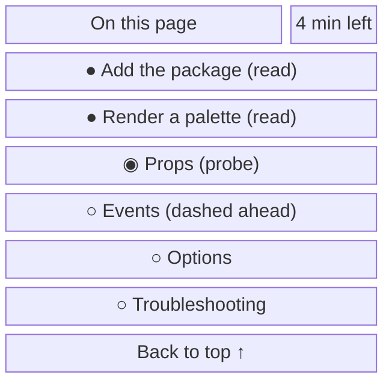
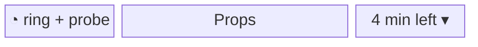
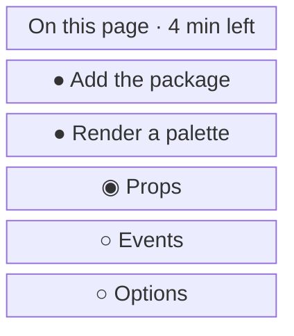
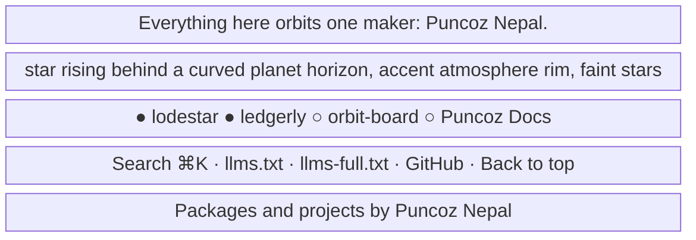

- **Status:** Current
- **Last updated:** 2026-11-01
- **Related ADRs:** [ADR-0019](../adr/ADR-0019-adr-folders-show-as-a-constellation-in-the-sidebar.mdx),
  [ADR-0018](../adr/ADR-0018-docs-pages-get-orbit-stations-a-trajectory-and-the-full-horizon.mdx),
  [ADR-0017](../adr/ADR-0017-the-whole-site-is-one-solar-system.mdx)

> Snapshot of the system as it stands today. Edit in place; never record what changed.

What a reader sees around a docs page (ADR-0018): the left sidebar's planet row
and orbit stations, the right-hand "On this page" trajectory, its bar on phones, and the full
horizon below. Sample values are invented (ADR-0008): `lodestar` is not a real package. Phone
width first; desktop differences are noted under each screen. The marks (planet, moons, sun and
moon) are those of [The solar system](./solar-system.mdx); the characters in the wireframes stand
for drawn SVG.

The flow and every screen are drawn with Archify; the page shows them and its Markdown
carries their Mermaid (ADR-0022). Their sources are in `diagrams/docs/`: `docs-sidebars.json` for the
flow, one `docs-sidebars-screen-<n>.json` per screen.

## Entry points

- Every page inside a package or project, `/<slug>/…`, and this site's own pages under `/docs`.
- On phones the left sidebar is Fumadocs' drawer, opened from the header; the trajectory is the
  bar under the header.
- Everyone sees the same pages. Nothing here depends on who the reader is.
- The per-page Markdown (`/<page>.md`) and `llms.txt` carry none of this; they are the page's
  content only.

## Flow

<Diagram src="/diagrams/docs/docs-sidebars.html" title="Docs page sidebars">

</Diagram>

## Screens

### 1. `Planet row and orbit stations` — the left sidebar, `/lodestar/use/v0.1/install`

<Diagram src="/diagrams/docs/docs-sidebars-screen-1.html" title="Screen 1 — Planet row and orbit stations">

</Diagram>

The planet row: the chip links to `/lodestar`; the sun and moon buttons open the same page on
Use or Maintain ("Use, the day side" and "Maintain, the night side" as names and tooltips). The
station holding the current page is open, its border in the ecosystem colour, its orbit drawing
showing a filled planet; its pages' moon dots sit on one outward-bowing arc, and the current page
is the accent planet with a halo. Other stations are closed and show their name and page count.

Desktop: the same, in the sidebar column; the sidebar's collapse button works as today. Phone:
the same inside Fumadocs' drawer.

<Diagram src="/diagrams/docs/docs-sidebars-screen-1-2.html" title="Screen 1 (2) — Planet row and orbit stations">

</Diagram>

A nested folder is a smaller station inside its parent, with no card border. A folder named
`adr` is a constellation instead, one moon per ADR ([The ADR constellation](./adr-constellation.mdx)).

**States**

- Empty: a track with no folders shows only its top-level pages on their arc, no stations.
- Loading: none; the sidebar is prerendered with the page. Before scripts load, stations show
  in their starting state (current open, others closed) and the chevrons do nothing until
  hydration.
- Not found: an unknown page gets the out-of-orbit 404, which has no sidebar.
- Refused: not applicable; every page is public.
- Error: not applicable at runtime; a broken `meta.json` fails the build (ADR-0013).
- Degraded: with reduced motion, stations open and close without animation. On touch screens no
  tooltips; the buttons' names are read out.
- One track: no sun and moon buttons. Maintain: no moon picker.
- Success: a moon opens its page; the sun or moon opens the same page on the other side when it
  exists, else that side's first page.

### 2. `Trajectory` — "On this page", desktop column

<Diagram src="/diagrams/docs/docs-sidebars-screen-2.html" title="Screen 2 — Trajectory">

</Diagram>

The path curves through every dot: shallow outward arcs between headings of the same depth, an
S-curve where depth changes. The read stretch is solid accent with filled dots; ahead is dashed
and muted with hollow dots. The probe planet glides along the path as the reader scrolls. The
column sits to the right of the page from Fumadocs' desktop breakpoint up.

**States**

- Empty: a page without headings shows "On this page", its reading time, and "This page has no
  sections."; no path.
- One heading: one dot and the probe on it; no path.
- Loading: none; prerendered. Before scripts load the whole path is drawn dashed with hollow
  dots, no probe, and the header shows the total, "4 min read".
- Long lists: the column scrolls, and keeps the probe's row in view.
- Not found, refused, error: not applicable.
- Degraded: with reduced motion the probe jumps from dot to dot and headings scroll into view
  instantly. Without scripts the headings are plain links that still jump.
- A page under one minute: no time shown. At the end of the page: "End of page".
- Success: choosing a heading scrolls to it; Back to top returns to the top of the page.

### 3. `Phone bar and sheet` — under the header, phone width

<Diagram src="/diagrams/docs/docs-sidebars-screen-3.html" title="Screen 3 — Phone bar and sheet">

</Diagram>

<Diagram src="/diagrams/docs/docs-sidebars-screen-3-2.html" title="Screen 3 (2) — Phone bar and sheet">

</Diagram>

The bar replaces Fumadocs' table-of-contents bar: a small ring with the probe at the reading
position, the current heading (truncated), the time left and a chevron. Tapping opens the same
trajectory as a sheet; choosing a heading scrolls there and closes it.

**States**

- Empty: a page without headings has no bar.
- Before the first heading: the bar shows the first heading, muted, and the total time.
- Degraded: with reduced motion the sheet opens without sliding. Without scripts the bar does not
  open; the page reads normally.
- Success: the reader jumps to a section and the sheet closes.

### 4. `Full horizon` — below every docs page

<Diagram src="/diagrams/docs/docs-sidebars-screen-4.html" title="Screen 4 — Full horizon">

</Diagram>

The same footer as the home page ([The solar system](./solar-system.mdx), screen 5), across the
full width below the sidebar and the page; its last link reads "Back to top".

**States**

- Empty: with no public entries, the planet row is left out.
- Degraded: with reduced motion Back to top jumps instead of scrolling. Without scripts Search and
  Back to top do nothing; the links work.
- Success: a planet link opens its overview; Search opens the dialog; Back to top returns to the
  top of the page.
