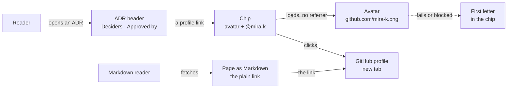
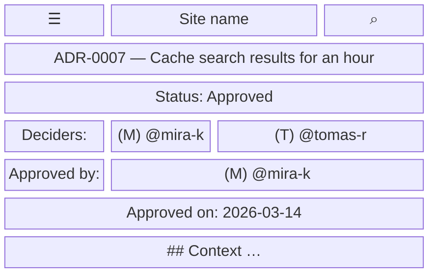
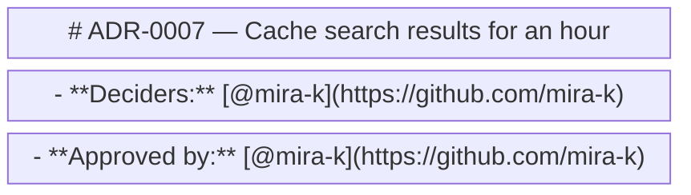

- **Status:** Current
- **Last updated:** 2026-11-01
- **Related ADRs:** [ADR-0020](../adr/ADR-0020-people-in-adrs-are-github-usernames-shown-as-profile-chips.mdx)

> Snapshot of the system as it stands today. Edit in place; never record what changed.

What a person sees and how they move through it. Sample values are invented (ADR-0008).
Phone width first; note where desktop differs.

A link written `[@user](https://github.com/user)` shows as a chip: the person's GitHub avatar,
20px and round, beside `@user`. In ADR headers, every decider and approver is written that way.

The flow and every screen are drawn with Archify; the page shows them and its Markdown
carries their Mermaid (ADR-0022). Their sources are in `diagrams/docs/`: `github-profile-chips.json` for the
flow, one `github-profile-chips-screen-<n>.json` per screen.

## Entry points

- Any ADR page: the `Deciders` and `Approved by` lines in its header. The sidebar's
  constellation and the search dialog lead there.
- Any other page that writes a link of exactly that shape.
- The page's Markdown version (`/<page>.md`, `llms-full.txt`): the plain link, no chip.
- Everyone sees the same chips. Nothing here depends on who is reading.

## Flow

<Diagram src="/diagrams/docs/github-profile-chips.html" title="GitHub profile chips">

</Diagram>

## Screens

### 1. `ADR header` — `/<project-slug>/maintain/adr/ADR-0007-…`

Phone width. The chip sits inline in the header line, so a line with two people wraps after
the first chip when it doesn't fit.

<Diagram src="/diagrams/docs/github-profile-chips-screen-1.html" title="Screen 1 — ADR header">

</Diagram>

`(M)` stands for the avatar. Desktop: the same, with the sidebar and the table of contents on
either side.

**States**

- Empty: a line that names no profile link stays as written, plain text.
- Loading: the avatar is lazy; until it loads, the chip shows the username's first letter on a
  quiet disc.
- Not found: a username GitHub doesn't know returns no image, so the letter stays; the link
  opens GitHub's own not-found page.
- Refused: not applicable; the chip shows the same to everyone.
- Error: a link whose text and address name different users, or an address that isn't exactly
  `https://github.com/<user>`, is not a chip; it renders as an ordinary link.
- Degraded: GitHub unreachable, or the image blocked by the browser or an extension: the letter
  shows; the link still points at the profile.
- Success: the avatar and `@mira-k`, one target that opens the profile in a new tab; hover
  underlines the name, focus rings the whole chip.

### 2. `Page as Markdown` — `/<project-slug>/maintain/adr/ADR-0007-….md`

<Diagram src="/diagrams/docs/github-profile-chips-screen-2.html" title="Screen 2 — Page as Markdown">

</Diagram>

**States**

- Success: the links as written; no image URL is added.
- Empty, loading, not found, refused, error, degraded: as for the page's Markdown route today.
