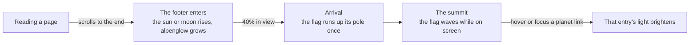
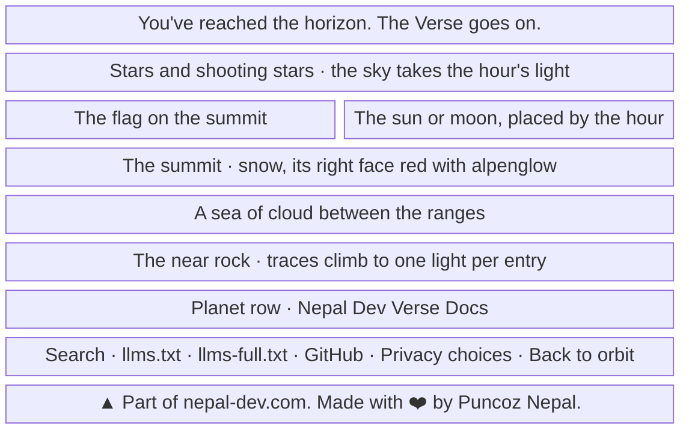
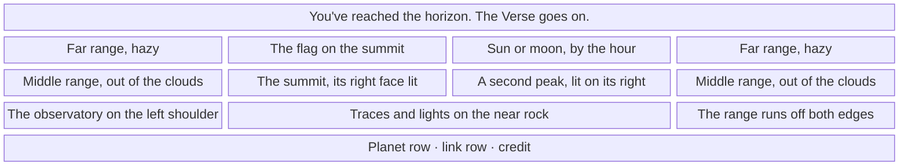

- **Status:** Current
- **Last updated:** 2026-11-04
- **Related ADRs:** [ADR-0037](../adr/ADR-0037-the-horizon-is-the-himalaya.mdx),
  [ADR-0040](../adr/ADR-0040-the-horizons-sun-and-moon-keep-the-readers-time.mdx),
  [ADR-0030](../adr/ADR-0030-the-horizon-rises-over-the-page-and-its-sky-comes-alive.mdx),
  [ADR-0033](../adr/ADR-0033-the-footer-says-you-have-reached-the-horizon.mdx)

> Snapshot of the system as it stands today. Edit in place; never record what changed.

How the end of every page works under ADR-0037. The bare curve of the planet becomes a range rising out
of a sea of cloud, and the summit carries the flag. Sample values are invented (ADR-0008). Phone width
first.

The flow and each screen are drawn with Archify; the page shows them and its Markdown carries their
Mermaid (ADR-0022). Their sources are in `diagrams/docs/`: `himalayan-horizon.json` for the flow, one
`himalayan-horizon-screen-<n>.json` per screen.

## Entry points

- **The end of every page:** docs pages, the home page and the 404. Everyone sees it, and nothing in the
  scene is a control.
- **The planet row:** hovering or focusing an entry's link lights that entry's point on the mountain.
- **Not here:** Markdown surfaces, which carry no footer. Screen readers skip the scene, which is
  `aria-hidden`, and read the closing line, the planet row and the credit.

## Flow

<Diagram src="/diagrams/docs/himalayan-horizon.html" title="The Himalayan Horizon">

</Diagram>

## Screens

### 1. `The Horizon` — the end of any page, at phone width

<Diagram src="/diagrams/docs/himalayan-horizon-screen-1.html" title="Screen 1 — The Horizon, phone">

</Diagram>

**States**

- Empty: with no entries there are no traces and no lights, and the mountain stands bare; the planet row
  is not shown, as now.
- Loading: none; the scene is inline in the static page. Before scripts run, the flag stands raised.
- Not found: the 404 has the same scene.
- Refused, error: not applicable.
- Degraded: under reduced motion, with no scripts or with no scroll-driven animations, the sun or moon
  stands risen, the flag stands raised and still, and the clouds stay where they are drawn.
- Success: the flag is at the top of its pole by the time the closing line has been read, and is never
  left part-way.

### 2. `The Horizon` — the end of a docs page, on a wide screen

<Diagram src="/diagrams/docs/himalayan-horizon-screen-2.html" title="Screen 2 — The Horizon, wide">

</Diagram>

The summit and the flag are never cropped, at any width: the far and middle ranges run wider and fall off
the edges, and the summit stays at the centre.

**States**

- As screen 1.
- Light theme: the same scene with a sun in place of the moon. The rock is the logo's navy, and the flag does
  not change. What each hour looks like is in [the Horizon by the clock](./horizon-clock.mdx).
- Success: hovering *lodestar* in the planet row brightens its light, in its ecosystem's colour, and it
  settles again when the pointer leaves.
