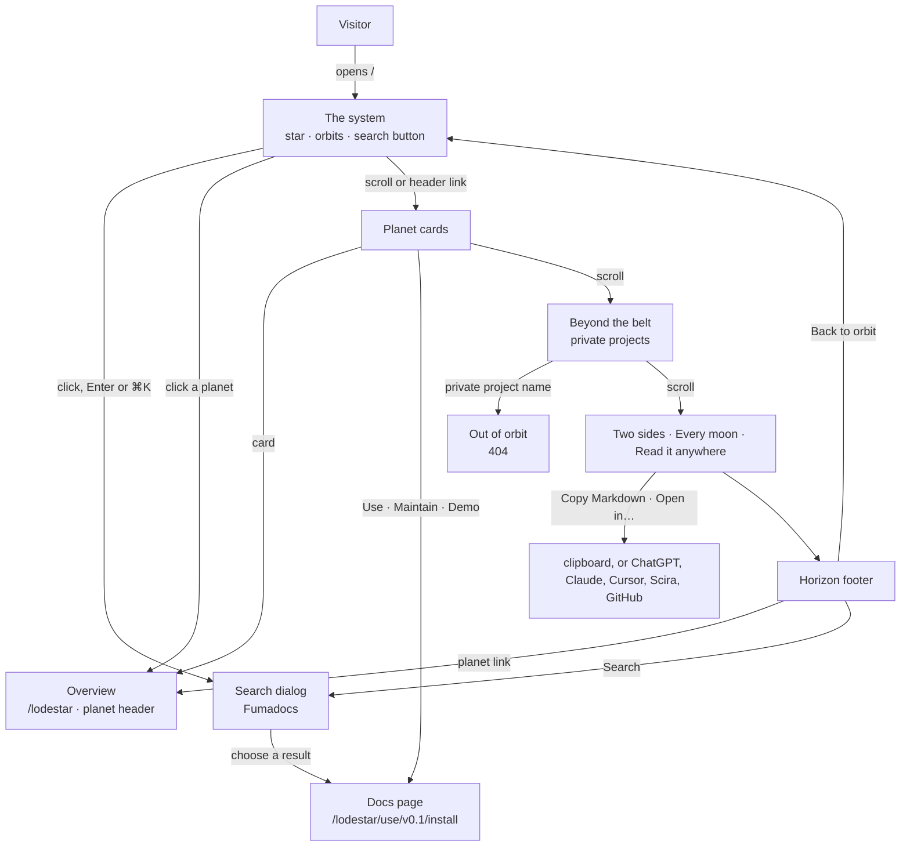
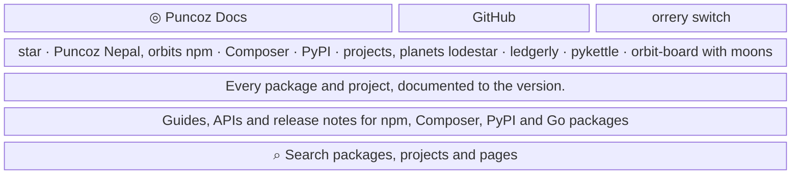
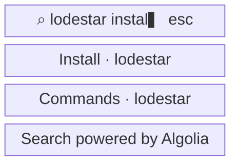
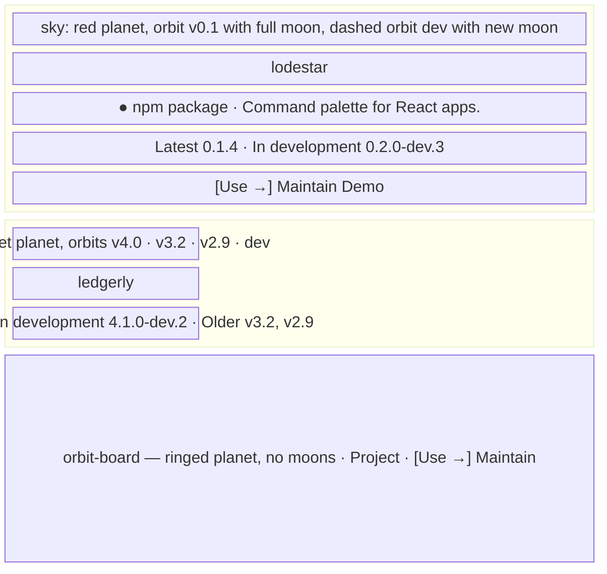
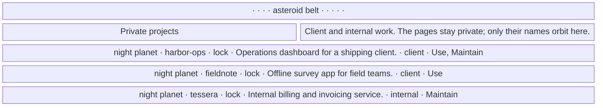
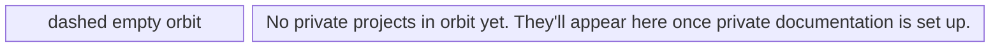
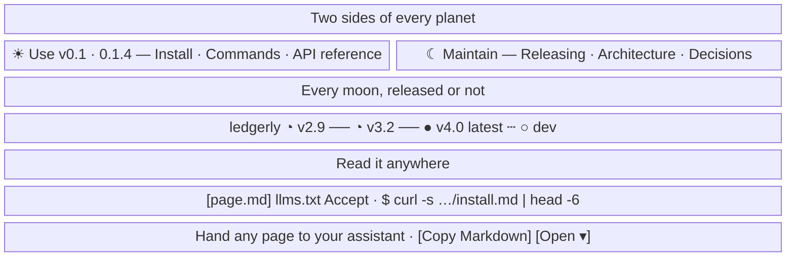

- **Status:** Current
- **Last updated:** 2026-11-01
- **Related ADRs:** [ADR-0017](../adr/ADR-0017-the-whole-site-is-one-solar-system.mdx),
  [ADR-0016](../adr/ADR-0016-home-search-is-the-fumadocs-dialog-and-private-projects-render-server-side.mdx),
  [ADR-0014](../adr/ADR-0014-home-page-is-a-search-first-release-map.mdx),
  [ADR-0013](../adr/ADR-0013-packages-and-projects-share-one-catalogue-shape.mdx)

> Snapshot of the system as it stands today. Edit in place; never record what changed.

What a person sees and how they move through it. Sample values are invented (ADR-0008):
`lodestar`, `ledgerly`, `pykettle` and `orbit-board` are not real packages or projects. The
private projects `harbor-ops`, `fieldnote` and `tessera` are invented too, and are the ones the
live site shows (ADR-0017 decision 4). Phone width first; desktop differences are noted under
each screen.

The home page at `/` is the solar system (ADR-0017): the star is the maker, Puncoz Nepal; each
ecosystem is an orbit; a solid planet is a package and a ringed planet a project; each version
line is a moon, full for the latest release, a crescent for an older one, a dashed new moon for
`dev`. The marks are described once in [The solar system](./solar-system.mdx). Every entry, line
and version comes from the catalogue fields in the content folders (ADR-0013) at build time, and
the page is prerendered.

Only this site, the project `docs`, is documented yet, so the page shows one project planet, the
three private projects, no Two sides and no Every moon section.

The flow and every screen are drawn with Archify; the page shows them and its Markdown
carries their Mermaid (ADR-0022). Their sources are in `diagrams/docs/`: `solar-system.json` for the
flow, one `home-page-screen-<n>.json` per screen.

## Entry points

- A direct visit to the site's root URL, the header wordmark on every page, `llms.txt`, and
  links from package READMEs or registry pages that point at the site rather than at one
  package.
- The header's Packages and Projects links, on every page, land on the first package card
  (`/#packages`) and the first project card (`/#projects`).
- Everyone sees the same page, the private projects included. The sign-in ADR will decide who
  sees the private group.
- The page has no Markdown twin of its own. `llms.txt` lists every package and project instead
  (invariant 5 covers documentation pages; the home page is navigation).

## Flow

<Diagram src="/diagrams/docs/solar-system.html" title="The home page and the solar system">

</Diagram>

## Screens

### 1. `The system` — `/`

<Diagram src="/diagrams/docs/home-page-screen-1.html" title="Screen 1 — The system">

</Diagram>

The star sits in the system with "Puncoz Nepal" under it. Each ecosystem with entries is an
orbit; every planet is labelled, carries its moons, and turns its night side away from the star.
The system turns slowly; pointing at a planet slows it and shows a card (name, description,
kind, latest version, "click to open"); clicking opens the overview. The headline and subline
are selectable text, and the canvas's crosshair cursor shows only over open sky.

The header is the site's one header ([site pages](./site-pages.mdx)) without its search button:
the hero's button is this page's search. Clicking it, Enter or Space on it, or `⌘K` / `Ctrl K`
anywhere opens the search dialog.

Desktop: the text and the 520px search button with its `⌘K` hint sit on the left; the system
fills the right, centred at 70% of the width. A legend under the button shows package, project,
moon = version and dashed = unreleased. The hero is up to 860px tall. Phone: the system sits in
the top 310px, the text and button below it.

**States**

- Empty: with no public entries, faint default orbits (npm, Composer, PyPI, Go, projects) around
  the star, no planets.
- Loading: none; prerendered. The system starts turning after first paint; the text and button
  are usable before it.
- Not found, Refused: not applicable at `/`; unknown paths get the out-of-orbit 404.
- Error: a broken catalogue field fails the build (ADR-0013). If the canvas cannot draw, the
  text and button show on the plain background.
- Degraded: with reduced motion, the system is drawn still and redrawn on hover. With scripts
  off, no canvas; the search button is replaced by a link to the cards. Keyboard and
  screen-reader users get the same content in the cards; the canvas has a label explaining it.
- Success: the dialog opens with the cursor in its field, or a planet opens its overview.

### 2. `Search dialog` — over the home page

<Diagram src="/diagrams/docs/home-page-screen-2.html" title="Screen 2 — Search dialog">

</Diagram>

Fumadocs' dialog, the one every page uses (`src/components/search.tsx`), in the site's colours:
results as you type, arrow keys and Enter, Escape closes it.

**States**

- Empty query: the dialog's own empty view.
- Loading: the dialog's own indicator while Algolia answers.
- Not found: the dialog's "no results". A result whose page was removed since the last index
  sync opens the 404.
- Refused: not applicable.
- Degraded: Algolia unreachable shows the dialog's error.
- Success: choosing a result opens that page.

### 3. `Planet cards` — `/#packages`, `/#projects`

<Diagram src="/diagrams/docs/home-page-screen-3.html" title="Screen 3 — Planet cards">

</Diagram>

No heading on screen (a visually hidden h2, "Packages and projects", keeps the outline). One card
per public entry, in catalogue order: the sky draws the planet, one orbit per version line with
its moon labelled by the line's name; then the name (the whole card links to the overview),
kind, description, the fact sheet (Latest, In development, Older) and the Use →, Maintain and
Demo links, each only when it exists. Desktop: two or three cards across; hovering a card turns
its moons a little and tints its border with the ecosystem colour.

**States**

- Empty: with nothing documented, "No packages or projects yet."
- A package with no release: Latest reads "unreleased"; only its dashed `dev` moon is drawn.
- A project: a ringed planet; no fact sheet without lines; no Use link without a Use track (this
  site, Puncoz Docs).
- Loading, Not found, Refused, Error: not applicable; built from content that passed the build
  checks.
- Success: the card opens the overview; Use, Maintain and Demo open their pages.

### 4. `Beyond the belt` — `/#private`

<Diagram src="/diagrams/docs/home-page-screen-4.html" title="Screen 4 — Beyond the belt">

</Diagram>

A seeded asteroid belt divides the public planets from the private ones. Each private project is
a night-side planet on a dashed orbit in a dashed card, with a drawn lock (read out as
"private"). The list is in `src/components/home/private-projects.ts`, never in `content/`.
Desktop: three cards across. Empty state:

<Diagram src="/diagrams/docs/home-page-screen-4-2.html" title="Screen 4 (2) — Beyond the belt">

</Diagram>

**States**

- Empty: the dashed empty orbit and its message, when the list is empty.
- Filled: the three invented projects.
- Not found: a private project's name opens `/<slug>`, which returns the out-of-orbit 404.
- Refused: not applicable today; the sign-in ADR will decide who sees the group.
- Loading, Error: not applicable; rendered on the server with the page.
- Success: the reader sees which private projects exist.

### 5. `Two sides · Every moon · Read it anywhere`

<Diagram src="/diagrams/docs/home-page-screen-5.html" title="Screen 5 — Two sides · Every moon · Read it anywhere">

</Diagram>

The sun, moon and phase characters stand for drawn SVG marks.

- **Two sides of every planet.** Use is the day side and Maintain the night side of the first
  entry with both tracks, split by a planet drawn with its terminator. Each side lists that
  entry's real pages; Use names its line.
- **Every moon, released or not.** One row per entry with two or more lines: its moons oldest
  first, each with its phase mark, name and version, linking to that line. A legend names the
  three phases.
- **Read it anywhere.** A terminal with three tabs, each a real `curl` against this site with the
  real first lines of its output, taken at build time: `page.md`, `llms.txt` and `Accept`. A tab
  types its command the first time it is shown; arrow keys move between tabs. Under it,
  "Everything in one file: `/llms-full.txt`". Beside it, Fumadocs' own Copy Markdown button and
  Open menu, live, for the example page, and a "See it on a page" link. The example page is a
  package's first Use page, or this site's overview, `/docs`, while no package is documented.

Desktop: the two sides sit either side of the terminator; Read it anywhere is two columns.

**States**

- Empty: no entry with both tracks drops Two sides; no entry with two or more lines drops Every
  moon. With only `llms.txt` available, the terminal shows one tab and the assistant panel is
  left out.
- Loading: none; prerendered. The terminal and assistant panel enter once as they come into
  view; their content is visible without scripts.
- Not found, Refused, Error: not applicable at runtime. A failed copy leaves the button as it
  was.
- Degraded: with reduced motion, commands show without typing. With scripts off, the first tab
  shows and the tabs don't switch; Copy Markdown and the Open menu don't respond.
- Success: the reader follows a page or line, copies the page, or opens it in their assistant.

### 6. `Horizon footer`

Drawn in [The solar system](./solar-system.mdx), screen 5: the closing line, the star rising over
a planet's horizon, the planet links and the link row.
