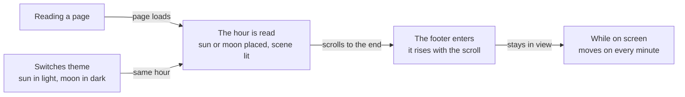
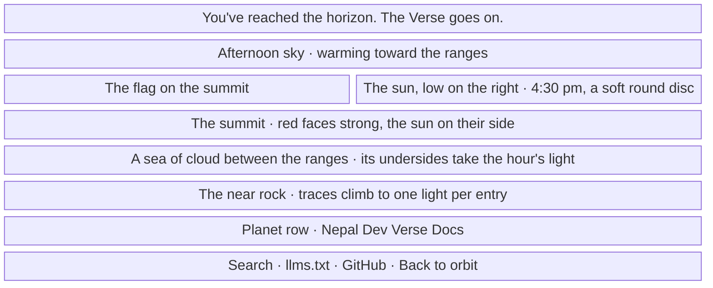
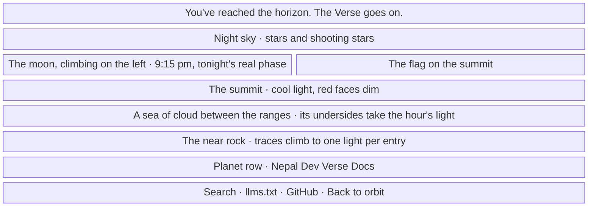
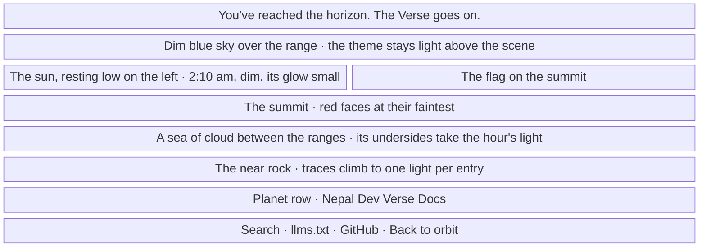

- **Status:** Current
- **Last updated:** 2026-11-04
- **Related ADRs:** [ADR-0040](../adr/ADR-0040-the-horizons-sun-and-moon-keep-the-readers-time.mdx),
  [ADR-0037](../adr/ADR-0037-the-horizon-is-the-himalaya.mdx),
  [ADR-0030](../adr/ADR-0030-the-horizon-rises-over-the-page-and-its-sky-comes-alive.mdx)

> Snapshot of the system as it stands today. Edit in place; never record what changed.

The light theme shows a sun and the dark theme a moon. Each stands where the reader's clock puts it, and lights the scene to match. It
still rises with the scroll as the footer enters. Times and names below are invented samples (ADR-0008). Phone width first.

The flow and each screen are drawn with Archify; the page shows them and its Markdown carries their Mermaid (ADR-0022). Their sources are
in `diagrams/docs/`: `horizon-clock.json` for the flow, one `horizon-clock-screen-<n>.json` per screen.

## Entry points

- **The end of every page:** docs pages, the home page and the 404. Everyone sees it, and nothing in the scene is a control.
- **The theme switch** in the site header: swaps the sun and the moon at once, at the same hour.
- **Not here:** Markdown surfaces, which carry no footer. Screen readers skip the scene, which is `aria-hidden`.

## Flow

<Diagram src="/diagrams/docs/horizon-clock.html" title="The Horizon by the clock">

</Diagram>

## The hours

| Hour | Sun (light theme) | Moon (dark theme) | Lighting |
|---|---|---|---|
| 5:00 to 7:00 | Rising on the left from 6:00 | Setting on the right until 6:00 | Dawn: rose gold, warm snow |
| 7:00 to 12:00 | Climbing to its highest | Resting low on the right, pale | Day: clear, true colours |
| 12:00 to 17:00 | Falling to the right | Resting low on the left, pale | Day: clear, true colours |
| 17:00 to 19:00 | Setting on the right until 18:00 | Rising on the left from 18:00 | Dusk: orange, warm snow |
| 19:00 to midnight | Resting low on the right, dim | Climbing to its highest | Night: deep blue, cool tint |
| Midnight to 5:00 | Resting low on the left, dim | Falling to the right | Night: deep blue, cool tint |

## Screens

### 1. `The sun by day` — the light theme at 4:30 pm, at phone width

<Diagram src="/diagrams/docs/horizon-clock-screen-1.html" title="Screen 1 — The sun by day">

</Diagram>

**States**

- Empty: with no entries there are no traces or lights, and the sun and sky work the same.
- Loading: none. The script places the sun after hydration, usually with the footer out of view.
- Not found: the 404 has the same scene. Its footer can show at load, so the sun may jump to its hour once.
- Refused, error: not applicable. Nothing is asked for and nothing is fetched.
- Degraded:
  - with no scripts, the sun stands right of the summit, with today's lighting;
  - under reduced motion, it stands at its hour, lit for it, with no rise and no fade;
  - with no scroll-driven animations, it stands at its hour, risen;
  - with a wrong device clock, the sky is wrong and nothing else is.
- Success: about noon the flag flies across the sun, in front of it. Scrolling up lowers the sun, and scrolling back raises it to the same
  place.

### 2. `The moon by night` — the dark theme at 9:15 pm, at phone width

<Diagram src="/diagrams/docs/horizon-clock-screen-2.html" title="Screen 2 — The moon by night">

</Diagram>

**States**

- As screen 1, for the moon. With no scripts, the moon stands right of the summit as a fixed crescent, because the page can't know the date.
- New moon: its dark side shows faintly, so the moon is still there. Full moon: the whole disc is lit, with its seas showing.
- Success: the moon's shape is the one the reader would see tonight, lit on the right while it waxes.

### 3. `The other hours` — the light theme at 2:10 am, at phone width

<Diagram src="/diagrams/docs/horizon-clock-screen-3.html" title="Screen 3 — The other hours">

</Diagram>

**States**

- As screen 1.
- The dark theme at noon is the same picture the other way round: the moon rests low and pale, in a sky that lifts a little and stays dark.
- Reading across midnight in the light theme, or noon in the dark one: the body fades out on the right and in on the left over a second.
  Under reduced motion it moves at once.
- Success: the closing line, the planet row and the links read exactly as they do at noon, because only the scene dims.
