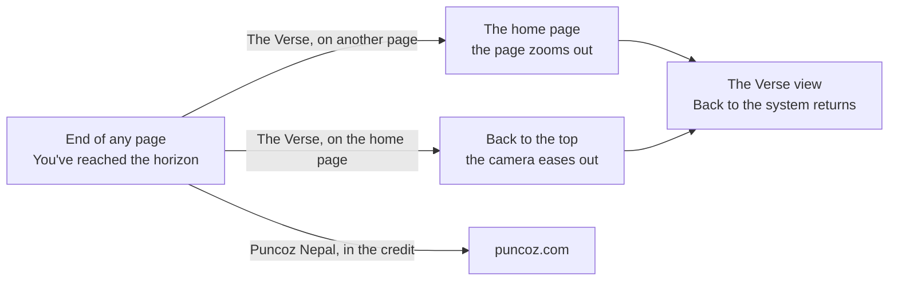
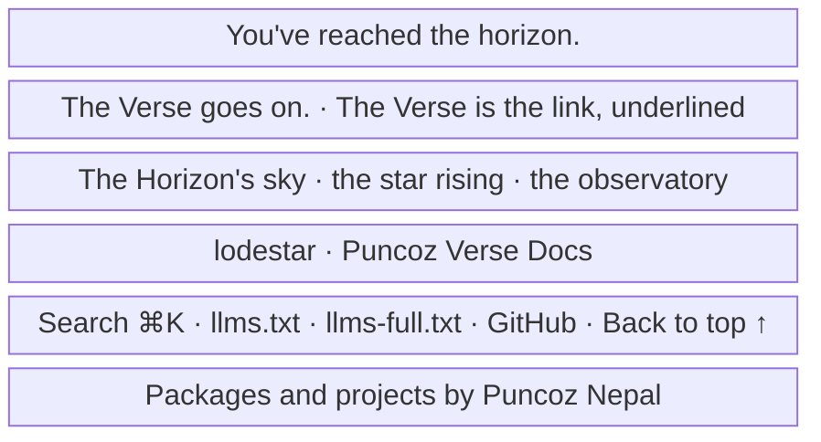

- **Status:** Current
- **Last updated:** 2026-11-03
- **Related ADRs:** [ADR-0033](../adr/ADR-0033-the-footer-says-you-have-reached-the-horizon.mdx),
  [ADR-0030](../adr/ADR-0030-the-horizon-rises-over-the-page-and-its-sky-comes-alive.mdx),
  [ADR-0029](../adr/ADR-0029-the-verse-is-a-still-sky-you-zoom-through.mdx)

> Snapshot of the system as it stands today. Edit in place; never record what changed.

How the closing line of the Horizon footer works under ADR-0033: it tells the reader they have
reached the horizon, and its link leads to the Verse view. Sample values are invented (ADR-0008).
Phone width first.

The flow and the screen are drawn with Archify; the page shows them and its Markdown carries
their Mermaid (ADR-0022). Their sources are in `diagrams/docs/`: `horizon-closing-line.json` for
the flow, `horizon-closing-line-screen-1.json` for the screen.

## Entry points

- **The end of every page:** docs pages, the home page and the 404. Everyone sees it.

## Flow

<Diagram src="/diagrams/docs/horizon-closing-line.html" title="The Horizon's closing line">

</Diagram>

## Screens

### 1. `The closing line` — the end of any page, at phone width

<Diagram src="/diagrams/docs/horizon-closing-line-screen-1.html" title="Screen 1 — The closing line">

</Diagram>

Each sentence stands on its own line, centred on the opaque ground above the scene. On a wide
screen the layout is the same at a larger size. Only "The Verse" is a link; the maker's name is
in the credit.

**States**

- Empty: not applicable; the line has no data. With no public planets the planet row is left out,
  as today.
- Loading: none; prerendered, and the link works as soon as scripts run.
- Not found: the 404 ends with the same line, and its link goes to the home page's Verse view.
- Refused, error: not applicable.
- Degraded:
  - with reduced motion the page jumps to the top and the Verse view opens at once, with no zoom;
  - without scripts the link is a plain link to the top of the home page, which then has no
    canvas and no Verse view;
  - on a screen too narrow for a sentence on one line, that sentence wraps within itself.
- Success: the reader follows the link and sees the Verse view at the top of the home page, and
  *Back to the system* returns them to the system.
