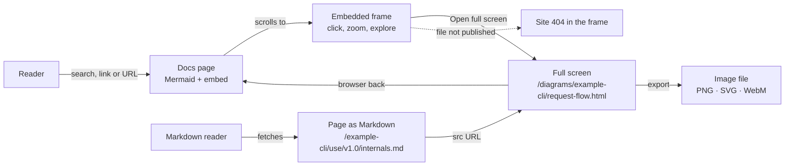
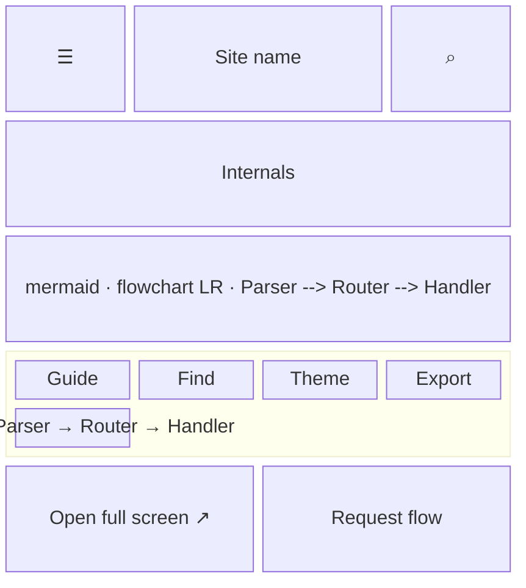
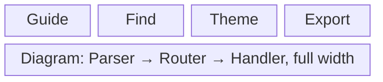
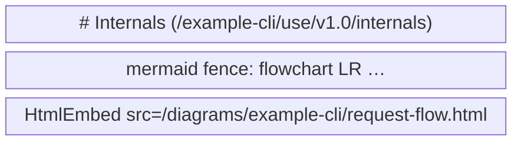

- **Status:** Draft
- **Last updated:** 2026-11-01
- **Related ADRs:** [ADR-0011](../adr/ADR-0011-archify-diagrams-are-embedded-from-sandboxed-html.mdx),
  [ADR-0012](../adr/ADR-0012-every-page-is-mdx.mdx)

> Snapshot of the system as it stands today. Edit in place; never record what changed.

What a person sees and how they move through it. Sample values are invented (ADR-0008).
Phone width first; note where desktop differs.

A page with a diagram shows its Mermaid version, then Archify's HTML from
`/diagrams/<project-slug>/<slug>.html` in a sandboxed frame (`<HtmlEmbed>`), with **Open full
screen** and a caption underneath.

The flow below is made with Archify. Its source is
`.archify/workflow-html-embeds-20261031/candidate.json`, and it moves to
`diagrams/docs/html-embeds.json` once ADR-0011 is approved.

## Entry points

- A docs page that embeds a diagram.
- **Open full screen** under a frame, or a shared URL to the file itself.
- The page's Markdown version (`/<page>.md`, `llms-full.txt`), where the `<HtmlEmbed>`
  tag shows the file's URL.
- Search leads to the docs page, never to the file: the files are not indexed.
- Everyone sees every embed. Private projects have none here (ADR-0011, invariant 1), so there
  is nothing to refuse.

## Flow

## Screens

### 1. `Docs page with a diagram` — `/<project-slug>/...`

Phone width. The Mermaid block scrolls sideways inside its frame; the diagram frame takes the
full content width at a fixed height.

At phone width the diagram is contained and small; **Open full screen** is the way to explore
it. Desktop: wide enough to read and explore in place, with the sidebar on the left and the
table of contents on the right.

**States**

- Empty: a page without an embed has neither the frame nor the link.
- Loading: the frame is lazy; Archify's file is about 0.8 MB, and until it scrolls into view and
  loads, its box shows the caption and the full-screen link.
- Not found: a `src` with no file shows the site's 404 inside the frame. A `src` outside
  `/diagrams/` never reaches a reader: the build fails.
- Refused: not applicable; no private content exists here.
- Error: if the browser blocks scripts in the frame, the diagram shows whatever it renders
  without them; not yet checked in a browser.
- Degraded: inside the sandbox the diagram's theme choice is not remembered between visits.
  Whether copying an image to the clipboard works is checked on implementation.
- Success: the page, the Mermaid block and the diagram, explorable in place, with export to
  PNG, SVG or WebM.

### 2. `Full screen` — `/diagrams/…/<slug>.html`

The file on its own, served with a CSP `sandbox` header. It has no site header or sidebar; the
reader returns with the browser's back.

**States**

- Not found: an unpublished file shows the site's 404.
- Success: the diagram, at the full width of the screen.
- Empty, loading, refused, error, degraded: as in the frame.

### 3. `Page as Markdown` — `/<project-slug>/<page>.md`

What a tool or `llms-full.txt` receives: the Mermaid fence as text, then the component's tag.

**States**

- Not found: an unknown page returns the Markdown route's not-found response.
- Success: the Mermaid source and the tag. A tool outside the site must prefix the site's
  address to follow `src`.
- Empty, loading, refused, error, degraded: as for the page's Markdown route today.
