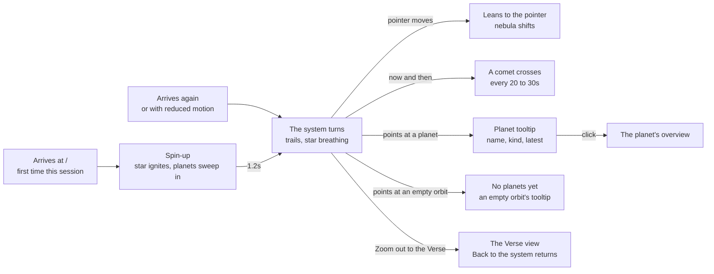
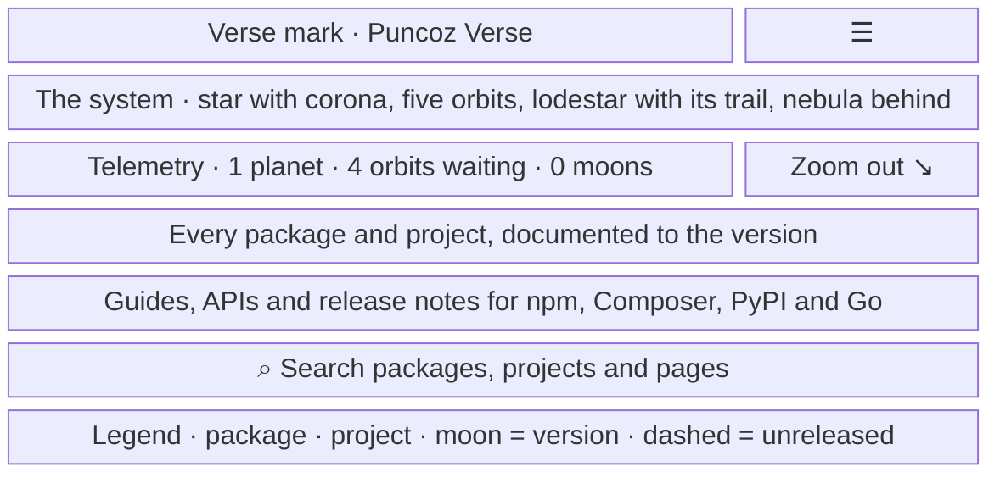
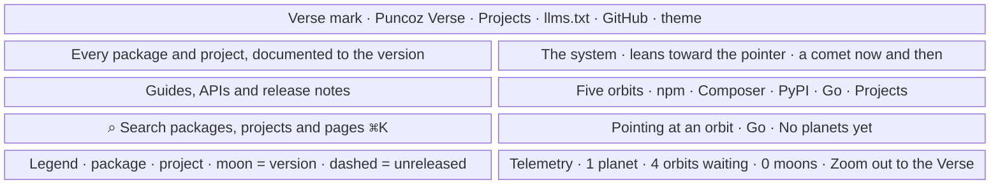

- **Status:** Current
- **Last updated:** 2026-11-01
- **Related ADRs:** [ADR-0032](../adr/ADR-0032-the-heros-system-comes-alive.mdx),
  [ADR-0029](../adr/ADR-0029-the-verse-is-a-still-sky-you-zoom-through.mdx),
  [ADR-0017](../adr/ADR-0017-the-whole-site-is-one-solar-system.mdx)

> Snapshot of the system as it stands today. Edit in place; never record what changed.

How the home page's hero works under ADR-0032. The system draws every ecosystem's orbit, a
living star, planet trails and a still nebula; it spins up on arrival, leans toward the pointer,
names its facts in one data line and sees a comet now and then. Sample values are invented
(ADR-0008). Phone width first.

The flow and each screen are drawn with Archify; the page shows them and its Markdown carries
their Mermaid (ADR-0022). Their sources are in `diagrams/docs/`: `living-hero.json` for the
flow, one `living-hero-screen-<n>.json` per screen.

## Entry points

- **`/`**, from the header's wordmark, *Back to orbit* in the footer, the 404's *Back to the
  system* and any link to the home page. Everyone sees it.
- **`/#verse`** opens the Verse view directly; the system skips the spin-up there.

## Flow

<Diagram src="/diagrams/docs/living-hero.html" title="The living hero">

</Diagram>

## Screens

### 1. `The living hero` — `/`, at phone width

<Diagram src="/diagrams/docs/living-hero-screen-1.html" title="Screen 1 — The living hero">

</Diagram>

The system fills the top 310px: the star with its corona and turning rays, the five orbits (the
empty ones fainter, with their names on the upper left), each planet with its trail, and the
nebula behind, kept inside the system's area. Under it, the telemetry line and *Zoom out to
the Verse*; then the headline, subline, search button and legend, all still.

**States**

- Empty: with no public entries the five orbits are all empty, there are no trails, and the line
  reads `0 planets · 5 orbits waiting · 0 moons`.
- Loading: prerendered text first; the canvas draws after scripts load, spinning up on the first
  view of the session.
- Not found, refused, error: not applicable at `/`. If the canvas cannot draw, the text, the
  search button and the caption show on the plain background.
- Degraded:
  - with reduced motion the system is drawn once: no spin-up, breathing, rays, comet or lean;
    the trails, empty orbits and nebula stay, still;
  - with a touch pointer there is no lean;
  - without scripts there is no canvas and no caption; the search button is replaced by a link
    to the cards, as today;
  - without `sessionStorage` the spin-up runs on every visit.
- Success: the reader sees the whole shape of the site, opens a planet or zooms out.

### 2. `The living hero` — `/`, on a wide screen

<Diagram src="/diagrams/docs/living-hero-screen-2.html" title="Screen 2 — The living hero, wide">

</Diagram>

The text column stands on the left, untouched; the system fills the right, centred at 70% of the
width. Moving the pointer over the hero leans the system up to ±0.05 of tilt and 8px, and shifts
the nebula 12px the other way. A comet crosses the upper part of the system, right of 52% of
the width, its tail pointing away from the star. Pointing near an empty orbit shows its name and
"No planets yet". The telemetry line sits beside *Zoom out to the Verse* at the lower right; in
the Verse view it gives way to *The Verse · one system so far*.

**States**

- Empty: as screen 1.
- Loading: as screen 1.
- Not found, refused, error: not applicable.
- Degraded: as screen 1; in a hidden tab, or with the hero scrolled away, everything pauses.
- Success: the system responds to the pointer, and a planet opens its overview.
