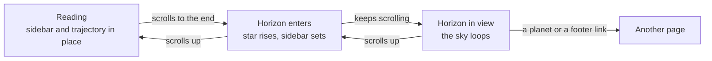
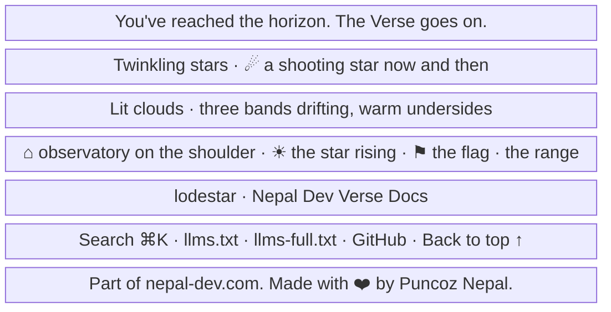
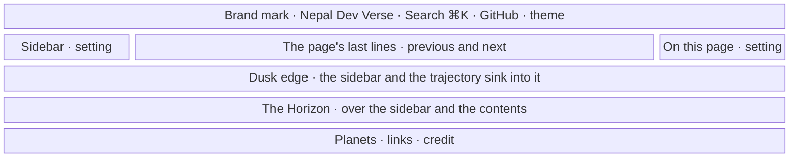

- **Status:** Current
- **Last updated:** 2026-11-03
- **Related ADRs:** [ADR-0037](../adr/ADR-0037-the-horizon-is-the-himalaya.mdx),
  [ADR-0030](../adr/ADR-0030-the-horizon-rises-over-the-page-and-its-sky-comes-alive.mdx),
  [ADR-0018](../adr/ADR-0018-docs-pages-get-orbit-stations-a-trajectory-and-the-full-horizon.mdx),
  [ADR-0017](../adr/ADR-0017-the-whole-site-is-one-solar-system.mdx)

> Snapshot of the system as it stands today. Edit in place; never record what changed.

How the end of every page moves under ADR-0030. The Horizon footer rises over the docs page's
sidebar and trajectory as the reader reaches it, and its sky is alive: twinkling stars, shooting
stars, the star rising with the scroll and drifting lit clouds. What stands under that sky, the
range, the flag and the entries' lights, is in [the Himalayan Horizon](./himalayan-horizon.mdx)
(ADR-0037). Sample values are invented (ADR-0008). Phone width first.

The flow and each screen are drawn with Archify; the page shows them and its Markdown carries
their Mermaid (ADR-0022). Their sources are in `diagrams/docs/`: `living-horizon.json` for the
flow, one `living-horizon-screen-<n>.json` per screen.

## Entry points

- **The end of every page:** docs pages, the home page and the 404. Everyone sees it; there is
  nothing to open or switch.
- **Docs pages on a wide screen**, where the sidebar and the trajectory stand beside the page:
  they set below the horizon as it rises (screen 2). On phones neither stands beside the page.

## Flow

<Diagram src="/diagrams/docs/living-horizon.html" title="The living horizon">

</Diagram>

The loops run only while the footer is on screen; once it leaves, they pause where they are.

## Screens

### 1. `The Horizon` — the end of any page, at phone width

<Diagram src="/diagrams/docs/living-horizon-screen-1.html" title="Screen 1 — The Horizon">

</Diagram>

The closing line stands on the opaque ground above the scene, and the surface rows below it;
nothing moves behind text. In the scene, back to front: stars (some twinkling), two shooting stars on 14- and
23-second cycles, the star rising with the scroll, the far range, three cloud bands looping sideways
over 90, 140 and 200 seconds, the mid range and the near range with the flag waving on its summit and
the observatory standing still on its left shoulder, its slit open toward the star.

**States**

- Empty: with no public planets the planet row is left out; the scene and the links stay.
- Loading: none; the scene is prerendered SVG. Until scripts run, the loops are paused, so the
  scene shows as a still picture with the star risen.
- Not found: the 404 ends with the same Horizon.
- Refused, error: not applicable.
- Degraded:
  - with reduced motion nothing loops or rises;
  - in a browser without scroll-driven animations the star stands risen;
  - in the light theme the clouds take a cool grey body with soft warm undersides;
  - without scripts the scene stays still.
- Success: the reader reaches the end, sees the sky come alive and finds the links below it.

### 2. `The horizon rises` — the end of a docs page, on a wide screen

<Diagram src="/diagrams/docs/living-horizon-screen-2.html" title="Screen 2 — The horizon rises">

</Diagram>

The footer stacks above the sidebar and the trajectory, under the header. As it comes into view,
both drop up to 24px in step with the scroll, at full opacity so their text keeps its contrast
(ADR-0031), and its dusk edge, 96px from clear
to the ground colour, takes them; what is below the horizon is hidden. Scrolling up raises them
again. The page column scrolls as usual.

**States**

- Empty: not applicable; every docs page has a sidebar.
- Loading: none; prerendered.
- Not found, refused, error: not applicable.
- Degraded:
  - with reduced motion, or without scroll-driven animations, the sidebar and the trajectory
    do not drop; the horizon simply covers them at its dusk edge;
  - on a page shorter than the window the footer is in view on arrival, and the sidebar stands
    partly below the horizon; its upper part and its own scrolling still work.
- Success: at the end of the page nothing sits on the closing line or the scene, and the
  sidebar comes back as the reader scrolls up.
