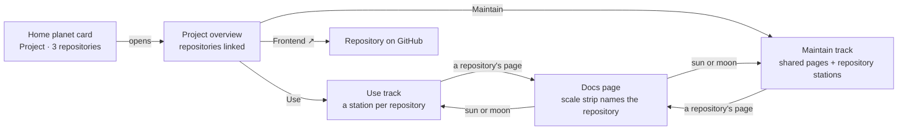
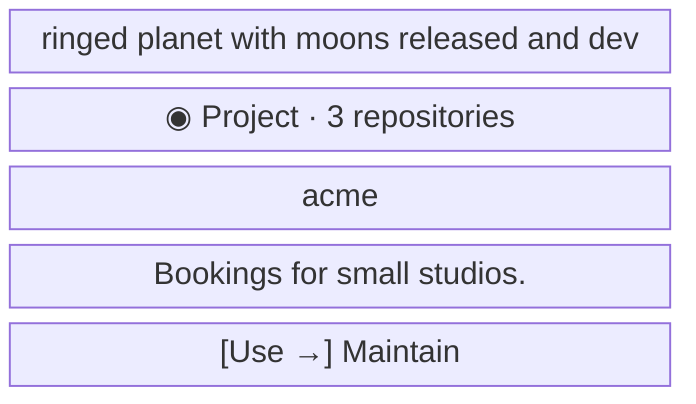
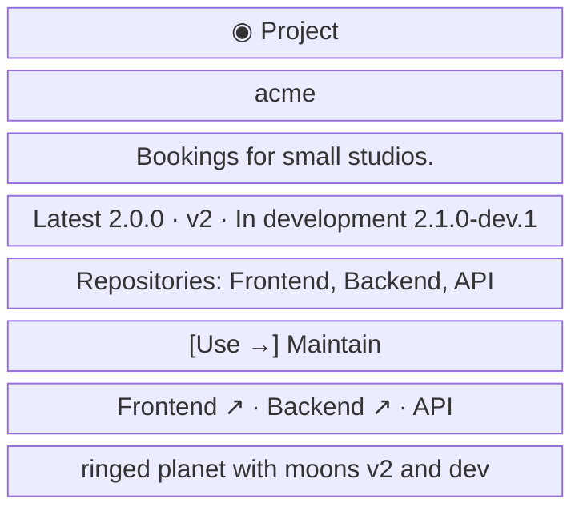
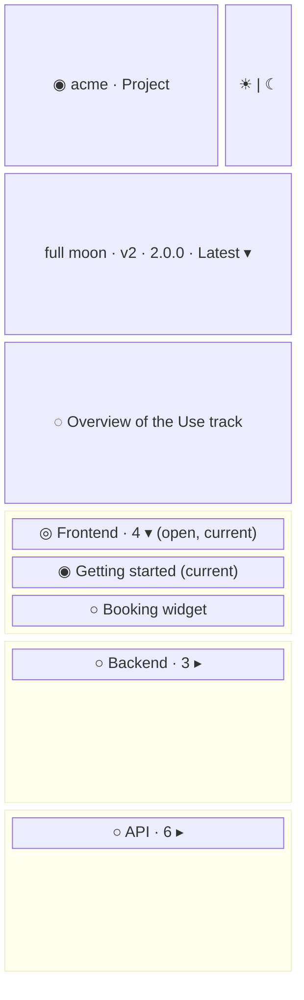
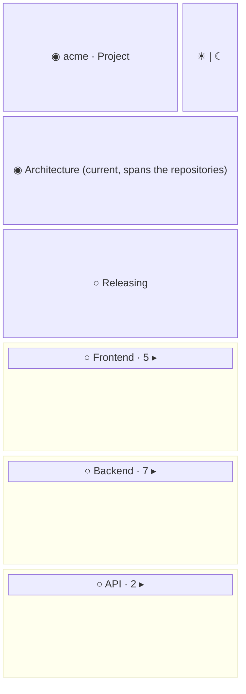

- **Status:** Current
- **Last updated:** 2026-11-01
- **Related ADRs:** [ADR-0024](../adr/ADR-0024-a-project-can-span-several-repositories.mdx),
  [ADR-0023](../adr/ADR-0023-sidebar-stations-open-one-at-a-time.mdx)

> Snapshot of the system as it stands today. Edit in place; never record what changed.

What a reader sees of a project made of several repositories (ADR-0024). Sample values are
invented (ADR-0008): `acme` and its repositories are not real. Phone width first.

The flow and every screen are drawn with Archify; the page shows them and its Markdown carries
their Mermaid (ADR-0022). Their sources are in `diagrams/docs/`:
`multi-repository-projects.json` for the flow, one `multi-repository-projects-screen-<n>.json`
per screen.

## Entry points

- The home page's planet card, search, a direct URL, or a repository's README linking to
  `/acme` or `/acme/use/latest/…`.
- Everyone sees the same; every project here is public (AGENTS.md §6.1).
- The per-page Markdown and `llms.txt` carry each page as today; a page in a repository
  folder sits under that folder in `llms.txt`.

## Flow

<Diagram src="/diagrams/docs/multi-repository-projects.html" title="Multi-repository projects">

</Diagram>

## Screens

### 1. `Home planet card` — `/`

<Diagram src="/diagrams/docs/multi-repository-projects-screen-1.html" title="Screen 1 — Home planet card">

</Diagram>

The kind line adds the number of repositories; a one-repository project shows the kind alone,
as today.

**States**

- Empty: no project, no card (the home page's own empty state).
- Loading: none; the card is prerendered.
- Not found, refused, error: not applicable; a broken catalogue fails the build.
- Degraded: with reduced motion the planet does not turn.
- Success: the card opens the overview.

### 2. `Project overview` — `/acme`

<Diagram src="/diagrams/docs/multi-repository-projects-screen-2.html" title="Screen 2 — Project overview">

</Diagram>

The planet header (`src/components/docs/package-hero.tsx`) links each repository by name,
primary first; *API* has no `url`, so it is named without a link. Desktop: the text on the left,
the planet on the right, as today.

**States**

- Empty: a project without a released line shows *In development* only.
- Loading, refused, error: as every overview.
- Not found: an unknown slug gets the out-of-orbit 404.
- Degraded: a repository without a `url` shows its name only.
- Success: each repository link opens the repository in the same tab.

### 3. `Use track` — the sidebar on `/acme/use/v2/frontend/getting-started`

<Diagram src="/diagrams/docs/multi-repository-projects-screen-3.html" title="Screen 3 — Use track">

</Diagram>

Each repository folder is a station titled with its name; one station is open at a time
(ADR-0023). The moon picker lists at most two moons, the latest line and `dev`.

**States**

- Empty: a repository with no `use/<id>/` has no station here.
- Loading: none; prerendered.
- Not found: a page in a removed line redirects to the same path in the released line.
- Refused, error: not applicable.
- Degraded: an unversioned project has no moon picker.
- Success: a moon opens the repository's page; its scale strip reads *Use ▸ Frontend*, with the
  line's moon and name beside *Use* (ADR-0029).

### 4. `Maintain track` — the sidebar on `/acme/maintain/architecture`

<Diagram src="/diagrams/docs/multi-repository-projects-screen-4.html" title="Screen 4 — Maintain track">

</Diagram>

Pages about the whole project sit on the top-level arc, above the repository stations. Maintain
has no moon picker (it is not versioned).

**States**

- Empty: a project with no `maintain/` has no moon button in the planet row.
- Loading, not found, refused, error: as screen 3.
- Degraded: as screen 3.
- Success: a repository's station opens and the others close; a moon opens its page.
