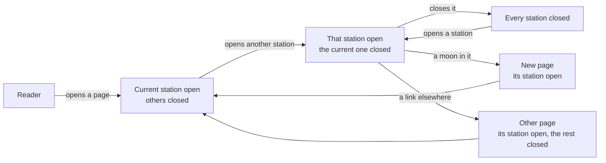
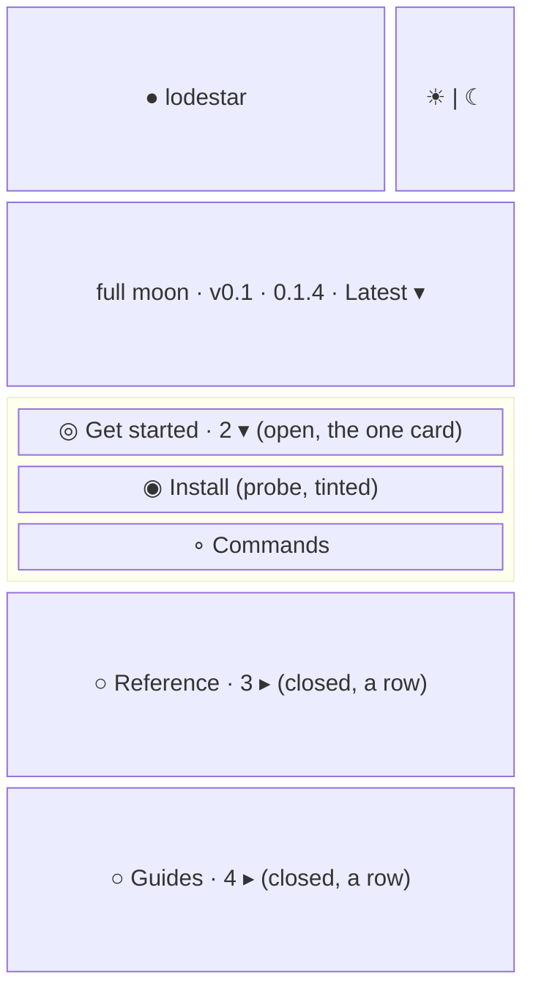
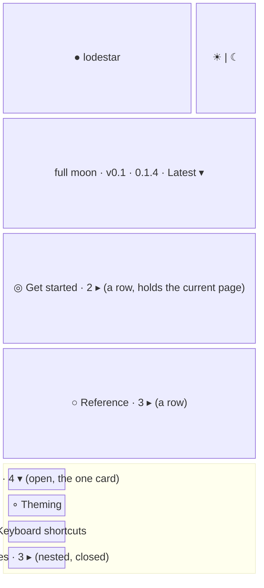

- **Status:** Current
- **Last updated:** 2026-11-01
- **Related ADRs:** [ADR-0023](../adr/ADR-0023-sidebar-stations-open-one-at-a-time.mdx),
  [ADR-0018](../adr/ADR-0018-docs-pages-get-orbit-stations-a-trajectory-and-the-full-horizon.mdx),
  [ADR-0027](../adr/ADR-0027-the-sidebar-is-a-scale-ladder-with-one-lifted-orbit.mdx)

> Snapshot of the system as it stands today. Edit in place; never record what changed.

How the sidebar's orbit stations open and close under ADR-0023: at most one open station
beside another, at every level. Everything else about stations is in
[Docs sidebars](./docs-sidebars.mdx), screen 1. Sample values are invented (ADR-0008):
`lodestar` is not a real package. Phone width first.

The flow and every screen are drawn with Archify; the page shows them and its Markdown carries
their Mermaid (ADR-0022). Their sources are in `diagrams/docs/`: `one-open-station.json` for
the flow, one `one-open-station-screen-<n>.json` per screen.

## Entry points

- Any docs page with stations in its sidebar: on desktop the sidebar column, on phones the
  sidebar drawer from the header.
- Everyone sees the same. The per-page Markdown and `llms.txt` carry no sidebar.

## Flow

<Diagram src="/diagrams/docs/one-open-station.html" title="One open station">

</Diagram>

## Screens

### 1. `Current station open` — the sidebar on `/lodestar/use/v0.1/install`

<Diagram src="/diagrams/docs/one-open-station-screen-1.html" title="Screen 1 — Current station open">

</Diagram>

The orbit holding the current page is open, as the sidebar's one card; the others are closed
rows (ADR-0027).

**States**

- Empty: a track with no folders has no stations.
- Loading: none; the sidebar is prerendered open on the current path. Before scripts load,
  the chevrons do nothing.
- Not found: the out-of-orbit 404 has no sidebar.
- Refused: not applicable; every page is public.
- Error: not applicable at runtime.
- Degraded: with reduced motion, stations open and close without animation.
- Success: one station open, the current page's.

### 2. `Another station opened` — the reader opens Guides on the same page

<Diagram src="/diagrams/docs/one-open-station-screen-2.html" title="Screen 2 — Another station opened">

</Diagram>

Get started drops back to a row as Guides lifts into the card; its ring keeps the ecosystem
colour, because it still holds the current page. Opening the nested Recipes station closes any other nested station
inside Guides, and leaves Guides open. Closing Guides leaves every station closed. Following a
moon or any link to another page opens that page's stations and closes the rest (screen 1 for
the new page).

**States**

- Empty, loading, not found, refused, error: as screen 1.
- Degraded: as screen 1.
- Success: one station open at each level, the one the reader opened last.
