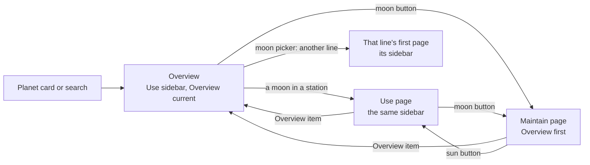
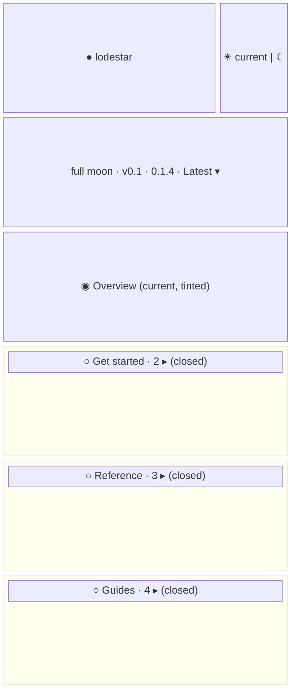
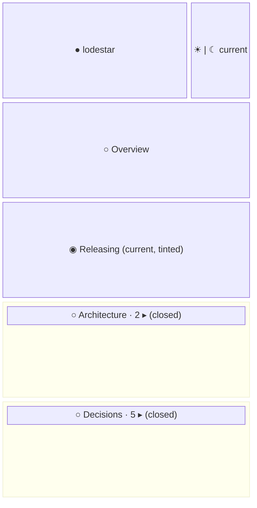
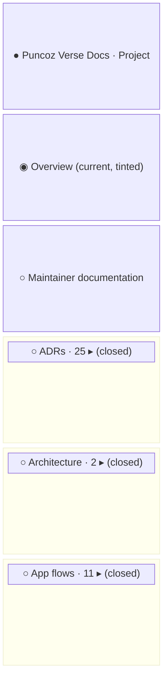

- **Status:** Current
- **Last updated:** 2026-11-01
- **Related ADRs:** [ADR-0025](../adr/ADR-0025-the-overview-has-the-same-sidebar-as-its-tracks.mdx),
  [ADR-0026](../adr/ADR-0026-the-moon-picker-on-an-overview-opens-a-lines-first-page.mdx),
  [ADR-0023](../adr/ADR-0023-sidebar-stations-open-one-at-a-time.mdx),
  [ADR-0013](../adr/ADR-0013-packages-and-projects-share-one-catalogue-shape.mdx)

> Snapshot of the system as it stands today. Edit in place; never record what changed.

What the sidebar shows on an entry's overview, `/<slug>`, under ADR-0025: the same sidebar as
a page of its default track, with an *Overview* item first in every track. Everything else
about stations is in [Docs sidebars](./docs-sidebars.mdx) and
[One open station](./one-open-station.mdx). Sample values are invented (ADR-0008): `lodestar`
is not a real package. Phone width first.

The flow and every screen are drawn with Archify; the page shows them and its Markdown carries
their Mermaid (ADR-0022). Their sources are in `diagrams/docs/`: `overview-sidebar.json` for
the flow, one `overview-sidebar-screen-<n>.json` per screen.

## Entry points

- An entry's overview, `/<slug>`: from a planet card on the home page, a search result, the
  planet chip in the sidebar, or the *Overview* item in any of its tracks.
- On desktop the sidebar column; on phones the sidebar drawer from the header.
- Everyone sees the same. The per-page Markdown and `llms.txt` carry no sidebar.

## Flow

<Diagram src="/diagrams/docs/overview-sidebar.html" title="The overview's sidebar">

</Diagram>

## Screens

### 1. `Overview` — the sidebar on `/lodestar`

<Diagram src="/diagrams/docs/overview-sidebar-screen-1.html" title="Screen 1 — Overview">

</Diagram>

The sidebar of the latest Use line: the planet row with the sun current, the moon picker,
*Overview* as the current page on the top-level arc, then the line's stations, all closed. The
page beside it is unchanged: the planet header, then the entry's own overview. Opening a
station closes any other (ADR-0023); a moon in it opens that page with the same sidebar. The
moon picker lists every line, the latest checked; another line opens that line's first page,
since the overview is the same page in every line.

**States**

- Empty: an entry whose Use has no folders shows *Overview* and its top-level pages only.
- Loading: none; prerendered.
- Not found: an unknown slug gets the out-of-orbit 404, with no sidebar.
- Refused: not applicable; every page is public.
- Error: a malformed catalogue fails the build, so it never reaches readers.
- Degraded: search unavailable shows the dialog's notice; the sidebar works.
- Success: the reader sees the Use sidebar they will keep on every Use page.

### 2. `Maintain page` — the sidebar on `/lodestar/maintain/releasing`

<Diagram src="/diagrams/docs/overview-sidebar-screen-2.html" title="Screen 2 — Maintain page">

</Diagram>

Maintain's sidebar, as today, with *Overview* first on the arc. The moon is current; the sun
opens the Use line's first page. *Overview* returns to screen 1.

**States**

- Empty, loading, not found, refused, error, degraded: as screen 1.
- Success: Maintain's stations, with the overview one click away.

### 3. `Maintain-only overview` — the sidebar on `/docs`

<Diagram src="/diagrams/docs/overview-sidebar-screen-3.html" title="Screen 3 — Maintain-only overview">

</Diagram>

An entry with Maintain only, like this site: the overview shows Maintain's sidebar, with
*Overview* current above Maintain's own first page. The planet row is the chip alone, with no
sun or moon, and there is no moon picker, as on its Maintain pages today.

**States**

- As screen 1.
- Success: the same sidebar as every Maintain page of the entry.
