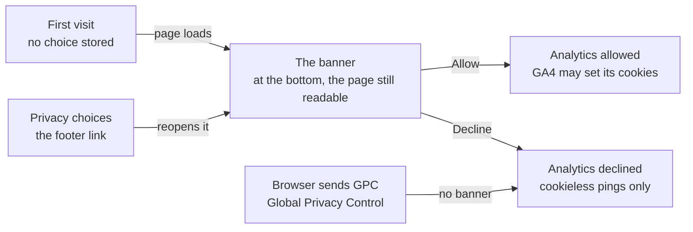
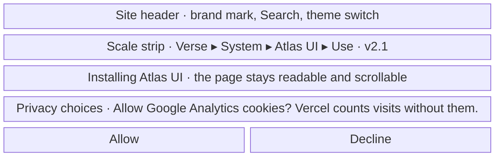
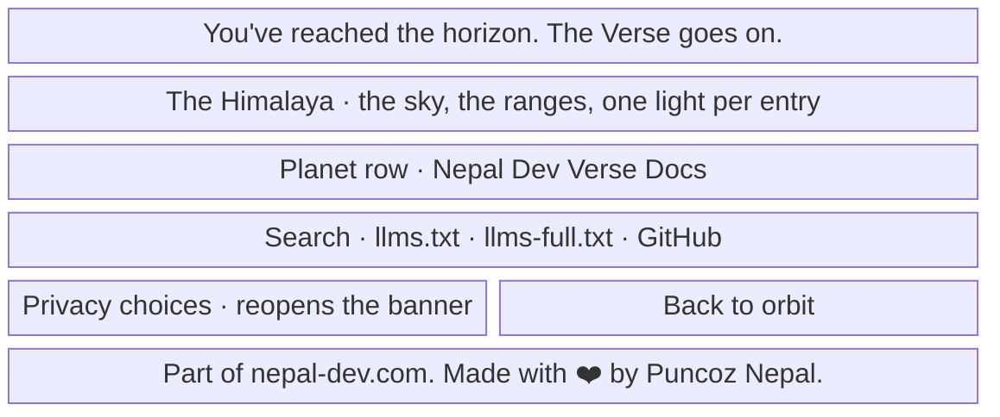

- **Status:** Current
- **Last updated:** 2026-11-04
- **Related ADRs:** [ADR-0041](../adr/ADR-0041-readers-are-counted-by-vercel-and-by-google-with-consent.mdx)

> Snapshot of the system as it stands today. Edit in place; never record what changed.

On a first visit a small banner asks whether Google Analytics may set cookies. Vercel counts visits without cookies either way. The
reader can change the answer from the footer of any page. Package names and dates below are invented samples (ADR-0008). Phone width
first.

The flow and each screen are drawn with Archify; the page shows them and its Markdown carries their Mermaid (ADR-0022). Their sources are
in `diagrams/docs/`: `privacy-choices.json` for the flow, one `privacy-choices-screen-<n>.json` per screen.

## Entry points

- **Any page of the site, on a first visit:** docs pages, the home page and the 404.
- **Privacy choices** in the Horizon's link row, on every page.
- **Who does not see it:** readers whose browser sends Global Privacy Control (declined without asking; the footer link still works);
  readers with scripts off (no analytics runs for them); every page when the site is built without a Google Analytics ID. Markdown
  surfaces carry neither banner nor analytics.

## Flow

<Diagram src="/diagrams/docs/privacy-choices.html" title="Privacy choices">

</Diagram>

## Screens

### 1. `The banner on a first visit` — any page, at phone width

<Diagram src="/diagrams/docs/privacy-choices-screen-1.html" title="Screen 1 — The banner on a first visit">

</Diagram>

The banner's full words: **Privacy choices.** *Allow Google Analytics cookies? They help us see which pages are read. Vercel counts
visits without cookies either way.* On desktop it is a card at the bottom right, the same words and buttons side by side.

**States**

- Empty: no choice stored, which is what this screen shows.
- Loading: none. It appears after hydration, without a placeholder in the static HTML.
- Not found: the 404 shows the same banner.
- Refused: Global Privacy Control is on, so the banner never shows and the choice is *declined*.
- Error: storage is blocked. The answer holds for this page, analytics stays denied, and the banner asks again on the next page.
- Degraded: Google's script is blocked or fails. The banner still shows and records the choice; nothing else changes.
- Success: *Allow* or *Decline* closes the banner and stores the choice for 12 months. Left unanswered, it shows again on the next page.

### 2. `Privacy choices in the footer` — the end of any page, at phone width

<Diagram src="/diagrams/docs/privacy-choices-screen-2.html" title="Screen 2 — Privacy choices in the footer">

</Diagram>

**States**

- Empty: built without a Google Analytics ID, the link is absent and the row is as it is today.
- Loading: none. The link appears after hydration.
- Not found: the 404's footer has the same link.
- Refused, error: not applicable. The link only opens the banner.
- Degraded: with scripts off, the link is absent, and no analytics runs.
- Success: the banner opens with the current choice in a line above the buttons, "You allowed analytics on 4 Nov 2026.", and a new
  answer replaces it.
