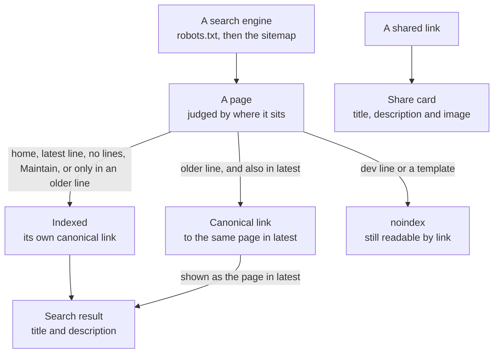
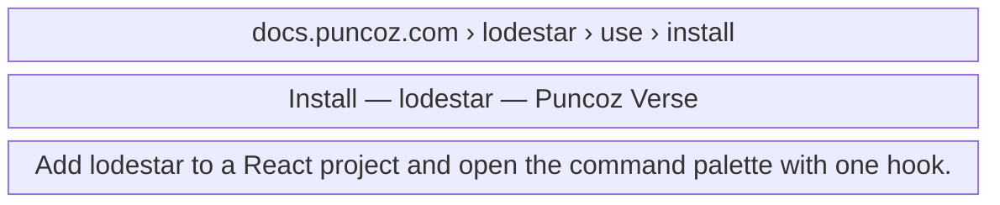
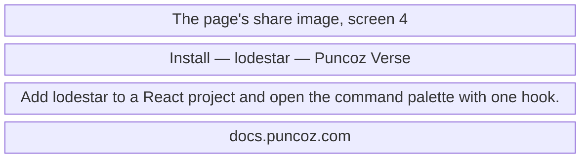
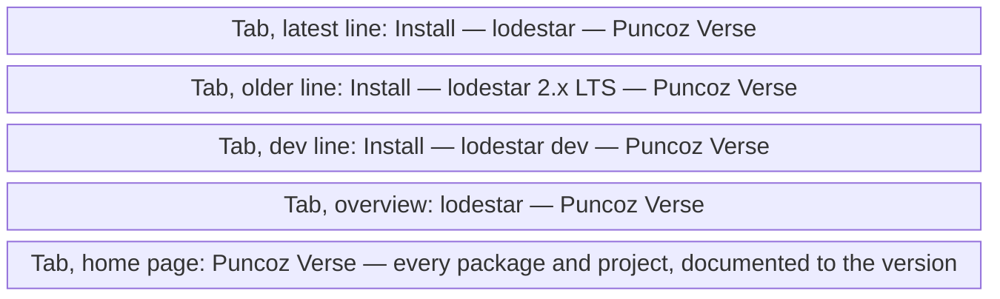
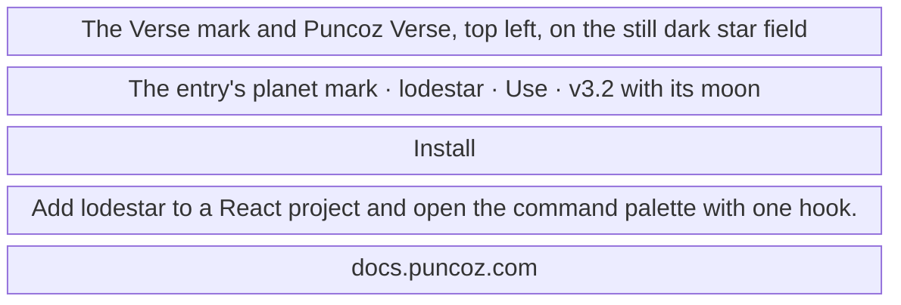
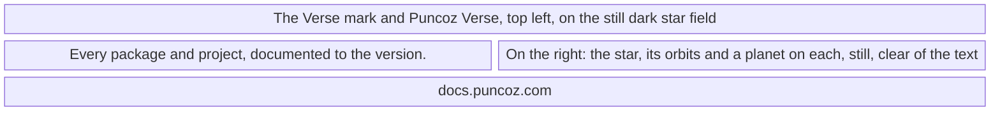

- **Status:** Current
- **Last updated:** 2026-11-03
- **Related ADRs:** [ADR-0035](../adr/ADR-0035-every-page-is-ready-for-search-and-sharing.mdx),
  [ADR-0034](../adr/ADR-0034-the-proxy-answers-unknown-paths-with-a-true-404.mdx),
  [ADR-0015](../adr/ADR-0015-every-entry-lives-at-the-root-in-one-shape-and-one-look.mdx)

> Snapshot of the system as it stands today. Edit in place; never record what changed.

What a person sees of a page before opening it, or outside it: the browser tab, a search result and
the card when a link is shared. Inside a page, one thing shows: its description, under its title. Sample values are invented (ADR-0008),
including the package `lodestar`. Phone width first.

The flow and the screens are drawn with Archify; the page shows them and its Markdown carries their
Mermaid (ADR-0022). Their sources are in `diagrams/docs/`: `search-and-sharing.json` for the flow and
`search-and-sharing-screen-1.json` to `-screen-5.json` for the screens.

## Entry points

- **A search engine:** a person searches, and sees the page's title and description.
- **A shared link:** pasted into a chat or a post, which shows the page's card.
- **Any open page:** its title in the browser tab, in history and in bookmarks.
- **Not here:** the 404, which stays out of search; Markdown copies, `llms.txt`, `static.json` and
  diagram frames, which stay readable by tools but out of search results.

## Flow

<Diagram src="/diagrams/docs/search-and-sharing.html" title="Search and sharing">

</Diagram>

## Screens

### 1. Search result, at phone width

<Diagram src="/diagrams/docs/search-and-sharing-screen-1.html" title="Screen 1 — Search result">

</Diagram>

How the result is laid out is the search engine's choice; the site supplies the words.

**States**

- Empty: not applicable; the build refuses a page without a description.
- Loading: not applicable.
- Not found: a removed page answers 404 and drops out over time.
- Refused: a `dev` page or a template is `noindex`, so it has no result.
- Error: not applicable.
- Degraded: with no `SITE_URL`, as on a preview or a local build, every page is `noindex`.
- Success: the reader opens the page. A search for an older version's page usually leads to the same
  page in latest, where the version menu is one click away.

### 2. Share card, at phone width

<Diagram src="/diagrams/docs/search-and-sharing-screen-2.html" title="Screen 2 — Share card">

</Diagram>

The home page's card has its own image, screen 5. The layout is the sharing app's choice.

**States**

- Empty: not applicable; every page has an image and a description.
- Loading: the sharing app fetches the card; the site does nothing.
- Not found: an unknown path has no card of its own, only the title *Page not found*.
- Refused, error: not applicable.
- Degraded: with no `SITE_URL` the image's address is a local one, so the app shows no image. This
  is only ever a preview or a local build.
- Success: the card shows, and opening it leads to the page.

### 3. Browser tab, at phone width

<Diagram src="/diagrams/docs/search-and-sharing-screen-3.html" title="Screen 3 — Browser tab">

</Diagram>

**States**

- Empty, loading, refused, error, degraded: not applicable; the title is in the page's HTML.
- Not found: *Page not found — Puncoz Verse*.
- Success: the tab, history and bookmarks name the page, its package and the site.

### 4. A page's share image, at its fixed 1200 by 630

<Diagram src="/diagrams/docs/search-and-sharing-screen-4.html" title="Screen 4 — A page's share image">

</Diagram>

Always in the dark theme's colours, because an image cannot follow the reader's theme. A project has
a ringed planet and a package a solid one, as everywhere on the site. Maintain has no moon, and a
long title is set smaller rather than cut.

**States**

- Empty: a page outside a track, such as an overview, has no track or moon in its kicker.
- Loading: none; every image is made at build.
- Not found: an unknown path's image address answers 404.
- Refused, error: a font that cannot be fetched fails the build rather than publishing a wrong image.
- Degraded: with no `SITE_URL` the image leaves out the domain.
- Success: the image shows in the sharing app's card.

### 5. The home page's share image, at its fixed 1200 by 630

<Diagram src="/diagrams/docs/search-and-sharing-screen-5.html" title="Screen 5 — The home page's share image">

</Diagram>

**States**

- Empty: with nothing documented, the orbits are drawn with no planets on them.
- Loading: none; the image is made at build.
- Not found, refused: not applicable.
- Error: as screen 4.
- Degraded: as screen 4.
- Success: the image shows in the sharing app's card.
