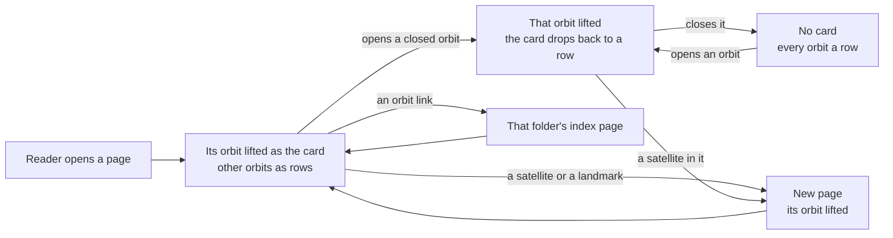
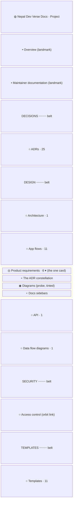
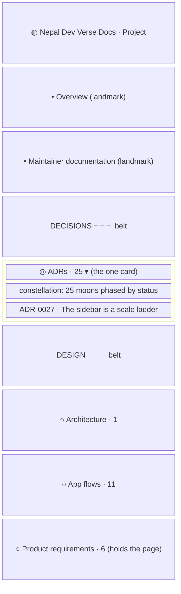
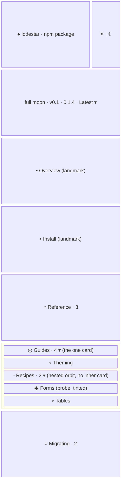

- **Status:** Current
- **Last updated:** 2026-11-01
- **Related ADRs:** [ADR-0027](../adr/ADR-0027-the-sidebar-is-a-scale-ladder-with-one-lifted-orbit.mdx),
  [ADR-0023](../adr/ADR-0023-sidebar-stations-open-one-at-a-time.mdx),
  [ADR-0025](../adr/ADR-0025-the-overview-has-the-same-sidebar-as-its-tracks.mdx),
  [ADR-0019](../adr/ADR-0019-adr-folders-show-as-a-constellation-in-the-sidebar.mdx)

> Snapshot of the system as it stands today. Edit in place; never record what changed.

How the docs sidebar is drawn under ADR-0027. Each level is a smaller body than the one above it:
the planet (the entry), its moon (the version line), landmark satellites (top-level pages),
belts (groups), orbits (folders) and satellites (pages), with the current page as the probe.
Only the open orbit is a card. Sample values are invented (ADR-0008): `lodestar` is not a real
package; this site's own Maintain track is shown with its real sections. Phone width first.

The flow and every screen are drawn with Archify; the page shows them and its Markdown carries
their Mermaid (ADR-0022). Their sources are in `diagrams/docs/`: `sidebar-scale-ladder.json`
for the flow, one `sidebar-scale-ladder-screen-<n>.json` per screen.

## Entry points

- Every docs page: on desktop the sidebar column, on phones the sidebar drawer from the header.
- Everyone sees the same. The per-page Markdown and `llms.txt` carry no sidebar.

## Flow

<Diagram src="/diagrams/docs/sidebar-scale-ladder.html" title="The sidebar's scale ladder">

</Diagram>

## Screens

### 1. `Maintain page` — the sidebar on `/docs/maintain/prd/diagrams`

<Diagram src="/diagrams/docs/sidebar-scale-ladder-screen-1.html" title="Screen 1 — Maintain page">

</Diagram>

The planet row, then the two landmarks at full size, then the belts with their orbits. Only
*Product requirements* is a card, because it holds the current page; its border takes the
ecosystem colour. *Access control* holds only its index, so it is an orbit link with no count.
The rows between *Data flow diagrams* and *Access control* (Sequence diagrams, State machines,
ERD) are left out of the drawing.

**States**

- Empty: a track with no folders shows only its landmarks; a track without separators shows no
  belts.
- Loading: none; prerendered with the current orbit lifted. Before scripts load, the chevrons
  do nothing.
- Not found: the out-of-orbit 404 has no sidebar.
- Refused: not applicable; every page is public.
- Error: a malformed `meta.json` fails the build, so it never reaches readers.
- Degraded: with reduced motion an orbit lifts and drops without animation. A project has no
  ecosystem colour, so its tint is the signal teal.
- Success: one card, the current page's orbit, with the probe on it.

### 2. `Another orbit opened` — the reader opens ADRs on the same page

<Diagram src="/diagrams/docs/sidebar-scale-ladder-screen-2.html" title="Screen 2 — Another orbit opened">

</Diagram>

*ADRs* lifts into the card and shows its constellation (ADR-0019); *Product requirements* drops
back to a row, its ring still in the ecosystem colour because it holds the current page. Closing
*ADRs* leaves no card.

**States**

- As screen 1.
- Success: one card, the orbit the reader opened last.

### 3. `Use page with a nested orbit` — the sidebar on `/lodestar/use/v0.1/guides/recipes/forms`

<Diagram src="/diagrams/docs/sidebar-scale-ladder-screen-3.html" title="Screen 3 — Use page with a nested orbit">

</Diagram>

A package line without separators: no belts. *Recipes* is a nested orbit inside the *Guides*
card, opened in place with its satellites indented; there is no card inside the card. Opening
another nested orbit in *Guides* closes *Recipes* (ADR-0023).

**States**

- As screen 1.
- Success: the current page's orbit and nested orbit open, the probe on *Forms*.
