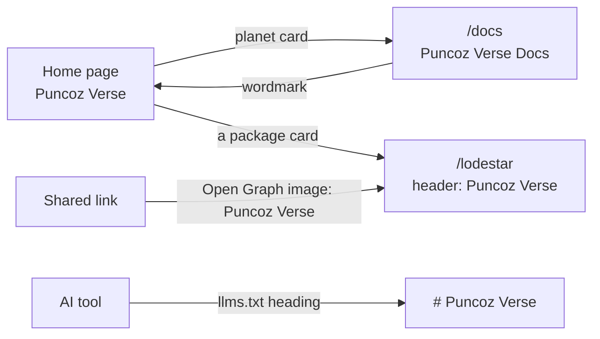
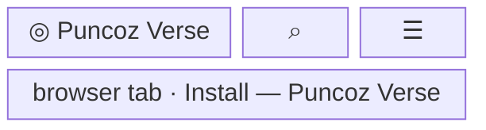
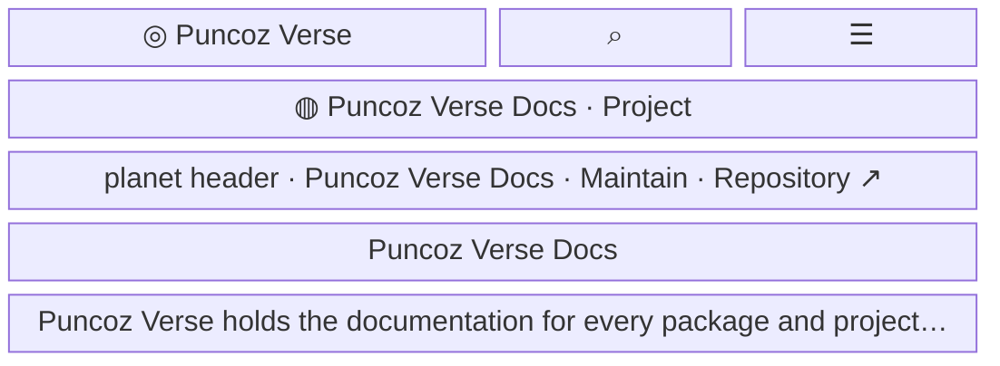

- **Status:** Current
- **Last updated:** 2026-11-01
- **Related ADRs:** [ADR-0028](../adr/ADR-0028-the-site-is-named-puncoz-verse.mdx)

> Snapshot of the system as it stands today. Edit in place; never record what changed.

Where readers see the site's name under ADR-0028. The site is *Puncoz Verse*; its own
documentation, the project with the slug `docs`, is *Puncoz Verse Docs*. Nothing moves and no
URL changes. Sample values are invented (ADR-0008): `lodestar` is not a real package. Phone
width first.

The flow and every screen are drawn with Archify; the page shows them and its Markdown carries
their Mermaid (ADR-0022). Their sources are in `diagrams/docs/`: `site-name.json` for the flow,
one `site-name-screen-<n>.json` per screen.

## Entry points

- Every page: the header's wordmark, the browser tab's title, the Open Graph image when a page
  is shared.
- `/docs` and its pages: the project's planet card on the home page, its planet header and its
  sidebar chip.
- `llms.txt` and `llms-full.txt`: the index heading.
- Everyone sees the same.

## Flow

<Diagram src="/diagrams/docs/site-name.html" title="The site's name">

</Diagram>

## Screens

### 1. `Header` — every page

<Diagram src="/diagrams/docs/site-name-screen-1.html" title="Screen 1 — Header">

</Diagram>

The wordmark reads *Puncoz Verse* beside the brand mark and links home. On the home page the tab
reads *Puncoz Verse — every package and project, documented to the version*; on the 404, *Page not
found — Puncoz Verse*.

**States**

- Empty, loading, not found, refused, error, degraded: the header does not change with them; the
  404 keeps the header with the new name.
- Success: the name reads the same on every page.

### 2. `This site's overview` — `/docs`

<Diagram src="/diagrams/docs/site-name-screen-2.html" title="Screen 2 — This site's overview">

</Diagram>

The header names the site; the sidebar chip, the planet header and the page title name this
site's own documentation. Its home page card reads *Puncoz Verse Docs* too.

**States**

- As screen 1. The search dialog lists the project as *Puncoz Verse Docs* after the next publish.
- Success: the site and its own documentation are told apart.
