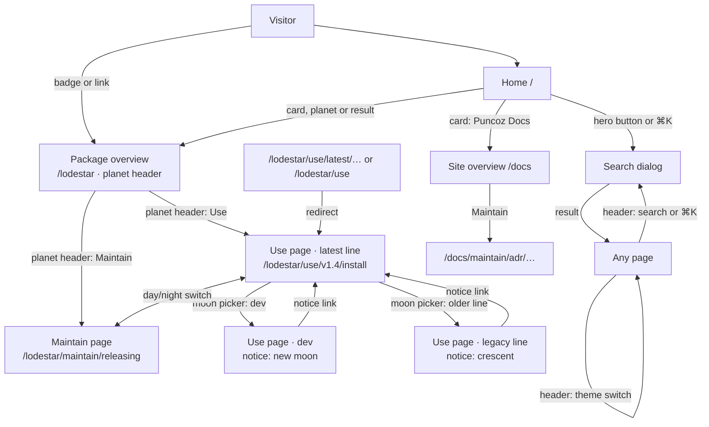
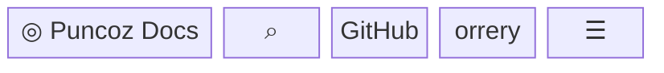
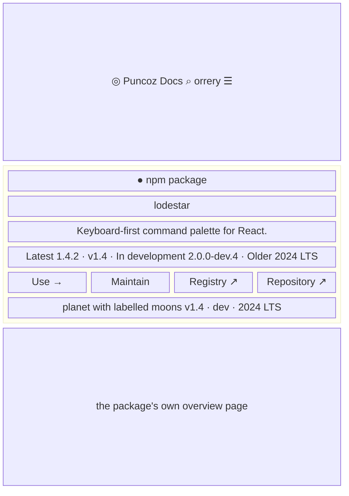
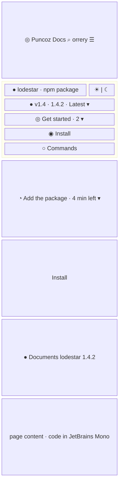
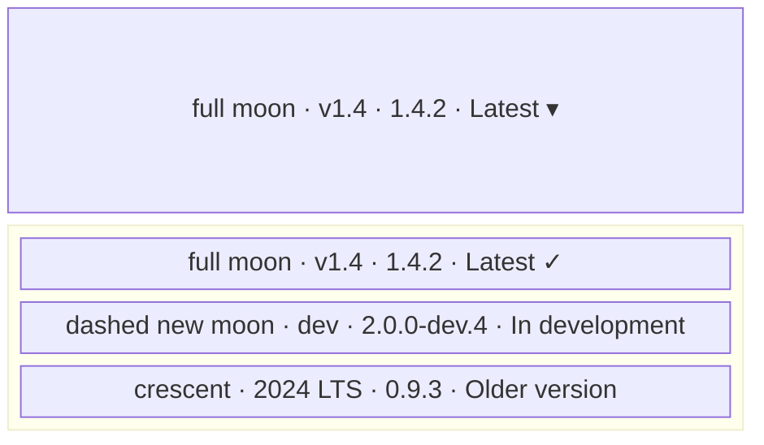
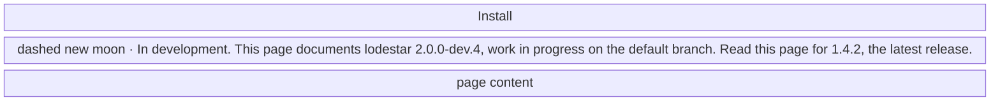
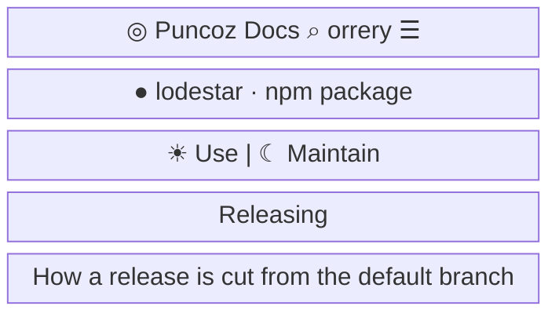
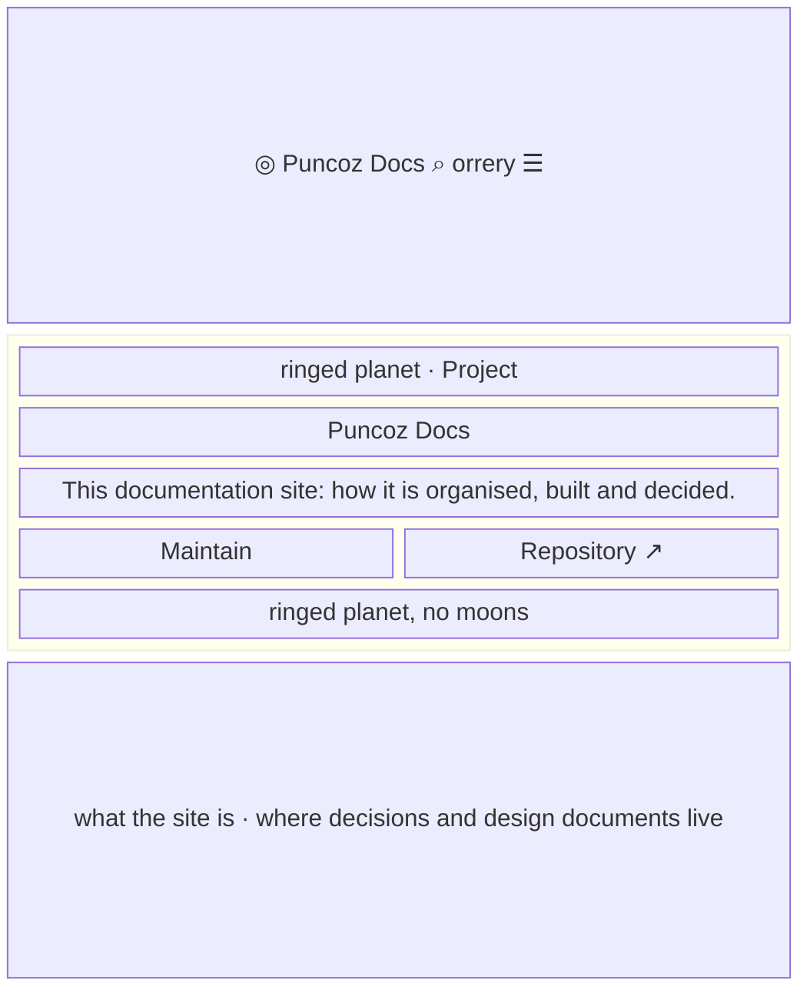

- **Status:** Current
- **Last updated:** 2026-11-01
- **Related ADRs:** [ADR-0018](../adr/ADR-0018-docs-pages-get-orbit-stations-a-trajectory-and-the-full-horizon.mdx),
  [ADR-0017](../adr/ADR-0017-the-whole-site-is-one-solar-system.mdx),
  [ADR-0016](../adr/ADR-0016-home-search-is-the-fumadocs-dialog-and-private-projects-render-server-side.mdx),
  [ADR-0015](../adr/ADR-0015-every-entry-lives-at-the-root-in-one-shape-and-one-look.mdx),
  [ADR-0013](../adr/ADR-0013-packages-and-projects-share-one-catalogue-shape.mdx),
  [ADR-0014](../adr/ADR-0014-home-page-is-a-search-first-release-map.mdx)

> Snapshot of the system as it stands today. Edit in place; never record what changed.

What a person sees and how they move through it: the root URLs, the header and the docs pages
(ADR-0015), drawn in the site's solar-system look (ADR-0017). The look's shared pieces, the
theme switch, the planet header, the sidebar's planet row and moon picker, the notices, the
footer and the 404, are drawn in [The solar system](./solar-system.mdx); the sidebar's stations
and "On this page" in [Docs sidebars](./docs-sidebars.mdx). Sample values are
invented (ADR-0008): `lodestar`, `ledgerly` and `orbit-board` are not real packages or projects.
Phone width first; desktop differences are noted under each screen.

Every package and project lives at `/<slug>`. Inside it, **Use** holds the user docs, one line
per release, each named by the package, plus `dev` for work in progress, and **Maintain**
holds the maintainer docs. This
site is the project `docs`: its overview is `/docs` and its ADRs and design documents are its
Maintain track, `/docs/maintain/…`. Every page, the home page included, shares one header with
the orrery theme switch; docs pages add a search button, and use the home page's colours and
type without its motion.

The flow is made with Archify. Its source is `.archify/site-pages-20261031/candidate.json`.
Until ADR-0011 is approved, the HTML stays in that folder and is not published.

## Entry points

- The home page: a planet card, a planet on the system or a search result opens `/<slug>` or one of its
  pages.
- The header on every page: the wordmark (home), Packages and Projects (their groups on the home
  page, `/#packages` and `/#projects`), `llms.txt`, GitHub. On docs pages, the search button; on
  every page, `⌘K` opens the search dialog (on the home page, the hero's button opens it too).
- A README or registry badge: `/<slug>` or the stable `/<slug>/use/latest/<page>`.
- A direct URL: `/<slug>/use/v1.4/install`, `/<slug>/use/dev/install`, `/<slug>/maintain/releasing`,
  or the Markdown version with `.md`.
- Everyone sees every public package and project. Private projects have no pages until the
  private-documentation ADR; a private URL then gets the same 404 as a missing page.

## Flow

## Screens

### 0. `Header` — on every page

Phone width: the wordmark (a ringed planet with the star's light on it), then 36px icon buttons:
search (docs pages only), GitHub, the theme switch (40px wide) and, on docs pages, a menu button that opens the sidebar. The nav links are hidden; on
the home page its own sections carry them.

Desktop: wordmark · Packages · Projects · `llms.txt` · a search button showing `⌘K` (docs pages
only; the home page's hero holds its search) · GitHub · the theme switch. Sticky. On docs pages
it carries a hairline border; on the home page it gains one once the page scrolls.

**States**

- Empty: with no package, Packages is not shown; with no project, Projects is not shown.
- Loading: none; prerendered. The theme switch shows the current theme from first paint.
- Not found, Refused: not applicable.
- Error: none at runtime.
- Degraded: search unavailable shows the dialog's notice; without scripts the search trigger and
  the theme switch don't respond, and the page keeps the default dark theme.
- Success: the switch flips light and dark on the spot and the choice holds on the next page and
  the next visit.

### 1. `Package overview` — `/<slug>`

The planet header ([The solar system](./solar-system.mdx), screen 2): the planet mark and a
faint wash take the ecosystem colour; a project is a ringed planet. Desktop: the text on the
left, the planet and its labelled moons on the right; the sidebar shows the planet row and its
stations, "On this page" the overview's headings on its trajectory.

**States**

- Empty: an unreleased package reads Latest "unreleased" and draws only its dashed `dev` moon;
  a project without lines has no fact sheet and no moons; a missing track, registry or
  repository has no link.
- Loading: none; prerendered.
- Not found: an unknown slug shows the site's 404.
- Refused: not applicable until private documentation exists.
- Error: a malformed catalogue field fails the build.
- Degraded: as the header.
- Success: the reader sees what the package is, its current and unreleased versions, and both
  tracks one click away.

### 2. `Use page` — `/<slug>/use/<line>/<page>`

The drawer is the sidebar, opened from the header's menu button. Its top holds the planet row
(the chip linking to the overview, a sun for Use and a moon for Maintain) and the moon picker;
below, each folder is an orbit station whose pages are moons on an arc, the current page the
teal planet ([Docs sidebars](./docs-sidebars.mdx), screen 1). Under the header, the "On this
page" bar shows the reading position and time left (screen 3 there). The sun, moon and dot
characters in the wireframes stand for drawn SVG marks. Desktop: the sidebar on the left, the
page in the middle, the trajectory on the right. Headings in Bricolage Grotesque, text in Onest,
code on the panel colour.

**States**

- Empty: a line with only its index page shows that page and a one-link sidebar.
- Loading: none; prerendered.
- Not found: a missing page gets the site's 404; a removed line redirects to the same page in
  `latest`.
- Refused: not applicable today.
- Error: the site's error page; no raw error text.
- Degraded: as the header.
- Success: the page, with its line selected and Use highlighted.

### 3. `Moon picker` — opened from the sidebar

Latest first, then `dev`, then older lines in the order `use/meta.json` gives, or newest
version first. Each option shows its line's moon, the line's name as the package set it, its
version, and its channel in words.

**States**

- Empty: an unreleased package lists only `dev`.
- Success: choosing a line opens the same page in that line when it exists, otherwise that
  line's first page.

### 4. `In development or older page` — `/<slug>/use/dev/<page>`, `/<slug>/use/2024-lts/<page>`

An older line shows a crescent and reads "Older version. This page documents lodestar 0.9.3.
Read this page for 1.4.2, the latest release."

**States**

- Success: the notice links to the same page in `latest`, or that line's first page. An
  unreleased package's `dev` notice has no link.
- Other states: as the Use page.

### 5. `Maintain page` — `/<slug>/maintain/<page>`

Not versioned: no moon picker and no version line.

**States**

- Empty: a package without a Maintain track has no switch; its Maintain URLs get the 404.
- Other states: as the Use page.

### 6. `Site overview` — `/docs`

The site's own entry has the project's planet header with a Maintain link and its repository. Its Maintain
track holds
the ADRs, architecture, app flows, PRDs, API, data flow, sequence, state, ERD, RBAC, security
and templates, in today's order.

**States**

- Empty: not applicable; the site always has its Maintain track.
- Other states: as the package overview.

### 7. `Theme switch` and `Footer`

Drawn in [The solar system](./solar-system.mdx): the orrery theme switch (screen 1) and, below
every docs page, the full Horizon footer (screen 5).
