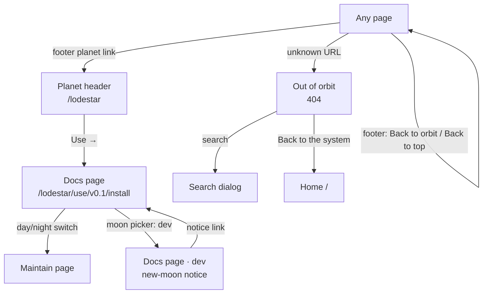
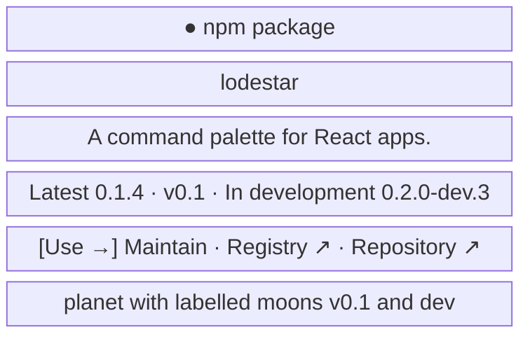
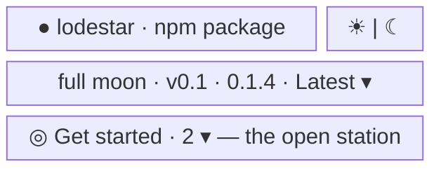
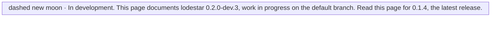
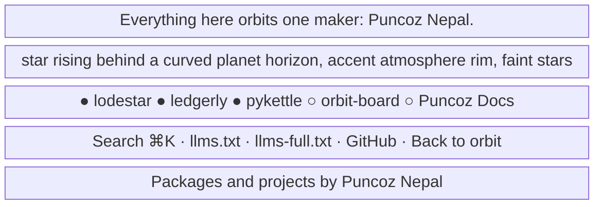
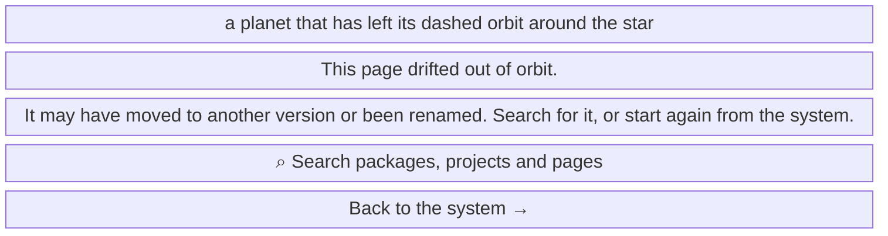

- **Status:** Current
- **Last updated:** 2026-11-01
- **Related ADRs:** [ADR-0018](../adr/ADR-0018-docs-pages-get-orbit-stations-a-trajectory-and-the-full-horizon.mdx),
  [ADR-0017](../adr/ADR-0017-the-whole-site-is-one-solar-system.mdx),
  [ADR-0016](../adr/ADR-0016-home-search-is-the-fumadocs-dialog-and-private-projects-render-server-side.mdx),
  [ADR-0015](../adr/ADR-0015-every-entry-lives-at-the-root-in-one-shape-and-one-look.mdx),
  [ADR-0013](../adr/ADR-0013-packages-and-projects-share-one-catalogue-shape.mdx)

> Snapshot of the system as it stands today. Edit in place; never record what changed.

The look every page shares (ADR-0017). The home page's own screens are in
[Home page](./home-page.mdx); the routes, header and docs page layout are in
[Site pages](./site-pages.mdx); the sidebar's stations and "On this page" in
[Docs sidebars](./docs-sidebars.mdx). Sample values are invented (ADR-0008): `lodestar`, `ledgerly`
and `orbit-board` are not real packages or projects. Phone width first; desktop differences are
noted under each screen.

## The marks

One metaphor, stated once and used everywhere:

| Mark | Means | Where |
|---|---|---|
| The star, labelled "Puncoz Nepal" | the maker | the home page's system, the footer's horizon, the 404 |
| An orbit | an ecosystem | the home page's system |
| A solid planet in an ecosystem colour, its night side shaded | a package | the system, cards, planet header, sidebar chip, footer |
| A ringed planet | a project | the same places |
| A full moon | the latest release | cards, planet header, moon picker, version line, Every moon |
| A small orbit with a planet on it | a section of pages, an orbit station | the docs sidebar |
| A moon dot on an arc | a page; the current page is the teal planet | the docs sidebar |
| A small planet riding a curved path | the reader's place on the page | "On this page" |
| A crescent | an older release | the same places |
| A dashed new moon | `dev`, in development | the same places |
| The day side, a drawn sun | Use | Two sides, the sidebar's switch |
| The night side, a drawn moon | Maintain | the same places |

The hero's legend teaches these once. Every mark is drawn SVG (`src/components/planet.tsx`):
`PlanetMark`, `MoonPhase` and `PlanetSystem`. The star uses `--home-star`, an unlit face
`--home-night`.

The flow is made with Archify. Its source is `.archify/solar-system-20261101/candidate.json`.
Until ADR-0011 is approved, it stays in that folder and is not published.

## Entry points

- The theme switch and the footer are on every page. The planet header opens every package and
  project overview; the sidebar's planet row and moon picker are on every page
  inside a package or project; the notices are on `dev` and older lines; the 404 is at every
  unknown path.
- Everyone sees the same pages.

## Flow

## Screens

### 1. `Theme switch` — the header, every page

```mermaid
block-beta
  columns 2
  dark["Dark, the night side: sun behind the planet, small; planet a thin crescent · name: Switch to day side (light theme)"]:1
  light["Light, the day side: sun in front; planet fully lit · name: Switch to night side (dark theme)"]:1
```

A 40 × 36px button (`src/components/theme-switch.tsx`): a tilted orbit, a sun on it, a planet
with a terminator. A click switches the theme; the sun moves along its orbit and the shadow
sweeps across the planet over half a second. A tooltip under the button repeats its accessible
name in short ("Night side · switch to day").

**States**

- Before hydration: the drawing follows the `dark` class next-themes sets before paint, so it
  never flashes; the accessible name starts as the dark one.
- Hover or focus: the tooltip shows (not on touch screens).
- Degraded: with reduced motion the drawing switches instantly. Without scripts the button does
  nothing and the site stays dark.
- Success: the theme and the drawing change together, and the choice holds across pages and
  visits in that browser.

### 2. `Planet header` — `/lodestar`

Above every overview (`src/components/docs/package-hero.tsx`), on the panel colour with a wash of
the ecosystem colour from the right. Desktop: the text on the left, the planet and its moons on
the right.

**States**

- A project: a ringed planet; without lines, no fact sheet and no moons.
- No released line: Latest reads "unreleased"; only the dashed `dev` moon.
- Not found: an unknown slug gets the 404.
- Loading, Refused, Error: not applicable; prerendered.
- Success: Use → opens the current line's first page.

### 3. `Sidebar top` — inside a package or project

The planet row: the planet chip links to the overview; beside it a sun for Use and a moon for
Maintain, shown when both tracks exist, each named "Use, the day side" or "Maintain, the night
side" with a tooltip; the current side is raised and, on the day side, its sun takes the star's
colour. The moon picker under it is Fumadocs' version menu with each line's moon as its icon.
The pages below are orbit stations ([Docs sidebars](./docs-sidebars.mdx), screen 1).

**States**

- One track: no sun and moon.
- Maintain: no moon picker (Maintain is not versioned).
- Success: the sun, the moon and the picker open the same page on the other side or line, when
  it exists.

### 4. `Version notice` — on `dev` and older lines

An older line shows a crescent and "Older version." The latest line shows a single quiet line
instead: a full moon and "Documents lodestar 0.1.4".

**States**

- No released line: the `dev` notice has no link.
- Success: the link opens the same page in the latest line, or its first page.

### 5. `Horizon footer` — every page

`src/components/horizon-footer.tsx`, the same on every page: the closing line (the name links to
`https://puncoz.com`), the scene, then the surface rows. On docs pages it runs across the full
width below the sidebar and the page, and its last link reads "Back to top" instead of "Back to
orbit". The links wrap on phones.

**States**

- Empty: with no public entries, the planet row is left out.
- Degraded: with reduced motion, Back to orbit jumps instead of scrolling. Without scripts,
  Search and Back to orbit do nothing; the links work.
- Success: a planet link opens its overview; Search opens the dialog; Back to orbit (Back to top
  on docs pages) returns to the top.

### 6. `Out of orbit` — any unknown path

`src/app/not-found.tsx`, with the home page's header (its anchors lead to `/#packages` and
`/#projects`) and the full footer.

**States**

- Degraded: without scripts the search button does nothing; "Back to the system" still works.
- Success: the reader searches or returns home. The page shows no part of the requested path.
