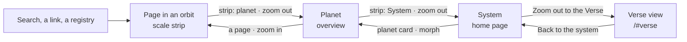
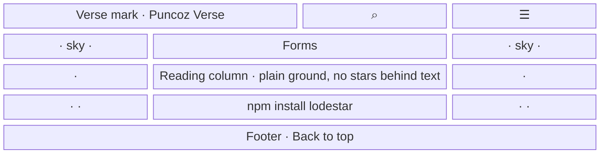
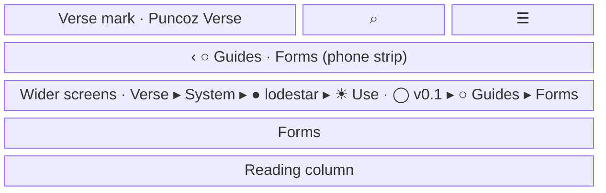
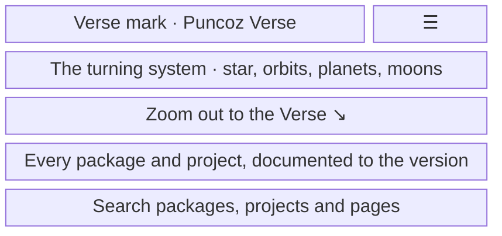
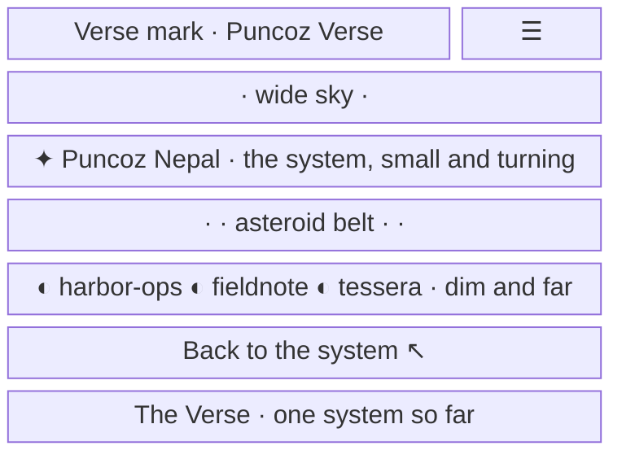
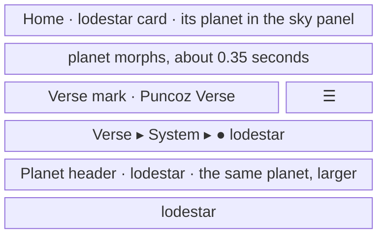

- **Status:** Current
- **Last updated:** 2026-11-01
- **Related ADRs:** [ADR-0029](../adr/ADR-0029-the-verse-is-a-still-sky-you-zoom-through.mdx),
  [ADR-0017](../adr/ADR-0017-the-whole-site-is-one-solar-system.mdx),
  [ADR-0027](../adr/ADR-0027-the-sidebar-is-a-scale-ladder-with-one-lifted-orbit.mdx)

> Snapshot of the system as it stands today. Edit in place; never record what changed.

How the Verse reaches every page under ADR-0029, in three stages: **identity and sky** (screen 1),
**zoom** (screens 2 to 5) and **words** (the table at the end). The Verse is the sky around the
one system; readers move through one scale ladder: Verse, System, Planet, Side and moon, Orbit,
Satellite, Probe. Sample values are invented (ADR-0008): `lodestar` is not a real package, and the
private planets are the three invented names already on the home page. Phone width first.

The flow and every screen are drawn with Archify; the page shows them and its Markdown carries
their Mermaid (ADR-0022). Their sources are in `diagrams/docs/`: `universe-theme.json` for the
flow, one `universe-theme-screen-<n>.json` per screen.

## Entry points

- **Every page** (stage 1): the Verse mark in the header, the still sky behind the page, the
  site icon in the browser tab.
- **Every docs page** (stage 2): the scale strip above the title.
- **The home page** (stage 2): *Zoom out to the Verse* on the system; a planet card opens its
  overview with the morph.
- **`/#verse`** (stage 2): the home page opened in the Verse view, from the strip's *Verse*, the
  footer's closing line or a shared link.
- Everyone sees the same. The Markdown surfaces (`/<page>.md`, `llms.txt`, `llms-full.txt`) carry
  none of it.

## Flow

<Diagram src="/diagrams/docs/universe-theme.html" title="The universe theme">

</Diagram>

From any docs page, the strip's *Verse* also opens the Verse view directly (screen 2).

## Screens

### 1. `Docs page` — the sky and the mark, on `/lodestar/use/v0.1/guides/forms` (stage 1)

<Diagram src="/diagrams/docs/universe-theme-screen-1.html" title="Screen 1 — Docs page">

</Diagram>

The header shows the Verse mark, a star-coloured centre inside two tilted orbits with a teal
planet, beside *Puncoz Verse*. The still sky fills the page's edges and the band behind the
header, and thins to nothing before the reading column, the sidebar's rows and "On this page".
The same mark is the browser tab's icon and sits on every Open Graph image.

**States**

- Empty: not applicable; every page has the sky and the mark.
- Loading: none; the sky is server-rendered SVG, present in the first paint and without scripts.
- Not found: the 404 stands on the same sky.
- Refused: not applicable; every page is public.
- Error: not applicable; the field is built from a fixed seed at build time.
- Degraded: reduced motion changes nothing, because the sky never moves. In the light theme the
  field is fine graphite specks, like a printed star chart. Where the content fills the width (most
  laptops on docs pages, every phone) there are no edges to fill, so the sky shows only in the
  header, in the gap between the wordmark and the buttons; the narrowest phones have no gap and no
  stars. The page's edges fill once the screen is wider than the content column.
- Success: one sky and one mark on every page; no text crosses a star.

### 2. `Scale strip` — the top of `/lodestar/use/v0.1/guides/forms` (stage 2)

<Diagram src="/diagrams/docs/universe-theme-screen-2.html" title="Screen 2 — Scale strip">

</Diagram>

The strip replaces Fumadocs' breadcrumb. On a phone it shows the parent level with a back arrow
and the current page's name; from about 720px it shows every level with its mark. *Verse* opens
`/#verse`, *System* the home page, the planet its overview, *Use · v0.1* the line's first page,
*Guides* its index if it has one. The current page is plain text. Going up a level settles the new
page in from slightly larger; going down, from slightly smaller.

**States**

- Empty: an overview shows `Verse ▸ System ▸ ● lodestar` only; a Maintain page shows a moon for
  the side and no version line.
- Loading: none; the strip is part of the prerendered page.
- Not found: the 404 has no strip.
- Refused: not applicable.
- Error: a page outside any catalogued entry is impossible (the build checks the shape); if it
  happened, the strip would show `Verse ▸ System` and the page.
- Degraded: with reduced motion, or without view transitions, the links navigate without a zoom.
  Without scripts every link still works. A folder without an index is plain text.
- Success: the reader sees every level above them and moves up one with a tap.

### 3. `The system` — the home page's hero, with the zoom control (stage 2)

<Diagram src="/diagrams/docs/universe-theme-screen-3.html" title="Screen 3 — The system">

</Diagram>

The system has one ghost control at its lower right, *Zoom out to the Verse*, with the
telemetry line beside it, and the still sky behind it in place of the canvas's own stars. What
the system itself draws is in [the living hero](./living-hero.mdx).

**States**

- Empty: with no public entries the system shows the star and its five empty orbits, and the
  control still opens the Verse.
- Loading: the canvas draws after scripts load; before that, the sky and the text are in place.
- Not found, refused, error: not applicable.
- Degraded: without scripts there is no canvas and no control (as today). With reduced motion
  the system is drawn once.
- Success: the system turns; the control is reachable by keyboard and names what it does.

### 4. `The Verse view` — the home page zoomed out, or opened at `/#verse` (stage 2)

<Diagram src="/diagrams/docs/universe-theme-screen-4.html" title="Screen 4 — The Verse view">

</Diagram>

The camera eases out over about 1.2 seconds: the system shrinks to the centre and keeps turning,
the wider sky opens, the belt and the private planets show dim and far, labels fade except
*Puncoz Nepal*. *Back to the system*, or a tap anywhere on the system's canvas, eases back in.
On a phone the caption sits under the button; on wider screens, to its left. The page below the
hero does not change.

**States**

- Empty: with no private planets there is no far region; the caption stays.
- Loading: `/#verse` opens in the Verse view once the canvas draws; before that the system's
  place shows the sky.
- Not found, refused, error: not applicable. An unknown fragment opens the system as usual.
- Degraded: with reduced motion the view changes instantly. Without scripts there is no canvas,
  so `/#verse` shows the home page as it is.
- Success: the reader sees the Verse around the one system and returns with one press.

### 5. `The morph` — a planet card opening its overview (stage 2)

<Diagram src="/diagrams/docs/universe-theme-screen-5.html" title="Screen 5 — The morph">

</Diagram>

The card's planet grows into the planet header's drawing while the rest of the page changes
under it. Going back from the overview, it shrinks into the card.

**States**

- Empty, not found, refused, error: not applicable; a card exists only for an entry with an
  overview.
- Loading: the overview is prerendered; the morph waits for it, as any navigation does.
- Degraded: with reduced motion, without view transitions, or when the card is off screen, the
  overview opens without the morph. The canvas planets open the overview without a morph.
- Success: the reader sees the planet they chose become the page they opened.

## Words

Under ADR-0029 decision 8, space words name places, never controls. Controls and scanned labels
keep their names: Search, Overview, Use, Maintain, On this page, version names, Back to top, and
the search button's text.

| Where | Words |
|---|---|
| Home page, no entries | No planets in the Verse yet. Packages and projects appear here once they are documented. |
| ADR constellation, no ADRs | No decisions in this constellation yet. |
| Search dialog, no results | Nothing in orbit matches. Try another word. |
| Scale strip, top levels | Verse · System |
| Home page system control | Zoom out to the Verse · Back to the system |
| Verse view caption | The Verse · one system so far |
| The 404 | This page drifted out of orbit. |
| Private projects, none | No private projects in orbit yet. |
| Footer | You've reached the horizon. The Verse goes on. · Back to orbit ↑ |
