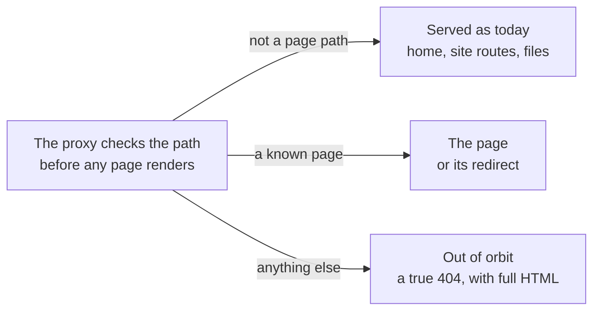
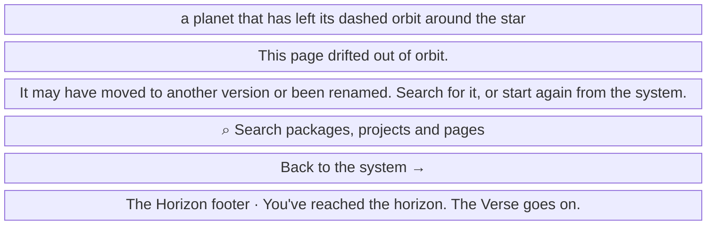

- **Status:** Current
- **Last updated:** 2026-11-03
- **Related ADRs:** [ADR-0034](../adr/ADR-0034-the-proxy-answers-unknown-paths-with-a-true-404.mdx),
  [ADR-0015](../adr/ADR-0015-every-entry-lives-at-the-root-in-one-shape-and-one-look.mdx),
  [ADR-0017](../adr/ADR-0017-the-whole-site-is-one-solar-system.mdx)

> Snapshot of the system as it stands today. Edit in place; never record what changed.

What a reader gets at a path that is not a page (ADR-0034). The page arrives whole, with a 404
status, on the first request. Sample values are invented (ADR-0008). Phone width first.

The flow and the screen are drawn with Archify; the page shows them and its Markdown carries
their Mermaid (ADR-0022). Their sources are in `diagrams/docs/`: `unknown-paths.json` for the
flow, `unknown-paths-screen-1.json` for the screen.

## Entry points

- **Any path that is not a page:** a mistyped address, an old or shared link, a private project's
  name on the home page, or `/docs/nothing-here` inside an entry. Everyone gets the same page.
- **Not here:** `/`, the site's own routes and anything below them (`/llms.txt`, `/og/…`,
  `/diagrams/…`), files, and a retired version line, which still redirects to the same path in the
  latest line.

## Flow

<Diagram src="/diagrams/docs/unknown-paths.html" title="Unknown paths">

</Diagram>

## Screens

### 1. `Out of orbit` — any unknown path, at phone width

<Diagram src="/diagrams/docs/unknown-paths-screen-1.html" title="Screen 1 — Out of orbit">

</Diagram>

The address stays as the reader typed it, and the page shows no part of it. The browser tab reads
*Page not found — Puncoz Verse*.

**States**

- Empty: not applicable; the page has no data of its own. With no public planets the footer's
  planet row is left out.
- Loading: none; the whole page is in the first response.
- Not found: this is that state, with a 404 status from the first request.
- Refused, error: not applicable.
- Degraded: without scripts the page and its links are all there, and *Back to the system* works;
  the search button does nothing.
- Success: the reader searches, or goes back to the system. A link inside the site to an unknown
  path shows the same page, with a full page load.
