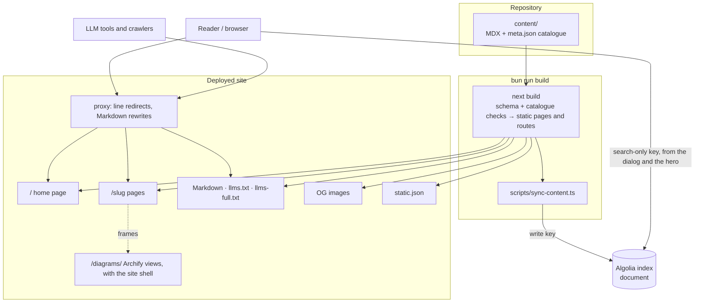

- **Status:** Current
- **Last updated:** 2026-11-01
- **Related ADRs:** [ADR-0013](../adr/ADR-0013-packages-and-projects-share-one-catalogue-shape.mdx),
  [ADR-0014](../adr/ADR-0014-home-page-is-a-search-first-release-map.mdx),
  [ADR-0015](../adr/ADR-0015-every-entry-lives-at-the-root-in-one-shape-and-one-look.mdx),
  [ADR-0017](../adr/ADR-0017-the-whole-site-is-one-solar-system.mdx),
  [ADR-0011](../adr/ADR-0011-archify-diagrams-are-embedded-from-sandboxed-html.mdx),
  [ADR-0020](../adr/ADR-0020-people-in-adrs-are-github-usernames-shown-as-profile-chips.mdx),
  [ADR-0021](../adr/ADR-0021-tests-run-with-bun-test.mdx)

> Snapshot of the system as it stands today. Edit in place; never record what changed.

## Context

A Next.js 16 App Router site built on Fumadocs. It renders the MDX pages in `content/`
as a documentation site, and serves every page again as Markdown, as an Open Graph image, and
as a search record. Search runs on Algolia. There is no database, no sign-in and no
server-side state. Cache Components is on (`cacheComponents` and `partialPrefetching` in
`next.config.mjs`, ADR-0016), and every page and route handler is prerendered at build time: none
reads request data yet. The sign-in ADR adds the first request-time part, the home page's
private group, inside a `<Suspense>` boundary, so the rest of `/` stays in the static shell.

Every top-level folder in `content/` is a **catalogue entry**, published at `/<slug>`: a
package or project whose root `meta.json` carries a `catalog` field (ADR-0013, ADR-0015). Inside
it, `use/` and `maintain/` are the two tracks. A versioned `use/` holds one folder per version
line, each with `version` and `channel` in its `meta.json`: `use/dev/` for unreleased work in
progress, and released lines whose URL segment comes from their `name` (`v1.0`, `2024 LTS` →
`2024-lts`). Maintain is not versioned. The only entry today is this site itself, project
`docs`, whose Maintain track (`content/docs/maintain/`) holds its decisions and design
documents; no package is documented yet, so the home page shows its empty states.

## Routes

| URL | File | What it is |
|---|---|---|
| `/` | `src/app/(home)/page.tsx` | Home page: the system, the search button opening the search dialog, planet cards, private projects beyond the belt and the sections of ADR-0017 |
| `/<slug>/…` | `src/app/(site)/[...slug]/page.tsx` | A documentation page in the notebook layout, each wrapped in `ZoomPage` and opening with the scale strip (Fumadocs' breadcrumb off); an overview opens with the planet header, a line page adds the version line or its moon notice; "On this page" is the trajectory, with the page's reading time worked out at build time |
| `/<slug>/use` and a line root without its own page | `src/app/(site)/[...slug]/page.tsx` | 307 redirect to the first page (the latest line, else `dev`) |
| `/<slug>/use/latest/…` | `src/proxy.ts` | 307 redirect to the line marked `latest`, or `dev` when nothing is released |
| `/<slug>/use/<segment>/…` for a line that does not exist | `src/proxy.ts` | 307 redirect to the same path in `latest` (or `dev`) |
| `/<slug>….md` | `src/proxy.ts` → `/llms.mdx/<slug>…/content.md` | The page as Markdown |
| `/<slug>…` with `Accept` preferring Markdown | `src/proxy.ts` → `/llms.mdx/<slug>…/content.md` | The page as Markdown, `Vary: Accept` |
| `/llms.mdx/…/content.md` | `src/app/llms.mdx/[...slug]/route.ts` | Processed Markdown of one page, `text/markdown` |
| `/llms.txt` | `src/app/llms.txt/route.ts` | Index of every page, version lines labelled |
| `/llms-full.txt` | `src/app/llms-full.txt/route.ts` | Every page's full Markdown in one file |
| `/og/…/image.png` | `src/app/og/[...slug]/route.tsx` | Open Graph image: title, description, site name |
| `/static.json` | `src/app/static.json/route.ts` | Every page as an Algolia search record |

Pages share the root with the site's own routes. The proxy acts only on paths whose first
segment is a catalogued slug (`isEntryPath`), and the build refuses a slug that would collide
with a route (`api`, `og`, `static`, …). Contracts for the machine-readable routes are in
[`../api/`](../api/index.mdx).

## Components

| Component | Responsibility | Depends on |
|---|---|---|
| `content/` | The published pages and `meta.json` files, one folder per catalogue entry | — |
| `src/lib/catalog-schema.ts` | `catalogMetaSchema`: Fumadocs' `metaSchema` plus `catalog`, `name`, `version` and `channel` (`latest`, `dev`, `legacy`), as a Standard Schema; rejects any `visibility` but `public`; a project's `repositories` (`id`, `name`, `url`, one `primary`), primary first — ADR-0024 | `fumadocs-core` |
| `src/lib/catalog-plugin.ts` | Loader plugin: the build checks of ADR-0015 decision 5, typed roots (`root: true` on an entry, `'track'` on `use/` and `maintain/`, `'line'` on a version line), line names and descriptions (`version · channel`) and line order (latest, `dev`, then older lines in `use/meta.json` `pages` order or newest first); a project's lines (`dev` and one released line) and repository folders named from the catalogue (ADR-0024); the `root` hook `overviewInTracks()`, which moves each overview into its tracks as an *Overview* item, and `withoutOverviewItems()` for `llms.txt` (ADR-0025); `lineInfo()`, `lineSegment()`, `pageVersion()`, `repositoryName()` | `fumadocs-core` |
| `src/lib/source.ts` | Loads `content/` with `defineDocs` at base URL `/`, swapping each line folder's URL segment for its name (`slugs`), with the diagram shape check first among the remark plugins and the Markdown filter for `<Diagram>` (ADR-0022); exposes `source`, `getMeta` and `docsLlms` (version line in each page's Markdown and in `llms.txt`) | `fumadocs-mdx`, the two above |
| `src/lib/catalog.ts` | Reads the page tree into typed catalogue entries (lines, tracks, demo, repositories), the page context for banners, and the home page's previews | `source.ts` |
| `src/lib/catalog-routes.ts` | Meta files only (no compiled pages), for the proxy: the catalogued slugs, each package's line segments, `latest` and `dev`; `isEntryPath()`, `resolveLineRedirect()` | `fumadocs-mdx` |
| `diagrams/` | Archify diagrams, one pair per diagram: the candidate JSON (not published) and the HTML exactly as `deliver` wrote it (ADR-0022) | — |
| `src/app/diagrams/[project]/[file]/route.ts`, `src/lib/diagram-files.ts` | Prerenders every HTML in `diagrams/` at `/diagrams/<project-slug>/<slug>.html` with the site shell; the CSP `sandbox` header comes from `next.config.mjs` | `diagram-shell.ts` |
| `src/lib/diagram-shell.ts` | The site shell added as a diagram is served: in a frame (`?frame=1`) it hides Archify's title, notes rail, theme and style buttons and credit; it sets the page colours to the site's tokens, starts motion Live (unless reduced motion) and reports the content height to the page | — |
| `src/components/diagram.tsx`, `diagram-frame.tsx` | `<Diagram src title>`, registered in `src/components/mdx.tsx`: the sandboxed, lazy frame sized from the diagram's `viewBox`, with the site's theme in its URL and the reported height taken only from that frame; the caption and **Open full screen**. The Mermaid it holds is not rendered | `diagrams.ts`, `fumadocs-ui/provider/base` |
| `src/lib/remark-diagrams.ts` | The shape check (a Mermaid fence only inside a `<Diagram>` that holds exactly that fence; templates exempt) and `markdownFilter`, which keeps a `<Diagram>`'s fence in the processed Markdown and drops the tag (ADR-0022) | `diagrams.ts` |
| `src/lib/diagrams.ts`, `diagrams-plugin.ts` | Which `src` is allowed, a diagram's size, the bounds of a height report, and the file checks run as a loader plugin: every HTML with its JSON and used by a page, every `src` with its file, nothing in `public/diagrams/`, no Archify receipt | `node:fs` |
| `src/lib/github-profile.ts`, `src/components/profile-link.tsx` | Which links are GitHub profile links (`[@user](https://github.com/user)`), and `withProfileChips`, the page's `a` component, which shows them as a chip with the avatar loaded live from GitHub and hands every other link to `createRelativeLink` (ADR-0020) | `fumadocs-ui/mdx.server` |
| `*.test.ts`, `*.test.tsx` beside the code | Unit tests, run with `bun run test` (`bun test --no-env-file`); type-checked through `tsconfig.test.json`, which adds Bun's types and is kept out of the site's own check (ADR-0021) | `bun:test`, `react-dom/server` |
| `src/lib/search-scope.ts` | The scope tag of a page (`<slug>`, `<slug>:maintain`, `<slug>:use:<segment>`) | — |
| `src/lib/adr-status.ts` | An ADR's status from its status line, its number and short title, whether a folder is named `adr` (ADR-0019) | — |
| `src/lib/trajectory.ts`, `reading-time.ts` | Pure geometry for the trajectory and the station arcs, the probe's position and the time left; a page's reading time from its `structuredData` at 220 words a minute (ADR-0018) | — |
| `src/lib/algolia.ts` | The search-only Algolia client used by the search dialog | `algoliasearch/lite` |
| `src/lib/shared.ts` | Site name (`Puncoz Verse`, ADR-0028), route prefixes (pages at the root, `/og`, `/llms.mdx`), GitHub repository (`puncoz-official/docs`), URL builders | — |
| `src/app/layout.tsx`, `global.css`, `site.css` | Root layout: the three fonts, the RootProvider (dark by default, light/dark through next-themes) and the search dialog; the tokens on `:root` / `.dark` mapped onto Fumadocs' colours; the site header, theme switch, docs typography, planet header, notices, planet row, stations, trajectory and footer | `fumadocs-ui` |
| `src/components/site-header.tsx`, `theme-switch.tsx` | The one header: the Verse mark and wordmark, the header's band of sky, nav, optional search button (left out on the home page), GitHub, the orrery theme switch (`useTheme`), optional menu button | `fumadocs-ui/provider/base` |
| `src/components/planet.tsx` | The shared marks, plain SVG with no client state: `PlanetMark`, `MoonPhase`, `PlanetSystem` (ADR-0017) | `rings.ts` |
| `src/components/verse-mark.tsx`, `src/app/icon.svg` | The Verse mark: the header's brand mark, the Open Graph images' icon (in fixed colours) and the site icon (ADR-0029) | — |
| `src/components/docs/scale-strip.tsx`, `src/lib/scale-strip.ts` | The scale strip: every level from the Verse to the page, worked out on the server from the page tree and the catalogue, with the phone's parent level (ADR-0029) | `catalog-plugin.ts`, `planet.tsx`, `verse-mark.tsx` |
| `src/components/zoom-page.tsx`, `src/lib/zoom.ts` | React `<ViewTransition>` wrappers: `ZoomPage` in each page enters and exits on the `zoom-in` and `zoom-out` transition types that links carry; `PlanetMorph` shares a planet's drawing between its card and its planet header. `zoom.ts` holds the two types, apart from the catalogue code, for client components (ADR-0029) | `react` |
| `src/components/sky.tsx`, `src/lib/sky.ts` | The still sky: seeded star fields drawn on the server, one fixed behind every page (placed in the root layout) and one band in the header; CSS keeps them clear of text (ADR-0029) | — |
| `src/components/horizon-footer.tsx`, `horizon-awake.tsx`, `footer-actions.tsx`, `src/lib/horizon-sky.ts` | The Horizon footer on every page: the closing line, whose `VerseLink` opens the Verse view (ADR-0033), and a living scene of layered SVGs (stars, aurora, shooting stars, the star, lit clouds, the ground and an observatory) drawn on the server from `horizon-sky.ts`; `HorizonAwake` lets its CSS loops run only while it is on screen; on docs pages it stacks above the sidebar and the trajectory, which set as it enters (ADR-0030). Its Search and Back to top buttons are client components | `catalog.ts`, `fumadocs-ui` |
| `src/app/not-found.tsx` | The out-of-orbit 404 for every unknown path and `notFound()` | `catalog.ts` |
| `src/app/(site)/layout.tsx` | Fumadocs notebook `DocsLayout` with the site header as its `nav.component`, the version-line switcher only (each line with its moon icon), the planet row as sidebar banner, orbit stations as the sidebar's folder, page and separator components, the ADR statuses for the constellation (`AdrStatusProvider`), and the full Horizon footer | `catalog.ts`, `source.ts` |
| `src/components/docs/` | `DocsHeader` (site header opening the search dialog and the sidebar), `PackageHero` (the planet header), `TrackSwitch` (the planet row: chip, a sun for Use and a moon for Maintain), `OrbitStation` / `OrbitItem` / `OrbitSeparator` (the sidebar's stations, on Fumadocs' sidebar primitives) with `StationGroup` (one open station per level, the rule in `src/lib/station-group.ts`, ADR-0023), `AdrConstellation` and `AdrStatusProvider` (a folder named `adr` as a grid of moons phased by status, ADR-0019), `TrajectoryTOC` / `TrajectoryPopover` ("On this page" as a trajectory with a probe and time left, on desktop and as the phone bar) and `VersionNotice` (the version stated with its moon; In development and Older version notices) — ADR-0018 | `fumadocs-ui`, `trajectory.ts` |
| `src/app/(home)/` | Home layout (`.home` wrapper, `home.css`) and page | `catalog.ts`, `source.ts` |
| `src/components/home/` | Server: hero, home header, planet cards, beyond the belt (private projects from `private-projects.ts`), two sides, moon rows. Client: orbit map (canvas; a planet opens its overview; the Verse view at `#verse`, its easing and far planets from `src/lib/verse-view.ts`, ADR-0029; every ecosystem's orbit, the living star, trails, pointer depth, the arrival, the comet and the telemetry line from `src/lib/hero-sky.ts`, with the nebula behind it in `home.css`, ADR-0032), search button (opens the search dialog), terminal (tabs), assistant actions (Fumadocs' Copy Markdown and Open menu for the example page), reveal | `catalog.ts`, `rings.ts`, `fumadocs-ui`, `lucide-react` |
| `src/components/search.tsx`, `search-empty.tsx` | The site-wide search dialog, opened by `⌘K`, the docs header's search button and the home page's hero button; its no-results line is the site's own (ADR-0029) | `algolia.ts` |
| `src/proxy.ts` | On catalogued paths only: line redirects, then the Markdown rewrites | `catalog-routes.ts`, `fumadocs-core/negotiation` |
| `scripts/sync-content.ts` | After `next build`, reads the built `static.json` and replaces the Algolia index `document` with it | `algoliasearch`, `ALGOLIA_WRITE_KEY` |

## How navigation is scoped

Fumadocs shows the sidebar of the deepest root folder on the current path, and groups root
folders of the same type into one switcher whose options keep the reader on the same page
(`fumadocs-ui/contexts/tree`). The catalogue plugin marks folders so that:

- on a package's Use page the sidebar holds only that line's pages, with a version menu
  (`v4.0` / `4.0.1 · Latest`, `dev` / `5.0.0-dev · In development`, older lines) that keeps the
  reader on the same page when it exists, matched by file path, not URL;
- on a Maintain page the sidebar holds only the Maintain pages;
- on an overview the sidebar is its default track's: the plugin's `root` hook takes the overview
  off the entry folder and puts an *Overview* item for it first in each Use line (or an
  unversioned Use) and in Maintain, with Use first, so the path search finds the overview in the
  latest Use line, or in Maintain when there is no Use (ADR-0025). The catalogue's links
  (`src/lib/catalog.ts`) and the version menu's (`lineLink()` in `src/lib/overview-sidebar.ts`)
  skip the item, and `llms.txt` reads the tree without it;
- `TrackSwitch` switches between the two tracks, and on an overview marks the default track as
  current;
- the site-wide switcher of root folders is not shown: the layout passes only `line` roots as
  tabs. Entries are reached from the home page and the header.

## Diagram

<Diagram src="/diagrams/docs/system-architecture.html" title="System architecture">

</Diagram>

## Key decisions in force

- [ADR-0013](../adr/ADR-0013-packages-and-projects-share-one-catalogue-shape.mdx): the catalogue
  shape, tracks, version lines, URLs, scoped navigation, search fields and build checks.
- [ADR-0014](../adr/ADR-0014-home-page-is-a-search-first-release-map.mdx): the home page.
- [ADR-0015](../adr/ADR-0015-every-entry-lives-at-the-root-in-one-shape-and-one-look.mdx): root
  addresses, `dev` and named lines, the site as project `docs`, one look and one header,
  light/dark.

## Constraints

- **Mermaid is not rendered.** Diagrams in these pages show as highlighted code.
- **Every page is public on every surface.** Nothing filters a page out of the site, the
  Markdown routes, `llms.txt` / `llms-full.txt`, `static.json`, the OG images or the search
  index. The catalogue schema rejects a private entry, so the build fails instead of publishing
  one (`AGENTS.md` §6.1).
- **Demos are not published.** A `use/<line>/demo.mdx` page would be linked from the catalogue,
  but ADR-0011's embed takes only `/diagrams/…` files, so how a demo runs needs its own ADR; the
  home page has no demo section.
- **`defineCollections({ type: 'meta' })` is broken in fumadocs-mdx 15.4.10** (its generated
  call passes `meta` where the runtime reads `entries`), so `catalog-routes.ts` uses a
  `defineDocs` whose page pattern matches nothing.
- **`bun run build` publishes.** Its second step overwrites the live search index.
- **Hosting is not decided.** `.gitignore` lists `.vercel`, from the scaffold; no host is
  configured in the repository.
