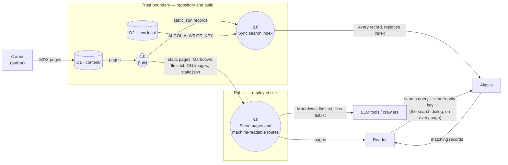

- **Status:** Current
- **Last updated:** 2026-11-01
- **Related ADRs:** ADR-0005, ADR-0013, ADR-0014, ADR-0016

> Snapshot of the system as it stands today. Edit in place; never record what changed.
> Conventions: `content/docs/maintain/dfd/index.mdx`. Levels balance — a child's flows match its parent's.

## Scope

The whole site: authoring, build, publishing and reading. No parent diagram.

## Diagram

## External entities

| Entity | Role |
|---|---|
| Owner | Writes the content; runs the build |
| Reader | Reads pages; searches from the browser, in the search dialog or the home page's hero field |
| LLM tools / crawlers | Read the Markdown routes and `llms.txt` / `llms-full.txt` |
| Algolia | Hosts the search index `document` |

## Processes

| # | Process | Input → Output |
|---|---|---|
| 1.0 | Build (`next build`) | `content/` → static pages and routes |
| 2.0 | Sync search index (`scripts/sync-content.ts`) | Built `static.json` → Algolia index |
| 3.0 | Serve | Built output → readers and tools |

## Data stores

| ID | Store | Contents | Classification |
|---|---|---|---|
| D1 | `content/` | Published documentation, one folder per package or project, including this site's own design documents (`docs/maintain/`) | Public — see [`../security/data-classification.mdx`](../security/data-classification.mdx) |
| D2 | `.env.local` (gitignored) | Algolia app ID, search-only key, write key | The write key is Restricted; the others are Public |

## Trust boundary crossings

| Flow | Direction | Authorisation | Private content? |
|---|---|---|---|
| Records → Algolia | Build → Algolia | `ALGOLIA_WRITE_KEY` | Would carry any page in `content/`. Each record also carries its scope `tag` and, for catalogue pages, `package`, `kind`, `ecosystem`, `track`, `line`, `channel` (ADR-0013) — public metadata about public pages |
| Search query → Algolia | Browser → Algolia | Search-only key, public by design | Can read every record in the index. The query is the reader's text only; the dialog adds no filter |
| Pages and machine-readable routes → readers and tools | Site → public | None | Would carry any page in `content/` |
| "View on GitHub" link | Site → GitHub | GitHub's own access rules | Points at the page's source in the repository named in `gitConfig` |

Every crossing carries everything in `content/`. That is why no private project content
may go there until its ADR is approved (`AGENTS.md` §6.1).
