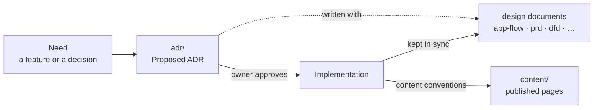

How this site is built and decided: its decisions, design documents and security documents.
Each directory's `index.mdx` holds its own conventions. The rules behind this layout are
[ADR-0002](./adr/ADR-0002-living-design-documentation.mdx).

This is the Maintain track of the project `docs`, this site itself. Packages, libraries and other
projects each have their own folder, `content/<slug>/`, published at `/<slug>`.

## Three kinds of document

| Kind | Directory | Changes how |
|---|---|---|
| **Package and project documentation** | `content/<slug>/`, one folder per package or project | **The product.** Written and updated within the approved content conventions and the invariants in `AGENTS.md` §6. |
| **Decisions** | [`adr/`](./adr/index.mdx) | **Immutable once approved.** A change of mind is a new ADR that supersedes the old one. |
| **Design documents** | everything else here | **Living snapshots.** Describe the site as it stands right now, edited in place. What is no longer true is deleted, not annotated. |

How they relate:

<Diagram src="/diagrams/docs/documentation-map.html" title="Documentation map">

</Diagram>

## Directories

| Directory | Holds | Required when |
|---|---|---|
| [`adr/`](./adr/index.mdx) | Architecture Decision Records and their index | Every feature and functional change ([ADR-0001](./adr/ADR-0001-adr-driven-development-workflow.mdx)) |
| [`app-flow/`](./app-flow/index.mdx) | The flow and screen wireframes, Mermaid and Archify, one file per feature | Any ADR that changes something a person sees ([ADR-0008](./adr/ADR-0008-a-ui-change-ships-an-app-flow.mdx)) |
| [`prd/`](./prd/index.mdx) | Requirements and user stories | Any reader-facing feature |
| [`architecture/`](./architecture/index.mdx) | High-level design | A new module, content source, build step or external integration |
| [`erd/`](./erd/index.mdx) | Persisted data | The first ADR that stores data creates `erd/system.mdx` |
| [`dfd/`](./dfd/index.mdx) | Data flow diagrams with trust boundaries | Data crosses a trust boundary or reaches an external system |
| [`state/`](./state/index.mdx) | State machines | An entity with more than two states, or guarded / timed transitions |
| [`sequence/`](./sequence/index.mdx) | Sequence diagrams | Multi-actor, async, or retrying flows |
| [`api/`](./api/index.mdx) | Route handler and endpoint contracts | Anything another client or system calls |
| [`rbac/`](./rbac/index.mdx) | Access matrices | Visibility depends on who the reader is |
| [`security/`](./security/index.mdx) | Threat model, data classification, secrets, audit checklist | Always kept accurate; per-feature analyses when warranted |
| [`_templates/`](./_templates/index.mdx) | A starting point for each document type | — |

Agent skills are not part of this project. They are tooling for contributors, vendored in
`.claude/agent-skills/` outside `content/`, so they are never published: `INDEX.md` routes
tasks to skills and `SOURCES.md` records provenance
([ADR-0009](./adr/ADR-0009-trusted-agent-skills-are-vendored.mdx)).

## Conventions for every design document

- **Frontmatter `title`**, no `#` heading; then the header: `Status`, `Last updated`, `Related ADRs`.
- **Snapshot, not changelog**: no revision tables, no "previously", no strikethrough.
- **Every diagram is Mermaid and Archify together**: flowcharts, sequences, state machines,
  ERDs and screen wireframes (`block-beta`) are a Mermaid fence inside a `<Diagram>`, with the
  Archify files in `diagrams/<project-slug>/`. The page shows the Archify view; the page's
  Markdown carries the Mermaid ([ADR-0022](./adr/ADR-0022-diagrams-show-archify-on-the-page-and-mermaid-in-markdown.mdx),
  `AGENTS.md` §8). No binary or externally hosted images.
- **Sample values are invented**, never a real person's name, a client's name, a real token or
  a private project's details.
- **Links between documents are relative and start with `./` or `../`** (`./adr/index.mdx`), so the site resolves them to page URLs and they still work on GitHub.
- **Start from [`_templates/`](./_templates/index.mdx)**. If unsure whether a document is required, write it.
