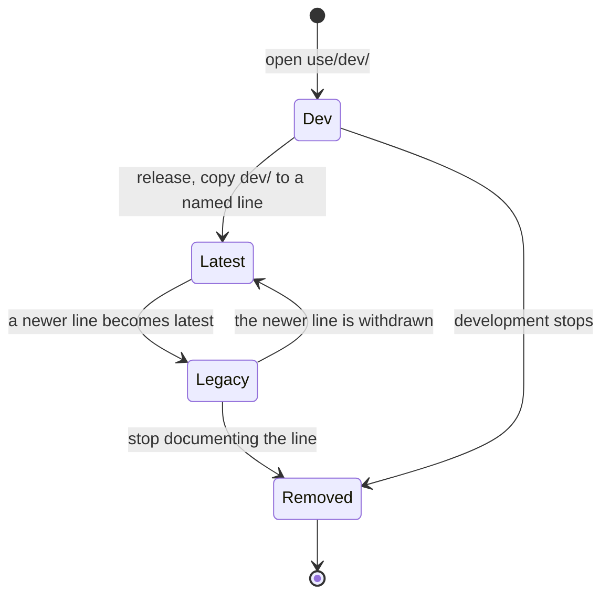

- **Status:** Current
- **Last updated:** 2026-11-01
- **Related ADRs:** [ADR-0013](../adr/ADR-0013-packages-and-projects-share-one-catalogue-shape.mdx),
  [ADR-0015](../adr/ADR-0015-every-entry-lives-at-the-root-in-one-shape-and-one-look.mdx),
  [ADR-0024](../adr/ADR-0024-a-project-can-span-several-repositories.mdx)

> Snapshot of the system as it stands today. Edit in place; never record what changed.

A **line** is one documented version of a package's Use track: a folder under `use/` whose
`meta.json` sets `channel` and the exact `version` it documents (ADR-0013, ADR-0015).

- **`use/dev/`** is the unreleased work in progress on the default branch: always that folder,
  always `channel: "dev"`, always at `/<slug>/use/dev`.
- **A released line** has any folder name and a `name` (`v1.0`, `4.x`, `2024 LTS`; the folder
  name when unset). Its URL segment is the name in lowercase, spaces as `-`, other characters
  outside `a-z 0-9 . _ -` dropped: `/<slug>/use/2024-lts`.

The consuming repository moves a line from one state to the next by editing those files, and a
human commits the change (ADR-0010).

**Projects have no Legacy state** (ADR-0024). A versioned project has Dev and at most one Latest
line, for the whole project: with several repositories each line holds their folders
(`use/dev/frontend/`). A release copies `dev/` to the new Latest line and removes the previous
one, which goes straight from Latest to Removed; links to it redirect to the new line. The build
fails on a `legacy` line in a project. The lifecycle below is a package's.

The diagram is drawn with Archify from its source, `diagrams/docs/package-version-lifecycle.json`; the page shows
it and its Markdown carries the Mermaid (ADR-0022).

## Diagram

<Diagram src="/diagrams/docs/package-version-lifecycle.html" title="Package version lifecycle">

</Diagram>

A release does not move `dev` itself: the copy becomes the new Latest line and `use/dev/` keeps
documenting the next version.

## States

| State | Meaning | Who can see it |
|---|---|---|
| Dev | Documents the unreleased version (`4.0.0-dev.3`). Every page carries the "In development" banner. At most one per package. | Everyone, for a public package |
| Latest | Documents the newest released version. The `use/latest/…` alias redirects here. Exactly one per released package. | Everyone |
| Legacy | Documents an older version that is still in use. Every page carries the "Older version" banner. | Everyone |
| Removed | The folder is deleted; its pages no longer exist. | Nobody. URLs redirect (see below) |

## Transitions

| From | To | Trigger | Guard | Side effects |
|---|---|---|---|---|
| — | Dev | The consuming repository adds `use/dev/` with `channel: "dev"` | Only that folder may use `dev` | Pages published with the banner; the home page row shows `dev <version>`; search and `llms.txt` include them, labelled |
| Dev | Latest (a new line) | A release: `dev/` is copied to a new folder with a `name`, the released `version` and `channel: "latest"` | The previous `latest` moves to Legacy in the same change; the new name's segment is not taken | The alias moves; links to removed lines redirect to the same path in the new line; the home page row shows the new version |
| Latest | Legacy | Another line becomes latest | Same change as above | Banner added; the line stays in the version menu |
| Legacy | Latest | The newer release is withdrawn | Same change removes the newer line | The alias moves back |
| Legacy | Removed | The folder is deleted | — | Its URLs redirect to the same path in `latest` (404 there if that page doesn't exist); Algolia records removed on the next index sync |
| Dev | Removed | `use/dev/` is deleted | — | Its URLs redirect to the same path in `latest`; a package with no `latest` has nowhere to redirect, so they return 404 |

The version menu lists Latest first, then Dev, then Legacy lines in the order of `use/meta.json`
`pages`, or newest version first when `pages` does not name them.

The build fails (`src/lib/catalog-plugin.ts`) when a line misses `version` or `channel`, when
`channel: "dev"` is used outside `use/dev/` or `use/dev/` has another channel, when a name's
segment is empty, `dev`, `latest` or ends in `.md`, when two lines share a segment, when pages
sit directly in a versioned `use/`, when a package has two `latest` lines, or when it has
`legacy` lines but no `latest`. The redirects are in `src/proxy.ts`: `use/latest/…` and any
segment that is not a line go to `latest`, or to `dev` when nothing is released. A package
with only `dev` is unreleased, and the catalogue shows it as such.

## Terminal states

**Removed** is final. Its pages are gone from the site, `llms.txt` and the next index sync. Pages
already crawled or copied elsewhere cannot be withdrawn (ADR-0005). Restoring a line is adding
it again as a new folder.
