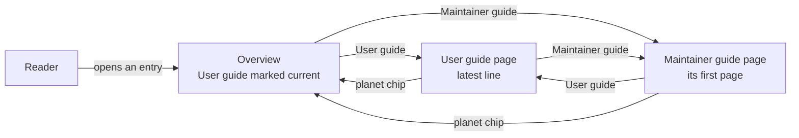
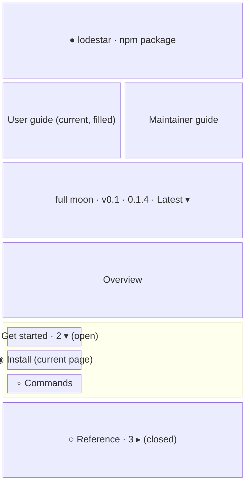
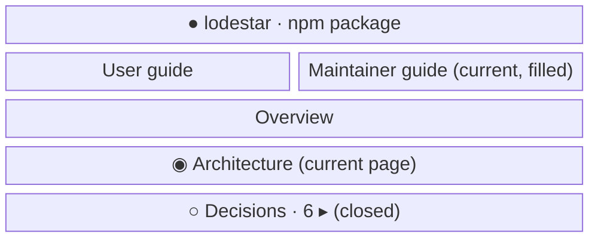

- **Status:** Current
- **Last updated:** 2026-11-14
- **Related ADRs:** [ADR-0048](../adr/ADR-0048-the-two-tracks-are-the-user-guide-and-the-maintainer-guide.mdx)

> Snapshot of the system as it stands today. Edit in place; never record what changed.

The guide switch (ADR-0048): two named segments under the planet chip, *User guide*
and *Maintainer guide*, with no icon and no tooltip. Everything else in the sidebar is in
[Docs sidebars](./docs-sidebars.mdx). Sample values are invented (ADR-0008): `lodestar` is not a
real package. Phone width first.

The flow and every screen are drawn with Archify; the page shows them and its Markdown carries
their Mermaid (ADR-0022). Their sources are in `diagrams/docs/`: `guide-switch.json` for the
flow, one `guide-switch-screen-<n>.json` per screen.

## Entry points

- Any page of an entry that has both guides: on desktop the sidebar column, on phones the sidebar
  drawer from the header. The switch is the second row of the sidebar, under the planet chip.
- An entry with one guide shows no switch.
- Everyone sees the same. The per-page Markdown and `llms.txt` carry no sidebar; they name the
  guide a page belongs to in words.
- The theme switch stays in the site header and is the only sun or moon control on the page.

## Flow

<Diagram src="/diagrams/docs/guide-switch.html" title="The guide switch">

</Diagram>

## Screens

### 1. `User guide current` — the sidebar on `/lodestar/user-guide/v0.1/install`

<Diagram src="/diagrams/docs/guide-switch-screen-1.html" title="Screen 1 — User guide current">

</Diagram>

The planet chip has its own row. Under it the switch fills the sidebar's width in two equal
segments, each with its full name always visible. The current guide's segment is filled; the
other is plain text that brightens on hover. The moon picker follows on the User guide. The
entry's overview shows this same screen, with *User guide* marked current and *Overview* the
current page.

**States**

- Empty: an entry with one guide has no switch; the chip is followed by the moon picker or the
  first page.
- Loading: none; the sidebar is prerendered with the current guide marked. The segments are
  links and work before scripts load.
- Not found: the out-of-orbit 404 has no sidebar.
- Refused: not applicable; every page is public.
- Error: not applicable at runtime.
- Degraded: in a sidebar too narrow for one line, a name wraps inside its segment; neither is
  cut short. With reduced motion the fill changes without a transition.
- Success: *User guide* filled, and marked as the current page for assistive technology.

### 2. `Maintainer guide current` — the sidebar on `/lodestar/maintainer-guide/architecture`

<Diagram src="/diagrams/docs/guide-switch-screen-2.html" title="Screen 2 — Maintainer guide current">

</Diagram>

*Maintainer guide* is filled. The Maintainer guide has no version lines, so no moon picker
stands under the switch. *User guide* opens the latest line's first page.

**States**

- Empty, loading, not found, refused, error, degraded: as screen 1.
- Success: *Maintainer guide* filled, and marked as the current page for assistive technology.
