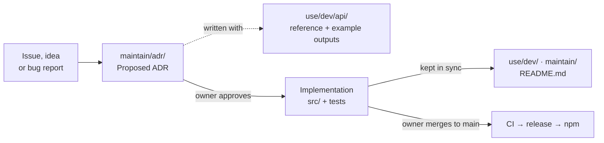

The map of what lives where. Each directory's `index.mdx` holds its own conventions. Why the
documentation lives here is
[ADR-0010](./adr/ADR-0010-documentation-lives-in-nepal-dev-verse.mdx); the rule that documents
are snapshots and decisions are immutable is
[ADR-0002](./adr/ADR-0002-living-design-documentation.mdx).

**Using the package?** Start with [Getting started](../use/dev/getting-started.mdx), then the
[API reference](../use/dev/api/index.mdx). **Contributing?** Read
[`AGENTS.md`](https://github.com/puncoz-official/nepali-number-js/blob/main/AGENTS.md) first.

## Where the documentation lives

The repository mounts the Nepal Dev Verse documentation repository as a git submodule at
`docs/docs.nepal-dev.com/`. Everything about `nepali-number` is in two folders of it:

| Folder in the submodule | Holds | Published at |
|---|---|---|
| `content/nepali-number/index.mdx` | The overview | `/nepali-number` |
| `content/nepali-number/use/dev/` | **Use**: docs for people using the package, for unreleased work on `main` | `/nepali-number/use/dev` |
| `content/nepali-number/use/v2/` | **Use**, for the 2.x release line | `/nepali-number/use/v2` |
| `content/nepali-number/maintain/` | **Maintain**: this track, not versioned | `/nepali-number/maintain` |
| `diagrams/nepali-number/` | The Archify view of every diagram, with its source | `/diagrams/nepali-number/` |

How pages, version lines and diagrams are written there is set by the submodule's
`PROJECT_AGENTS.md` and the skills it names.

## Two kinds of document

| Kind | Directory | Changes how |
|---|---|---|
| **Decisions** | [`adr/`](./adr/index.mdx) | **Immutable once approved.** A change of mind is a new ADR that supersedes the old one. |
| **Living documents** | everything else, the Use track, and the repository's `README.md` | **Snapshots.** Describe the package as it stands right now, edited in place. What is no longer true is deleted, not annotated. |

How they relate:

<Diagram src="/diagrams/nepali-number/documentation-flow.html" title="How decisions and documents relate">

</Diagram>

## Directories

| Directory | Holds | Required when |
|---|---|---|
| [`adr/`](./adr/index.mdx) | Architecture Decision Records and their index | Every feature and functional change ([ADR-0001](./adr/ADR-0001-adr-driven-development-workflow.mdx)) |
| [`architecture/`](./architecture/index.mdx) | Module layering, build outputs, the `exports` map | A new domain, cross-domain import, or change to the build or published shape |
| [`release/`](./release/index.mdx) | Semver policy, CI and the release process | The versioning rules, CI or release process change |
| [`security/`](./security/index.mdx) | Threat model, secrets inventory, release audit checklist | Always kept accurate; per-change analyses when warranted |
| [`use/dev/api/`](../use/dev/api/index.mdx) | Public API reference, one page per domain; [limitations](../use/dev/api/limitations.mdx) | Any change a consumer can observe ([ADR-0008](./adr/ADR-0008-public-api-changes-ship-their-reference.mdx)) |
| [`use/dev/guides/`](../use/dev/guides/index.mdx) | Recipes and migration from v1; [getting started](../use/dev/getting-started.mdx) sits beside it | A new way to use the package, or a breaking change |

Templates for each document type stay in the repository, in
[`docs/_templates/`](https://github.com/puncoz-official/nepali-number-js/tree/main/docs/_templates).

## Conventions for every living document

- **Frontmatter**: `title` and `description` on every page. The description is one or two plain
  sentences for someone reading a search result.
- **Header on a Maintain page**: `Status`, `Last updated`, `Related ADRs`.
- **Snapshot, not changelog**: no revision tables, no "previously", no strikethrough. The
  migration guide is the one document whose subject is a difference between versions.
- **Unreleased behaviour goes in `use/dev/`.** A released line keeps describing its version;
  only mistakes are corrected there.
- **Example outputs are real.** Every `// →` result is produced by running the built package.
  Run it again when the code changes.
- **Digits in examples are explicit.** Show both the input and the exact output string,
  including Devanagari digits (`"१२,३४,५६७"`), signs and spacing.
- **Every diagram is Mermaid and Archify together**: a Mermaid fence inside a `<Diagram>`, with
  its Archify view in `diagrams/nepali-number/`. No binary or externally hosted images.
- **Links between pages are relative** and start with `./` or `../`. A link to a file in the
  repository is its GitHub address.
- **Start from a template.** If unsure whether a document is required, write it.

## Conventions for the API reference

- One page per domain, matching `src/<domain>/`.
- Each export: signature exactly as in `dist/nepali-number.d.ts`, parameter table with defaults,
  return value and safe default, and examples covering typical, Nepali digits, zero, negative,
  decimal, ≥ 1 crore and invalid input.
- Outputs are copied from a run of the built package, never typed from expectation.
- Surprising behaviour links to its entry in
  [limitations](../use/dev/api/limitations.mdx).
