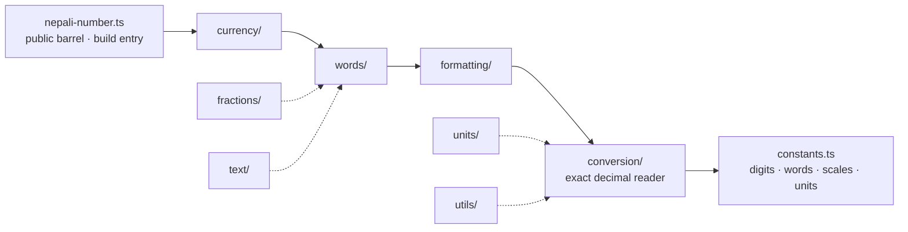

- **Status:** Current
- **Last updated:** 2026-11-14
- **Related ADRs:** [ADR-0009](../adr/ADR-0009-package-invariants.mdx), [ADR-0012](../adr/ADR-0012-read-every-number-once-exactly.mdx), [ADR-0016](../adr/ADR-0016-add-a-fractions-domain.mdx), [ADR-0017](../adr/ADR-0017-add-a-units-domain.mdx), [ADR-0018](../adr/ADR-0018-add-a-text-domain.mdx)

> Snapshot of the package as it stands today. Edit in place; never record what changed.

## Context

`nepali-number` is a single-entry library of pure functions. There is no runtime state, no I/O
and no dependency. Everything a consumer can import, 45 functions and their input, option and
result types, is re-exported from one barrel, `src/nepali-number.ts`, which is also the only
build entry.

## Components

| Component | Responsibility | Imports |
|---|---|---|
| `src/constants.ts` | All language data and unit factors: digits, the 0–99 words and ordinals, the scales (10² … 10¹⁹), the international English scales, the decimal-point, negative and ordinal-suffix words, currency words and input symbols, fraction and multiplier words, land and weight units | — |
| `src/conversion/` | The exact decimal reader (`decimal.ts`), digit mapping and parsing: `toNepali`, `toEnglish`, `parseNepaliNumber`, `convert`; `NumericInput` | `constants` |
| `src/formatting/` | Grouping, precision, percentages, un-formatting: `formatNepaliNumber`, `addNepaliCommas`, `formatPercent`, `removeFormatting`; `FormatOptions`, `PercentOptions` | `conversion` |
| `src/utils/` | Detection, validation, padding, rounding, `normalize`; `NumberSystem`, `PadOptions` | `conversion` |
| `src/words/` | Cardinals, ordinals, abbreviations and words back to numbers: `toNepaliWords`, `toEnglishWords`, `toNepaliOrdinal`, `toEnglishOrdinal`, `toNepaliOrdinalNumber`, `toEnglishOrdinalNumber`, `toDecimalWord`, `parseNepaliWords`, `parseEnglishWords`; `EnglishWordsOptions`, `OrdinalNumberOptions`, `DecimalWordOptions` | `constants`, `conversion`, `formatting` |
| `src/currency/` | Rupee formatting, words and parsing: `toNepaliCurrency`, `toNepaliCurrencyWords`, `toEnglishCurrencyWords`, `parseNepaliCurrency`; `CurrencyOptions`, `CurrencyWordsOptions`, `EnglishCurrencyWordsOptions` | `constants`, `conversion`, `formatting`, `words` |
| `src/fractions/` | Spoken fractions and multipliers: `toNepaliFraction`, `toNepaliFractionWords`, `toNepaliMultiplier` | `constants`, `conversion`, `words` |
| `src/units/` | Traditional land and weight units: `convertLandArea`, `convertWeight`, `formatRopani`, `formatBigha`, `formatTola`, `parseLandArea`; `LandUnit`, `WeightUnit`, `UnitFormatOptions` | `constants`, `conversion` |
| `src/text/` | Numbers inside prose, comparing and sorting: `findNumbers`, `extractNumbers`, `replaceNumbers`, `spellOutNumbers`, `compareNumbers`, `sortNumbers`; `NumberMatch`, `SpellOutOptions` | `conversion`, `words` |
| `src/nepali-number.ts` | Public barrel: `export *` from each domain's `index.ts` | every domain |

The language constants are **internal**: they are not re-exported from the barrel, so they can
change shape without a breaking change — only the strings the functions return are public.

## Diagram

Each arrow is a direct import. The barrel re-exports every domain, and a domain also imports
from layers further along: the *Imports* column above lists every import.

<Diagram src="/diagrams/nepali-number/module-layering.html" title="Module layering">



</Diagram>

The order is a strict layering: `constants` → `conversion` → `formatting` → `utils` →
`words` → `currency`. A module imports only from layers before it in that order. `fractions`,
`units` and `text` are leaves: they import from `words` and the layers before it, and nothing
imports them. There are no cycles.

## One reader for every number

Every export that reads a number calls `parseDecimal` in `src/conversion/decimal.ts` once
([ADR-0012](../adr/ADR-0012-read-every-number-once-exactly.mdx)). It turns a `number`, a `bigint`
or a string in either script into `{ negative, integer, fraction }`, with the digits as ASCII
strings, or `null` when the input is not a number. Rounding, grouping, comparing and
word-building then work on those digit strings, so nothing passes through binary floating point
and the result is exact at any size.

| Internal module | Holds | Used by |
|---|---|---|
| `src/conversion/decimal.ts` | `parseDecimal`, `scanDecimal` (one left-to-right pass, no regular expression), `roundDecimal` (half away from zero), `groupDigits`, `compareDecimal`, `shiftDecimal`, digit mapping and the small digit-string helpers | every domain |
| `src/formatting/internal.ts` | `formatDecimal`: round, group and convert a parsed decimal | `formatting`, `words`, `currency` |

Both are imported by path (`@/conversion/decimal`, `@/formatting/internal`) and are **not**
re-exported from a domain `index.ts`, so they are not part of the public API.

Three consequences hold across the API:

- **Invalid input never throws and never reads as zero.** A function that returns a number
  returns `NaN`, a string `""`, a boolean `false`, an array `[]`.
- **Functions that return a JavaScript `number`** (`parseNepaliNumber`, `removeFormatting`, the
  word and currency parsers, `findNumbers`, the unit converters) are limited by it: integers are
  exact up to 2⁵³. Functions that return strings are exact.
- **The word functions recurse on the count above the largest scale**, about once per 19
  digits. A number of roughly 100 000 digits or more exceeds the JavaScript call stack
  ([threat model](../security/threat-model.mdx#measured-on-hostile-input)).

## Inside a domain

```
src/<domain>/
├── <domain>.ts        # the functions — `export const name = (…): T => …`
├── <domain>.test.ts   # bun:test, imports from "."
├── types.ts           # input, option and result types (every domain but fractions)
└── index.ts           # export * from "./<domain>" · export type * from "./types"
```

- Cross-domain imports use the `@/` alias and the domain root (`@/words`). The two internal
  modules above are the only files imported from inside another domain.
- Domain-local imports use a relative path (`./types`).
- `index.ts` re-exports the functions and the types, so every public type is importable from
  the package root.

## Key decisions in force

- [ADR-0009](../adr/ADR-0009-package-invariants.mdx) — zero dependencies, environment-agnostic,
  pure, non-throwing for declared types; one-way layering.
- [ADR-0008](../adr/ADR-0008-public-api-changes-ship-their-reference.mdx) — the public surface
  is the barrel's exports and their output strings.
- [ADR-0012](../adr/ADR-0012-read-every-number-once-exactly.mdx) — one exact reader, `bigint`
  input, one invalid-input rule, one rounding rule.

## Constraints

- `isolatedDeclarations`: every export has an explicit type, so `.d.ts` files are emitted per
  file without type inference across modules.
- No host globals — the same code runs in Node, Bun, Deno, browsers and workers.
- The minified build is about 22 kB per format (7.5 kB gzipped); see
  [build and distribution](./build-and-distribution.mdx).
