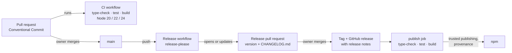

- **Status:** Current
- **Last updated:** 2026-11-15
- **Related ADRs:** [ADR-0005](../adr/ADR-0005-security-as-a-standing-practice.mdx), [ADR-0008](../adr/ADR-0008-public-api-changes-ship-their-reference.mdx), [ADR-0019](../adr/ADR-0019-add-github-community-files-dependabot-and-codeql.mdx), [ADR-0020](../adr/ADR-0020-release-with-release-please-and-npm-trusted-publishing.mdx)

> Snapshot of the process as it stands today. Edit in place; never record what changed.

## Flow

<Diagram src="/diagrams/nepali-number/release-flow.html" title="Release flow">

</Diagram>

A release is one merge:

1. Pull requests are merged to `main` with Conventional Commit messages.
2. On every push to `main`, release-please looks at the commits since the last release. While any
   is `feat:`, `fix:` or `perf:`, it keeps **one release pull request** open. It holds the next
   version in `package.json`, the new section of `CHANGELOG.md` and
   `.release-please-manifest.json`.
3. **The owner merges the release pull request.** release-please tags the commit `vX.Y.Z` and
   creates the GitHub release, with the changelog section as its notes.
4. The `publish` job checks out that tag, runs the checks, builds, and publishes to npm.

Commits with only `docs:`, `test:`, `chore:`, `ci:` or `refactor:` open no release pull request.
Only `main` releases.

## CI — `.github/workflows/ci.yml`

Runs on every pull request and on a push to `main`. Newer runs on the same ref cancel older ones.
Permissions: `contents: read`. Actions are pinned to commit SHAs, and the checkout keeps no
credentials.

| Job | Steps |
|---|---|
| `quality` (Node 20, 22, 24 on `ubuntu-24.04`) | Bun from `.bun-version` · `bun install --frozen-lockfile` · `bun run type-check` · `bun run test` · Codecov upload (Node 24 only, `CODECOV_TOKEN`, fails the job on upload error; skipped for a pull request from a fork) · `bun run build` |
| `test-package` (after `quality`) | Build · `npm pack` · install the tarball into an empty project · load it with `require` and with `import`, and compare `toNepali(123)` and `toEnglish("१२३")` with their expected values |

The Bun version is in `.bun-version` and moves by hand, together with `@types/bun`.

## CodeQL — `.github/workflows/codeql.yml`

Runs on a pull request to `main`, on a push to `main`, and every Monday at 03:17 UTC. It scans the
TypeScript and the workflows without building, and uploads the findings to the repository's
*Security* tab. Permissions: `contents: read`, and `security-events: write` on the job. Its actions
are pinned to commit SHAs. It releases nothing
([ADR-0019](../adr/ADR-0019-add-github-community-files-dependabot-and-codeql.mdx)).

## Dependency updates — `.github/dependabot.yml`

Every Monday Dependabot opens at most a few pull requests: one for minor and patch updates of the
dev dependencies, one for each `tsdown` update, one for the GitHub Actions. A version is proposed
once it is 7 days old; a security update is not delayed. `@types/bun` is ignored and moves by hand
with the Bun version. Commits are prefixed `chore(deps)`, so they change no version number.

Nothing merges by itself. The owner reviews the lockfile diff and merges. A minor or patch update
of a dependency or action already in use needs no ADR; a major version, and any `tsdown` 0.x
minor, does. CI on these pull requests reads `CODECOV_TOKEN` from the Dependabot secrets
([secrets](../security/secrets.mdx)).

## Release — `.github/workflows/release.yml`

Runs on every push to `main`. One run at a time; a run that has started is never cancelled.
Actions are pinned to commit SHAs.

| Job | Runs | Permissions | Does |
|---|---|---|---|
| `release-please` | Always | `contents: write`, `pull-requests: write`, `issues: write` | Opens or updates the release pull request; after that pull request is merged, pushes the tag and creates the GitHub release |
| `publish` | Only when `release-please` created a release | `contents: read`, `id-token: write`, in the GitHub environment `npm` | Checks out the tag · Node 24 · Bun · fails if npm is older than 11.5.1 · `bun install --frozen-lockfile` · type-check · test · build · `npm pack --dry-run` · `npm publish --access public` |

- **No npm token exists.** npm trusts this repository's `release.yml`, in the `npm` environment,
  as a publisher. GitHub proves each run's identity to npm, and npm attaches provenance to the
  version: a link to the commit and the workflow run that built it.
- **The `publish` job stays in `release.yml`.** npm checks the name of the workflow file, and what
  release-please creates with `GITHUB_TOKEN` starts no other workflow.
- **A failed check publishes nothing.** The tag and the GitHub release then exist without a
  version on npm. The fix is a new commit and the next release.
- **CI does not run on the release pull request**, because release-please opens it with
  `GITHUB_TOKEN`. It changes only the version, the changelog and the manifest; the `publish` job
  runs every check on the tag. To run CI on it, close and reopen the pull request.

### The release files

| File | Holds | Edited by |
|---|---|---|
| `release-please-config.json` | Release type `node`, tag `vX.Y.Z`, which commit types appear in the changelog (features, bug fixes, performance; breaking changes always) | A change to it is a tooling ADR |
| `.release-please-manifest.json` | The last released version | release-please only |
| `CHANGELOG.md` | One section per release, written from the commits. It appears with the first release | release-please only |
| `version` in `package.json` | The released version | release-please only |

To release a version other than the one release-please proposes, add a commit whose message ends
with the footer `Release-As: X.Y.Z`.

## Settings outside the repository

The workflows depend on these. The owner keeps them.

| Where | Setting |
|---|---|
| GitHub → Settings → Actions → General | *Allow GitHub Actions to create and approve pull requests* is on |
| GitHub → Settings → Environments | `npm` exists and is limited to the `main` branch |
| npmjs.com → `nepali-number` → Settings → Trusted publisher | GitHub Actions; organisation `nepal-dev-com`; repository `nepali-number-js`; workflow `release.yml`; environment `npm` |
| npmjs.com → `nepali-number` → Settings → Publishing access | *Require two-factor authentication and disallow tokens* |

## Before merging the release pull request

- [ ] `main` is green in CI.
- [ ] The version it proposes matches [versioning](./versioning.mdx) for the changes in its
      changelog section.
- [ ] The audit in the [release security checklist](../security/checklist.mdx) passes.
- [ ] `README.md` and the API reference in `user-guide/dev/api/` match the build.

## The documentation's part of a release

The User guide has one folder per version line in the documentation submodule,
`content/nepali-number/user-guide/`. `dev/` describes unreleased work on `main`; `v2/` is the line
marked `latest`. A released line keeps describing its version: only mistakes are corrected in
it, and new behaviour is written in `dev/`.

When a version is released, following the submodule's `nepal-dev-project-versions` skill:

- [ ] Copy `user-guide/dev/` to a new line folder.
- [ ] In the new folder's `meta.json`, set its `name`, its `version` (the released version) and
      `channel: "latest"`.
- [ ] In the previous `latest` line's `meta.json`, set `channel: "legacy"`.
- [ ] In `user-guide/dev/meta.json`, set the next `version`, and keep working in `dev/`.
- [ ] The owner commits and pushes the submodule, then commits the moved pointer in this
      repository. Pushing the submodule's `main` publishes the site at once.

Whether a minor or patch release gets a line of its own, or replaces the line of its major, is
the owner's call at release time.
