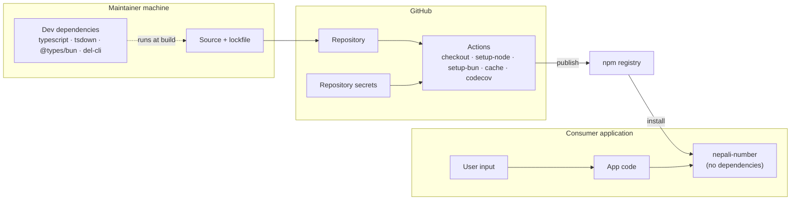

- **Status:** Current
- **Last updated:** 2026-11-15
- **Related ADRs:** [ADR-0005](../adr/ADR-0005-security-as-a-standing-practice.mdx), [ADR-0009](../adr/ADR-0009-package-invariants.mdx), [ADR-0012](../adr/ADR-0012-read-every-number-once-exactly.mdx), [ADR-0019](../adr/ADR-0019-add-github-community-files-dependabot-and-codeql.mdx)

> Snapshot of the package as it stands today. Edit in place; never record what changed.

## What is worth protecting

The package holds no data. What it has is **reach**: its code runs, with the host's privileges,
inside every application, server, build and browser that installs it. The assets are:

- **Integrity of the published tarball** — consumers run whatever is on npm.
- **Availability of the host** — a function that hangs on input hangs the consumer's server.
- **Correctness of output** — amounts in words appear on invoices and cheques.

## Trust boundaries

<Diagram src="/diagrams/nepali-number/trust-boundaries.html" title="Trust boundaries">

</Diagram>

## Threats and controls

| Threat | How | Control today | Gap |
|---|---|---|---|
| Malicious runtime dependency | A dependency (or its dependency) is compromised | **No runtime dependencies** (§6.1); a new one needs an ADR | — |
| Compromised dev dependency | A build tool runs code on maintainer or CI machines, or injects into `dist/` | Four dev dependencies, lockfile committed, `--frozen-lockfile` in CI. Dependabot proposes updates weekly, at least 7 days old; the owner reviews the lockfile diff and merges by hand. A major version, and any `tsdown` 0.x minor, needs its own ADR ([ADR-0019](../adr/ADR-0019-add-github-community-files-dependabot-and-codeql.mdx)) | `@types/bun` is `latest`, and CI installs Bun `latest`; neither is pinned, and Dependabot ignores `@types/bun` |
| Stolen publish credential | Someone publishes a malicious version | Publishing is not automated yet | No provenance, no trusted publishing ([releasing gaps](../release/releasing.mdx#current-gaps)) |
| Release from untested code | Release workflow runs after a failed CI, or on a different commit | — | Release has no success guard and checks out the default ref ([releasing gaps](../release/releasing.mdx#current-gaps)) |
| Compromised GitHub Action | A third-party action is altered | `codeql.yml` pins its actions to commit SHAs. `ci.yml` and `release.yml` pin to major versions (`@v5`, `@v2`). Dependabot proposes action updates weekly, and CodeQL scans the workflows | `ci.yml` and `release.yml` are not pinned to commit SHAs |
| Install-time execution | A lifecycle script runs on `npm install` | No `prepare` / `preinstall` / `install` / `postinstall` scripts | — |
| Tarball contains extra files | Secrets or tooling published by accident | `files: ["dist"]`; `npm pack --dry-run` in the release checklist | — |
| ReDoS | Crafted long input makes a regular expression backtrack | Numbers are read by a single-pass scanner with no regular expression ([ADR-0012](../adr/ADR-0012-read-every-number-once-exactly.mdx)); the four patterns left are linear (see below) | The suite runs each reader on 100 000-character hostile strings with a time bound; the figures below are measured by hand |
| Unbounded work | Huge input makes a function run long or recurse deeply | Every export is linear in its input length; `toNepaliWords(1.7e308)` finishes in 0.1 ms | A caller that passes megabytes of digits gets megabytes of words back; capping input length stays the caller's choice |
| Wrong amount in words | A table error produces a wrong word on an invoice | Tests assert exact strings for each word table ([ADR-0007](../adr/ADR-0007-tests-are-part-of-every-change.mdx)); amounts are rounded on their decimal digits, never as floats | A `number` argument has already been rounded by JavaScript ([limitations](../../user-guide/dev/api/limitations.mdx#a-number-argument-has-already-been-rounded-by-javascript)) |

### Regular expressions in `src/`

| Location | Pattern | Assessment |
|---|---|---|
| `words.ts` `splitWords` (the word parsers) | `/\s+/` in `split` | Linear |
| `utils.ts` `normalize` | `/\s+/g`, `/,+/g`, `/\.+/g` | Linear: one quantifier each, nothing after it to backtrack into |

Everything else walks the string by character code: `scanDecimal` and the digit mappers in
`conversion/decimal.ts`, and the number finder in `text/`.

### Measured on hostile input

Node 24.21.0, Apple Silicon, against the built `dist/nepali-number.cjs`:

| Call | 10 000 characters | 100 000 characters |
|---|---|---|
| `validateNepaliNumber("१".repeat(n) + "x")` | 0.6 ms | 1.8 ms |
| `isValidNumber("9".repeat(n) + "x")` | 0.3 ms | 1.1 ms |
| `parseNepaliNumber("1,".repeat(n / 2) + "x")` | 0.4 ms | 0.4 ms |
| `addNepaliCommas("1".repeat(n))` | 2.0 ms | 3.0 ms |
| `formatNepaliNumber("9".repeat(n))` | 0.7 ms | 4.1 ms |
| `normalize`, `removeFormatting`, `parseNepaliWords` | under 1 ms | under 2 ms |
| `findNumbers("1,".repeat(n / 2))` | 0.5 ms | 0.9 ms |
| `sortNumbers` (`n / 10` values) | 0.5 ms | 2.5 ms |
| `spellOutNumbers("9".repeat(n))` | 1.4 ms | 6.9 ms |
| `toNepaliWords("9".repeat(n))` | 1.8 ms | 7.5 ms |

Ten times the input costs at most ten times the time: no call is quadratic.

**Depth.** No export recurses in proportion to its input. Above the largest scale the word
functions loop over 19-digit groups, so `toNepaliWords` on 3 000 000 digits returns (about
0.3 s) instead of exhausting the stack. The suite spells a 300 000-digit number in each word
function.

## Residual risk

The release-path gaps above are accepted only until the release workflow is completed; the ADR
that completes it closes them.
